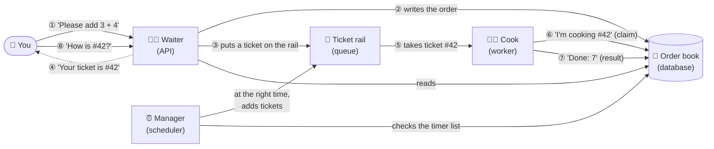

# 1. What is this?

> **Who this is for:** everyone. No technical background needed.
> **Time to read:** 10 minutes.

---

## 1.1 The problem

Imagine a website where a customer clicks **"Email me my invoice"**.

Creating the PDF and sending the email might take 10 seconds. If the website
did that work *while the customer waits*, the page would freeze. And if the
email provider happened to be down at that moment, the request would simply
fail and the customer would never get the invoice.

There is a better way: the website says **"Got it — we'll email it shortly"**
straight away, and hands the actual work to a separate system that does it
in the background, retries if something goes wrong, and keeps a record of
what happened.

**This project is that separate system.** It is a *background job system*:
you give it work ("jobs"), and it makes sure the work gets done — reliably,
in the background, and exactly once.

It can also do work **on a schedule**, without anyone asking each time:
- "Send this reminder **once**, tomorrow at 09:50."
- "Check the payment provider **every 2 hours**."
- "Clean up old files **every weekday at 08:00**."

---

## 1.2 The restaurant analogy

The easiest way to understand the system is to picture a busy restaurant.

| In the restaurant | In this project | What it does |
|---|---|---|
| 🧑‍💼 **The waiter** takes your order and gives you a ticket number | The **API** | Accepts work from you and immediately gives you a **job ID**. It never cooks. |
| 🎫 **Order tickets** on the kitchen rail | The **queue** (Redis) | Work waiting to be done, in order. |
| 👩‍🍳 **The cooks** take tickets and cook | The **workers** | Actually do the work. You can hire more cooks when it's busy. |
| 🔥 **A separate station for slow dishes** (the roast that takes 3 hours) | The **long queue** | Slow jobs get their own cooks so they never hold up quick orders. |
| ⏰ **The manager with a timer list** ("bake bread at 6:00 every morning") | The **scheduler** | Puts scheduled work on the rail at the right time. |
| 📒 **The order book** where every order and its outcome is written | The **database** (Postgres) | The permanent record and the single source of truth. |
| 📺 **The screen showing all orders and cooks** | **Flower** (dashboard) | Lets you watch everything live. |

Here is the same picture as a flow — follow the arrows:

Now some situations, and how the restaurant (and this system) handles them:

- **The kitchen is busy.** Orders wait on the rail, in the order they arrived. Nothing is lost.
- **A cook burns a dish.** The cook tries again a few times before giving up, and writes down *why* it failed.
- **A cook faints in the middle of cooking.** Another cook notices the dish was abandoned and finishes it.
- **Two copies of the same ticket end up on the rail.** Before cooking, every cook checks the order book: "Has someone already cooked order #42?" If yes, the duplicate ticket is thrown away. **The dish is cooked once.**
- **A customer asks twice** ("did you get my order?"). The waiter recognises the order (an *idempotency key*) and doesn't create a second one.
- **There are three managers with timer lists, to be safe.** At 6:00 all three want to start the bread. They all check the order book; whoever writes "bread started at 6:00" first wins, and the others see it's already done. **The bread is baked once.**
- **A manager goes home sick.** The other two keep going. Nobody notices a gap.

This is exactly what the project does, with computers instead of people.

---

## 1.3 What you can do with it

From the outside, you talk to the system through a **web API** — a set of web
addresses that accept and return data. (A web browser can show you all of
them at `http://localhost:8000/docs`.) With it you can:

1. **Submit a job** — "please run task X with these inputs". You get a job ID back immediately.
2. **Check a job** — is it waiting, running, finished, or failed? What was the result? If it failed, why?
3. **List jobs** — everything that ran recently, filterable by status.
4. **Retry a failed job** — run it again with the same inputs.
5. **Cancel a job** — stop it before or while it runs.
6. **Create schedules** — run a task once at a set time, every N seconds, or on a calendar pattern.
7. **Pause, resume, change or delete schedules** — at any time, with no restart.

The project ships with a few **example tasks** so you can try all of this
straight away:

| Example task | What it does | Why it's there |
|---|---|---|
| `add` | Adds two numbers | The simplest possible job — proves everything works. |
| `long_running_task` | Waits for a number of seconds, reporting progress | Shows slow jobs and live progress. |
| `flaky_task` | Fails randomly | Shows automatic retries. |
| `send_notification` | Pretends to send an email (fails 30% of the time) | Shows careful, manual retries — the pattern for real emails or payments. |
| `heartbeat` | Writes "I'm alive" | Runs every 30 seconds to prove the system is healthy. |
| `scheduled_cleanup` | Deletes old records | Runs every night to keep the database small. |

In a real deployment, your team replaces or adds to these with real work
(sending invoices, resizing images, syncing data, etc.).

---

## 1.4 What makes this project special

Lots of systems can run background jobs. This one is designed for the hard
part — being **trustworthy at scale**:

1. **It never runs the same job twice by accident.** Even when messages get duplicated, machines crash, or several schedulers run at once. (Chapter 7 explains exactly how, and the one situation where a re-run is unavoidable.)
2. **It has no single point of failure.** Every part runs as several copies ("replicas"). If one copy dies, the others carry on.
3. **It never loses a job.** Work is written to the database *before* anything else happens, so a crash at any moment can be recovered.
4. **It keeps a full history.** Every job records its inputs, result, timings, which machine ran it, how many times it was retried, and — on failure — the exact error.
5. **It is secure by default.** API keys are required, passwords are mandatory in deployment, and nothing internal is exposed to the internet.
6. **It is tested against failure.** Automated tests deliberately kill machines, stop the database and stop the queue, then check that every job ran exactly once.

---

## 1.5 What it is *not*

- **Not a website or user interface for end customers.** It's an engine that other software (or people using the API docs page) talks to.
- **Not a place to store files or large data.** Jobs carry small inputs (numbers, text, IDs); big data should live elsewhere and be referenced by ID.
- **Not instant.** A job usually starts within a fraction of a second, and a scheduled job within about 5 seconds of its time — great for background work, not for split-second timing.

---

## 1.6 The technology, in one sentence each

You don't need to know these to use the system, but here's what's inside:

| Technology | Role | One-line explanation |
|---|---|---|
| **Python** | Language | The programming language the whole project is written in. |
| **FastAPI** | The API | A Python library for building web APIs; it also generates the interactive docs page. |
| **Celery** | The workers | A popular Python library for running background jobs on many machines. |
| **Redis** | The queue | A very fast in-memory store, used here as the "ticket rail" that passes jobs to workers. |
| **PostgreSQL** ("Postgres") | The database | A reliable database: the permanent record and the referee that ensures "exactly once". |
| **SQLite** | Small database | A one-file database used for local development and tests instead of Postgres. |
| **Flower** | Dashboard | A web page that shows workers and jobs live. |
| **Docker / Docker Compose** | Packaging | Packages everything so it runs the same on any computer, and starts all the pieces with one command. |
| **Kubernetes** | Production platform | Runs and supervises many copies of each piece across many servers. |

**Next:** [2. Key concepts & glossary →](02-key-concepts.md)
