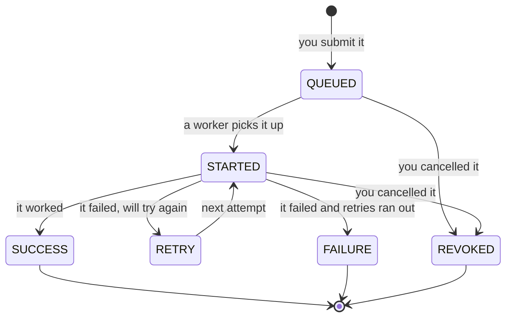

# 2. Key concepts & glossary

> **Who this is for:** everyone. Read sections 2.1–2.4 once; use 2.5 as a dictionary later.

---

## 2.1 Task vs. job

These two words are easy to mix up:

- A **task** is a *kind* of work — a recipe. Example: `send_notification` ("send an email to someone").
- A **job** is *one specific request* to run a task, with specific inputs. Example: "run `send_notification` for `ana@example.com` with the message `Your report is ready`".

One task can have millions of jobs. Every job gets a unique **job ID**
(also called `task_id` in the API — a long random string such as
`8f14e45f-fceb-4dc9-9a0f-3b2c1d4e5f60`). You use the job ID to check on it,
retry it, or cancel it.

---

## 2.2 The life of a job (statuses)

Every job moves through a few **statuses**. You'll see these words everywhere:

| Status | Meaning | Final? |
|---|---|---|
| `QUEUED` | Accepted and waiting for a free worker. | No |
| `STARTED` | A worker is running it right now. | No |
| `RETRY` | It failed but will be tried again automatically after a short wait. | No |
| `SUCCESS` | Finished. The `result` field holds the answer. | ✅ Yes |
| `FAILURE` | Failed for good. The `error` and `traceback` fields say why. | ✅ Yes |
| `REVOKED` | Cancelled by someone. | ✅ Yes |

Once a job is in a **final** status it never changes again, and it is
**never run again** — not even if a duplicate message turns up.

When you ask for the *live* status (`GET /jobs/{id}/status`) you may also see
`PENDING` (not started yet — same idea as QUEUED) and `PROGRESS` (running and
reporting how far along it is).

---

## 2.3 The moving parts

| Part | Plain description | How many run? |
|---|---|---|
| **API** | The front door. Receives requests over HTTP, records jobs, hands them to the queue, answers questions. | 2 or more |
| **Queue / broker** (Redis) | The conveyor belt carrying jobs to workers. Holds only work *in transit*. | 1 (made highly available by your cloud provider) |
| **Worker** | A program that takes jobs off the belt and runs them. | As many as you need |
| **Queues: `default` and `long`** | Two separate belts. Quick jobs go on `default`, slow ones on `long`, so slow jobs can't block quick ones. | — |
| **Scheduler** | Watches the list of schedules and puts jobs on the belt when they are due. Also does clean-up and recovery duties. | 2 or more |
| **Database** (Postgres) | The permanent record of every job and schedule, and the "referee" that guarantees each job runs once. | 1 (made highly available by your cloud provider) |
| **Flower** | A dashboard to watch workers and jobs live. | 1 |
| **Migrate** | A short program that creates/updates the database tables, then exits. Runs before the others start. | Runs once per deployment |

---

## 2.4 Ideas that make it reliable

These five ideas come up again and again. Each has a simple version here and a
deep explanation in [chapter 7](07-reliability.md).

### Replica
A **copy** of a program running at the same time as other copies. Three
scheduler replicas means three identical schedulers running on (ideally)
three different machines. If one dies, the others carry on. In Kubernetes,
each running copy is called a **pod**.

### Claim (with a lease)
Before a worker runs a job, it must **claim** it in the database — like
writing your name next to an order in the order book. Only one worker can
succeed. The claim comes with a **lease**: a time limit (60 seconds) that the
worker keeps extending while it's alive. If the worker dies, it stops
extending, the lease runs out, and another worker can take over.

### Idempotency
A fancy word for "doing it twice has the same effect as doing it once".
An **idempotency key** is a label you attach to a request
(`Idempotency-Key: order-42`). If the same request arrives again with the same
label — for example because your network timed out and you retried — the
system recognises it and returns the original job instead of creating a new
one.

### Outbox
The rule "**write it down first, then send it**". Every job is saved in the
database *before* it is put on the queue. If the program crashes in between,
the job is still written down, and the scheduler notices it was never sent
and sends it. (It's called an outbox because, like an email outbox, things
sit there until they're confirmed sent.)

### Fencing token
Each time a job is claimed, its **attempt number** goes up (1, 2, 3…). Every
later update must quote the attempt number. If an old, slow worker that lost
its lease wakes up and tries to say "I finished!", its attempt number is out
of date and the update is refused. This stops old workers from overwriting
newer information.

---

## 2.5 Glossary (A–Z)

| Term | Meaning |
|---|---|
| **API** | Application Programming Interface — here, the set of web addresses (endpoints) you call to use the system. |
| **API key** | A secret password sent with each request in the `X-API-Key` header to prove you're allowed in. |
| **Attempt** | One execution of a job by a worker. Normally `attempts = retries + 1`. |
| **At-least-once delivery** | The queue guarantees a message is delivered *at least* once — maybe more. The system turns this into "runs once" using claims. |
| **Backoff** | Waiting longer between each retry (5 s, 10 s, 20 s…) so a struggling service gets time to recover. |
| **Broker** | The message queue software — Redis here. |
| **Celery** | The Python library that runs workers and moves jobs through the broker. |
| **Celery Beat** | Celery's built-in scheduler. **Not used** in this project, because it can only run as a single copy. Replaced by our own scheduler. |
| **Chaos test** | A test that deliberately breaks things (kills machines, stops the database) to prove the system copes. See `scripts/chaos_test.py`. |
| **Container** | A packaged, isolated running program (made with Docker). |
| **Cron / cron expression** | A compact way to write a calendar schedule, e.g. `0 8 * * 1-5` = "08:00 every weekday". See [chapter 6](06-scheduling.md#63-a-gentle-cron-primer). |
| **Dashboard** | Flower — a web page that shows workers and tasks live. |
| **Deferred duplicate** | A second copy of a job that arrived while the first was still running; it waits and re-checks later. |
| **Endpoint** | One web address of the API, e.g. `POST /tasks/add`. |
| **Envelope (error envelope)** | The fixed shape of every error response: `{"error": {"status_code", "type", "message", "details"}}`. |
| **FIFO** | First In, First Out — jobs are started in the order they arrived. |
| **Fencing token** | The attempt number used to reject updates from outdated workers. |
| **Final / terminal status** | SUCCESS, FAILURE or REVOKED. Never changes, never re-runs. |
| **Flower** | The monitoring dashboard. |
| **Grace period** | Extra waiting time before the system assumes something is dead. |
| **Health check / probe** | A quick "are you OK?" call. `/health` = "is the process up?"; `/health/ready` = "can it reach the database and queue?" |
| **High availability (HA)** | Staying up even when parts fail, by running several copies of everything. |
| **Idempotency key** | A client-chosen label that makes repeating a request safe. |
| **Job** | One request to run a task with specific inputs. |
| **Job ID / task_id** | The unique identifier of a job. |
| **JSON** | The text format used for all API requests and responses, e.g. `{"x": 3, "y": 4}`. |
| **Kubernetes (k8s)** | A platform that runs and supervises many containers across many servers. |
| **Lease** | A time-limited claim on a job, renewed while the worker is alive. |
| **Liveness / readiness** | Two kinds of health check: "should this be restarted?" vs. "should this receive traffic?" |
| **Migration** | A change to the database structure (adding a table or column). Applied by `python -m app.migrate`. |
| **Optimistic lock** | A way to update a row only if it hasn't changed since you read it (checked via a `version` number). Used so only one scheduler fires each due run. |
| **Outbox** | "Write first, send second" — jobs are stored before being queued, and unsent ones are re-sent. |
| **Pod** | Kubernetes' name for one running copy of a program. |
| **Postgres / PostgreSQL** | The production database. |
| **Publish** | Put a job's message onto the queue. |
| **Queue** | A line of waiting jobs. This project has two: `default` and `long`. |
| **Redis** | The fast in-memory software used as the queue. |
| **Replica** | One of several identical running copies. |
| **Result backend** | Where Celery stores live task results and progress (in the database here). |
| **Retention** | How long old job records are kept (30 days by default). |
| **Retry** | Running a failed job again — automatically (by the task) or manually (`POST /jobs/{id}/retry`). |
| **REVOKED** | The status of a cancelled job. |
| **Schedule** | A rule for running a task in the future: `once`, `interval` or `cron`. |
| **Scheduler** | The service that fires schedules, re-sends unsent jobs, and recovers jobs whose worker died. |
| **SQLite** | A database stored in a single file — used for local development and tests. |
| **Swagger UI** | The interactive API docs page at `/docs`. |
| **System schedule** | A schedule defined in the code (heartbeat, nightly cleanup). Visible in the API but read-only. |
| **Task** | A kind of work the system knows how to do (a "recipe"). |
| **Traceback** | The detailed technical error report showing exactly where in the code something failed. |
| **UTC** | Coordinated Universal Time — the single time zone used everywhere in this system. |
| **Visibility timeout** | How long Redis waits before re-delivering a message a worker took but never confirmed. |
| **Worker** | A program that runs jobs. |
| **Worker loss** | A worker dying mid-job (crash, out of memory, machine failure). |

**Next:** [3. Architecture →](03-architecture.md)
