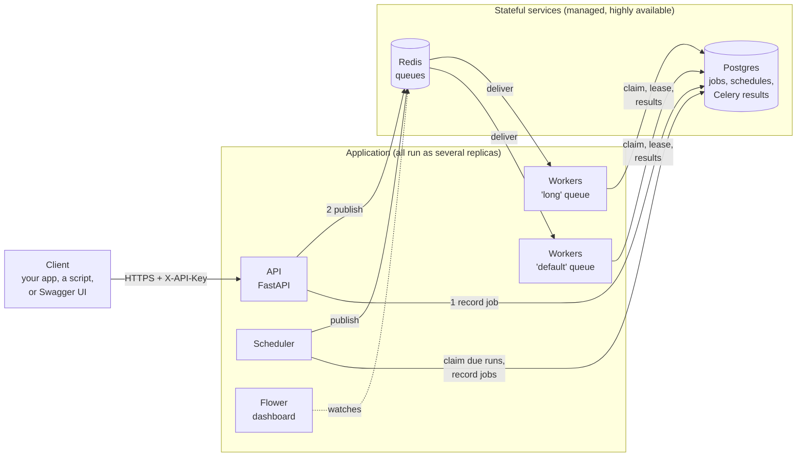
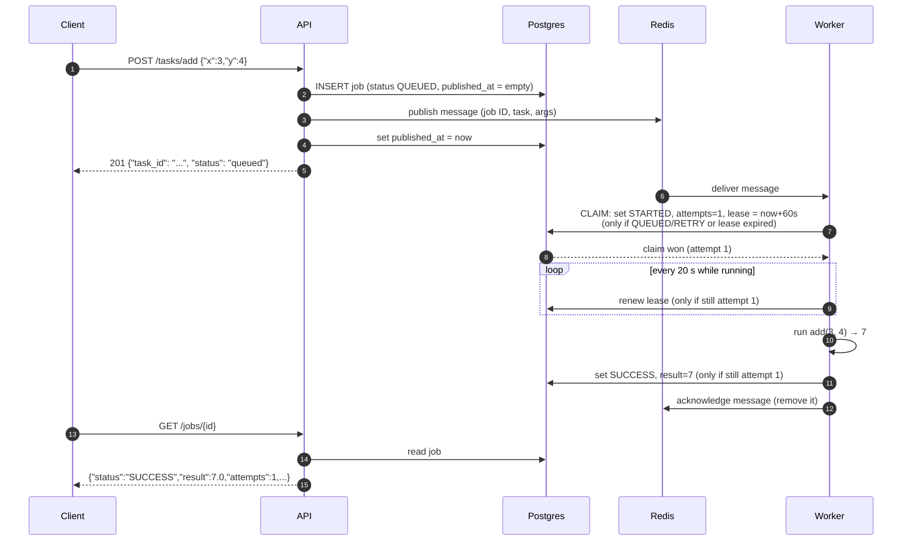
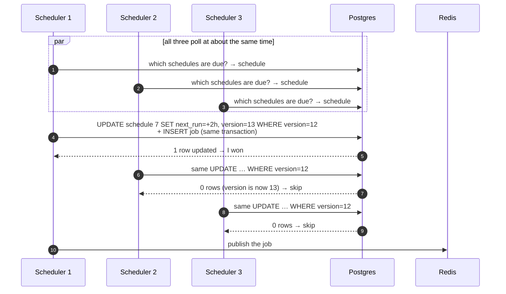

# 3. Architecture

> **Who this is for:** developers, operators, and curious readers.
> **Prerequisite:** [chapter 2](02-key-concepts.md) (key concepts).

---

## 3.1 The big picture

There are two groups:

- **The application** — API, scheduler, workers, Flower. These hold **no
  important state of their own**, so you can run as many copies as you like,
  restart them freely, and lose any one without losing data.
- **The stateful services** — Postgres and Redis. These hold the data. In
  production they are provided by your cloud (or run as highly available
  clusters), not by this project.

**Postgres is the source of truth.** Redis is just the conveyor belt. If the
two ever disagree, Postgres wins.

---

## 3.2 Each component in detail

### API (`app/main.py`, `app/api/`)
- A FastAPI web service, normally run as 2+ replicas behind a load balancer.
- Checks the API key on every request (except health checks).
- Validates input (types, ranges, schedule rules, task arguments).
- To submit a job it **records the job in Postgres first**, then publishes it to Redis. It returns the job ID immediately — it never waits for the job to run.
- Answers questions about jobs and schedules by reading Postgres (and Celery's live result store for progress).
- Returns every error in the same shape (the "error envelope").

### Workers (`app/celery_app.py`, `app/guard.py`, `app/tasks.py`)
- Celery worker processes. Each worker listens to one queue (`default` or `long`) and runs several jobs in parallel (4 for `default`, 2 for `long` by default).
- Every task inherits the **execution guard**: before running a job, the worker must win the claim in Postgres. While running, a background thread renews the lease every 20 seconds.
- When a job finishes, the worker records the result (or error and traceback) in Postgres. These writes are "fenced" by the attempt number.

### Scheduler (`app/scheduler.py`)
A small loop that runs every 5 seconds (plus a random 0–1 s so replicas don't
move in lockstep). Each loop does three things:
1. **Fire due schedules** — for each schedule whose time has come, try to claim it. The claim and the new job record are saved in one database transaction; only one replica can win. The winner publishes the job.
2. **Relay the outbox** — find jobs that were recorded but never reached Redis (older than 30 s) and publish them.
3. **Recover abandoned jobs** — find jobs stuck in `STARTED` whose lease ran out (their worker died) and re-publish them so a healthy worker finishes them. Jobs that keep killing workers are eventually marked FAILURE.

It also writes a heartbeat file each loop, which the health check reads.

### Postgres (database)
Holds three groups of tables:
- `jobs` — one row per job (inputs, status, result, error, timings, attempt count, lease, outbox fields).
- `schedules` — one row per schedule (including the two system schedules).
- `celery_taskmeta` / `celery_tasksetmeta` — Celery's own live results and progress (managed by Celery).

### Redis (queue)
Holds two lists — `default` and `long` — of job messages waiting for a worker,
plus messages a worker has taken but not yet confirmed. Nothing else. If Redis
loses its data, the database still knows about every job, and the scheduler
re-sends what's needed.

### Flower
Optional dashboard (port 5555) that shows workers, queues and tasks live.
Protected by a username and password.

### Migrate (`app/migrate.py`)
A one-shot program that creates or updates database tables, then exits. It is
safe to run many times and from many machines at once (it takes a database
lock). In Kubernetes it runs as an *init container* before every pod starts.

---

## 3.3 Life of a job, step by step

Here is what happens when you call `POST /tasks/add` with `{"x": 3, "y": 4}`:

Things to notice:
- **Step 2 happens before step 3.** If the API crashed after step 2, the job is still recorded; the scheduler's outbox relay would publish it later.
- **Step 7 is the claim.** If a duplicate message arrived, its claim would fail and the duplicate would be dropped or deferred.
- **The message is acknowledged last (step 11).** If the worker died before that, Redis would eventually re-deliver the message, and the claim in step 7 would stop it running twice.

### What happens when the job fails
Suppose `flaky_task` raises an error:
1. The worker records status `RETRY` and the error message.
2. Celery re-publishes the job with a delay (5 s, then 10 s, then 20 s… with some randomness), keeping the same job ID and increasing `retries`.
3. A worker picks it up and claims it again (allowed, because it's a new retry), and `attempts` goes up.
4. If it keeps failing after the maximum retries (3 by default), the status becomes `FAILURE`, and the `error` and `traceback` fields are saved.
5. You can then call `POST /jobs/{id}/retry`, which creates a **new** job with the same inputs and `retry_of` pointing at the old one.

---

## 3.4 Life of a scheduled run

Suppose you created an `interval` schedule that runs `heartbeat` every 7200 s,
and three scheduler replicas are running:

Exactly one replica wins each due time, because the database only lets one
`UPDATE … WHERE version = 12` succeed. If Scheduler 1 crashed right after
winning, the job is already recorded (same transaction), so the outbox relay
in Scheduler 2 or 3 would publish it.

---

## 3.5 Where data lives

| Data | Where | How long |
|---|---|---|
| Job record (inputs, status, result, error, timings) | Postgres `jobs` table | Until 30 days after it finishes (`JOB_RETENTION_DAYS`) |
| Live result & progress | Postgres `celery_taskmeta` | 24 hours (`CELERY_RESULT_EXPIRES`) |
| Schedules | Postgres `schedules` table | Until deleted |
| Jobs waiting for a worker | Redis lists `default`, `long` | Until a worker finishes them |
| Logs | Standard output of each container (collected by your platform) | Your log platform's policy |

> **Local development** uses SQLite files (`data/scheduler.db` and
> `data/celery_results.db`) instead of Postgres, and log files in `logs/`.

### The `jobs` table, column by column

| Column | Meaning |
|---|---|
| `task_id` | The job ID (primary key). |
| `task_name` | Which task, e.g. `app.tasks.add`. |
| `args`, `kwargs` | The inputs (JSON). |
| `queue` | `default` or `long`. |
| `status` | QUEUED, STARTED, RETRY, SUCCESS, FAILURE, REVOKED. |
| `result` | The return value (on success). |
| `error` | Short failure reason. |
| `traceback` | Full technical error report. |
| `retries` | How many automatic retries Celery has done. |
| `attempts` | How many times a worker started it (the fencing token). |
| `lease_expires_at` | While running: when the worker's claim runs out unless renewed. |
| `worker` | Name of the worker that ran it. |
| `retry_of` | If this is a manual retry: the original job's ID. |
| `schedule_id` | If a schedule created it: which one. |
| `idempotency_key` | The client's key, if one was sent. Unique. |
| `published_at` | When it reached Redis. Empty = still in the outbox. |
| `publish_attempted_at` | Last time the scheduler tried to (re-)publish it. |
| `submitted_at`, `started_at`, `finished_at` | Timings (UTC). |

### The `schedules` table, column by column

| Column | Meaning |
|---|---|
| `id` | Schedule number. |
| `name` | Only for system schedules (e.g. `system:cleanup`). |
| `task_name`, `args`, `kwargs` | What to run, and with which inputs. |
| `schedule_type` | `once`, `interval` or `cron`. |
| `run_at` / `interval_seconds` / `cron_expr` | The timing (one of them, depending on type). |
| `enabled` | Paused (`false`) or active (`true`). |
| `next_run_at` | When it will fire next (UTC). |
| `last_run_at`, `run_count` | When it last fired, and how many times. |
| `version` | Optimistic-lock counter; goes up on every change. |
| `idempotency_key` | The client's key, if one was sent. Unique. |
| `created_at` | When it was created. |

---

## 3.6 Design decisions (and why)

| Decision | Why |
|---|---|
| **Our own scheduler instead of Celery Beat** | Celery Beat must run as exactly one process — a single point of failure, and two copies would fire everything twice. Our scheduler runs as many active copies and uses the database to decide who fires what. |
| **Postgres as the referee** | "Exactly once" needs one place that everyone agrees on. A database with transactions gives that. Redis alone can't, because it delivers messages *at least* once. |
| **Write to the database before publishing (outbox)** | So a crash between the two steps can never lose a job. |
| **Claims with leases, not permanent locks** | A permanent lock held by a dead worker would block the job forever. A lease expires on its own. |
| **Attempt numbers as fencing tokens** | So an outdated worker can never overwrite newer information. |
| **Two queues (`default`, `long`)** | Slow jobs get their own workers and can never starve quick ones. Each pool scales separately. |
| **Late acknowledgement** (`task_acks_late`) | A message is only removed from Redis after the job finishes, so a crash mid-job doesn't lose it. |
| **JSON only for messages** | No "pickle" (a Python format that can run code), so a forged message can't execute anything. |
| **Same code for Postgres and SQLite** | Developers can run everything on a laptop with no database server, and tests run on both. |
| **API keys, mandatory secrets, no public Redis/Flower** | Secure by default. |

**Next:** [4. Getting started →](04-getting-started.md)
