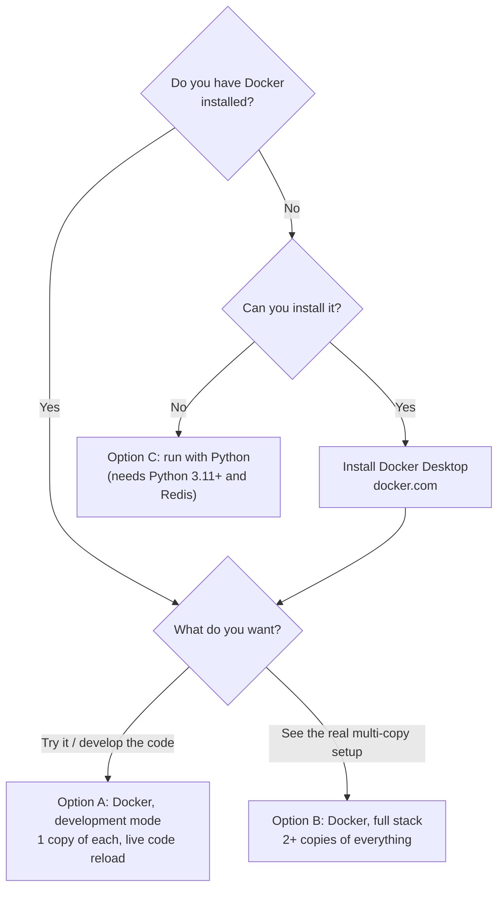
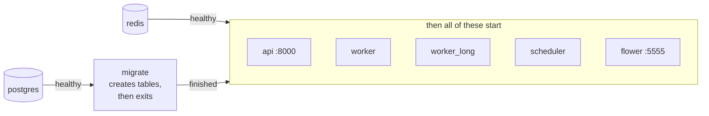
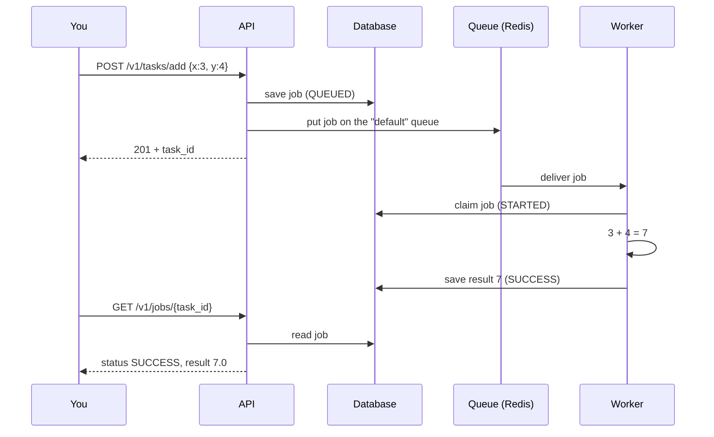

# 4. Getting started

> **Who this is for:** anyone who wants to run the system on their own computer.
> **Time:** about 10–15 minutes.
> **You will:** install it, start it, open the API page, run your first job, and create your first schedule.

---

## 4.1 Choose how to run it



| Option | Best for | Database | Copies of each part |
|---|---|---|---|
| **A. Docker — development** | Trying it out, changing code | Postgres (in Docker) | 1 |
| **B. Docker — full stack** | Seeing high availability, running the chaos test | Postgres (in Docker) | 2 (3 schedulers/workers if you want) |
| **C. Python, no Docker** | Laptops without Docker | SQLite file | 1 |

> **What's an "API key"?** A password you invent. Every request must include it
> in a header called `X-API-Key`. Below we use `dev-key`; in real use make a
> long random one: `python -c "import secrets; print(secrets.token_urlsafe(32))"`.

---

## 4.2 Option A — Docker, development mode (recommended first)

**Step 1. Get the code** (if you haven't already) and open a terminal in the project folder.

**Step 2. Create your settings file.**
```bash
cp .env.example .env
```
Open `.env` in any text editor and set these four lines (any values you like for local use):
```ini
API_KEYS=dev-key
REDIS_PASSWORD=redis-pass
POSTGRES_PASSWORD=postgres-pass
FLOWER_BASIC_AUTH=admin:admin-pass
```

**Step 3. Start everything.**
```bash
docker compose up --build
```
The first time this downloads and builds things — it can take a few minutes.
You'll see logs from every part scrolling by. Leave this terminal open.

What starts, in order:



**Step 4. Check it's alive.** In a *second* terminal:
```bash
curl http://localhost:8000/health
```
You should see:
```json
{"status": "ok", "service": "job-scheduler", "version": "4.0.0"}
```
And the deeper check (database and queue reachable):
```bash
curl http://localhost:8000/health/ready
# {"status": "ready", "checks": {"database": "ok", "broker": "ok"}}
```

Continue at [4.5 Your first job](#45-your-first-job).

---

## 4.3 Option B — Docker, full multi-copy stack

Same `.env` as above, then:
```bash
docker compose -f docker-compose.yml up -d --build
docker compose -f docker-compose.yml ps
```
The `-f docker-compose.yml` tells Docker to ignore the development settings.
This starts **2 API copies** (on ports 8000 and 8001), 2 workers, 2 slow-job
workers, 2 schedulers, plus Postgres, Redis and Flower. `-d` runs it in the
background.

To run more copies:
```bash
docker compose -f docker-compose.yml up -d --scale worker=4 --scale scheduler=3
```

To see logs: `docker compose -f docker-compose.yml logs -f scheduler worker`
To stop: `docker compose -f docker-compose.yml down` (add `-v` to also delete the data).

---

## 4.4 Option C — Python only (no Docker)

**You need:** Python 3.11 or newer, and Redis.
- macOS: `brew install redis && brew services start redis`
- Ubuntu/Debian: `sudo apt install redis-server`
- Check: `redis-cli ping` should answer `PONG`.

**Step 1. Install the Python packages** (once):
```bash
python -m venv venv
source venv/bin/activate          # Windows: venv\Scripts\activate
pip install -r requirements-dev.txt
```

**Step 2. Start the four parts, each in its own terminal.** In every terminal,
first run `source venv/bin/activate` and `export API_KEYS=dev-key`.

| Terminal | Command | What it is |
|---|---|---|
| 1 | `uvicorn app.main:app --reload --port 8000` | The API |
| 2 | `celery -A app.celery_app worker -Q default --loglevel=info` | Worker for quick jobs |
| 3 | `celery -A app.celery_app worker -Q long -c 2 --loglevel=info` | Worker for slow jobs |
| 4 | `python -m app.scheduler` | The scheduler |
| 5 (optional) | `celery -A app.celery_app flower --port=5555` | The dashboard |

Without a `DATABASE_URL` setting, data is stored in SQLite files under `data/`
— perfect for one computer. Logs also go to the `logs/` folder.

> **Minimum to see a job run:** Redis + API + the quick worker. Add the slow
> worker for `long_running_task`, and the scheduler for schedules.

---

## 4.5 Your first job

### Using the browser (easiest)
1. Open **http://localhost:8000/docs** — the interactive API page (Swagger UI).
2. Click **Authorize** (top right), type `dev-key`, click **Authorize**, then **Close**.
3. Open **Tasks → POST /v1/tasks/add**, click **Try it out**, keep the example body `{"x": 3, "y": 4}`, click **Execute**.
4. Under **Server response** you'll see code **201** and a body like
   `{"task_id": "8f14e45f-…", "status": "queued"}`. Copy the `task_id`.
5. Open **Jobs → GET /v1/jobs/{task_id}**, **Try it out**, paste the ID, **Execute**.
   You'll see `"status": "SUCCESS"` and `"result": 7.0`.

### Using the terminal
```bash
# submit
curl -X POST http://localhost:8000/v1/tasks/add \
  -H "X-API-Key: dev-key" -H "Content-Type: application/json" \
  -d '{"x": 3, "y": 4}'
# → {"task_id":"8f14e45f-...","status":"queued"}

# check (replace the ID)
curl http://localhost:8000/v1/jobs/8f14e45f-... -H "X-API-Key: dev-key"
```

What just happened behind the scenes:



### Try the others
| Try | Body | What to look for |
|---|---|---|
| `POST /v1/tasks/long` | `{"duration_seconds": 10}` | Call `GET /v1/jobs/{id}/status` while it runs: `state` = `PROGRESS`, `result.progress` climbing to 100. |
| `POST /v1/tasks/flaky` | `{"fail_probability": 1.0}` | After ~1 minute: `FAILURE`, with `error` and `traceback`, `retries: 3`. |
| `POST /v1/tasks/notify` | `{"email": "you@example.com", "message": "hi"}` | Sometimes succeeds first time, sometimes after a retry. |
| `POST /v1/tasks/test-batch` | *(no body)* | Queues one of everything at once. |

---

## 4.6 Your first schedule

Run `add(10, 20)` once, 30 seconds from now:

```bash
RUN_AT=$(python3 -c "from datetime import datetime,timedelta,timezone; print((datetime.now(timezone.utc)+timedelta(seconds=30)).isoformat())")
curl -X POST http://localhost:8000/v1/schedules \
  -H "X-API-Key: dev-key" -H "Content-Type: application/json" \
  -d "{\"task_name\": \"app.tasks.add\", \"args\": [10, 20], \"schedule_type\": \"once\", \"run_at\": \"$RUN_AT\"}"
```
Note the `id` in the response. Wait about 40 seconds, then:
```bash
curl http://localhost:8000/v1/schedules/<id> -H "X-API-Key: dev-key"
# "run_count": 1, "enabled": false   ← it fired once and switched itself off
curl "http://localhost:8000/v1/jobs?limit=3" -H "X-API-Key: dev-key"
# a job with "schedule_id": <id> and "result": 30.0
```

More in [chapter 6 — Scheduling](06-scheduling.md).

---

## 4.7 Look around

| Address | What it is |
|---|---|
| http://localhost:8000/docs | Interactive API docs (Swagger UI) |
| http://localhost:8000/redoc | The same docs, as a readable page |
| http://localhost:5555 | Flower dashboard (login from `FLOWER_BASIC_AUTH`) |

A quick automated check of everything:
```bash
API_URL=http://localhost:8000 API_KEY=dev-key python scripts/smoke_test.py
```

---

## 4.8 If something doesn't work

| Symptom | Likely cause | Fix |
|---|---|---|
| `docker compose up` says *"required variable … is missing"* | `.env` is missing a secret | Set all four values from step 2. |
| `curl` → *connection refused* | The API isn't running yet | Wait for the logs to settle; check `docker compose ps`. |
| `401 unauthorized` | Missing or wrong API key | Add `-H "X-API-Key: dev-key"` (matching `API_KEYS`). |
| Job stays `QUEUED` | No worker for that queue | Start the worker (or the `long` worker for slow jobs). |
| Schedule never fires | No scheduler running | Start `python -m app.scheduler`. |
| `port is already allocated` | Something else uses port 8000 | Set `API_PORT=8080` in `.env` (and use that port). |

More in [chapter 12 — FAQ & troubleshooting](12-faq-troubleshooting.md).

**Next:** [5. Using the API →](05-using-the-api.md)
