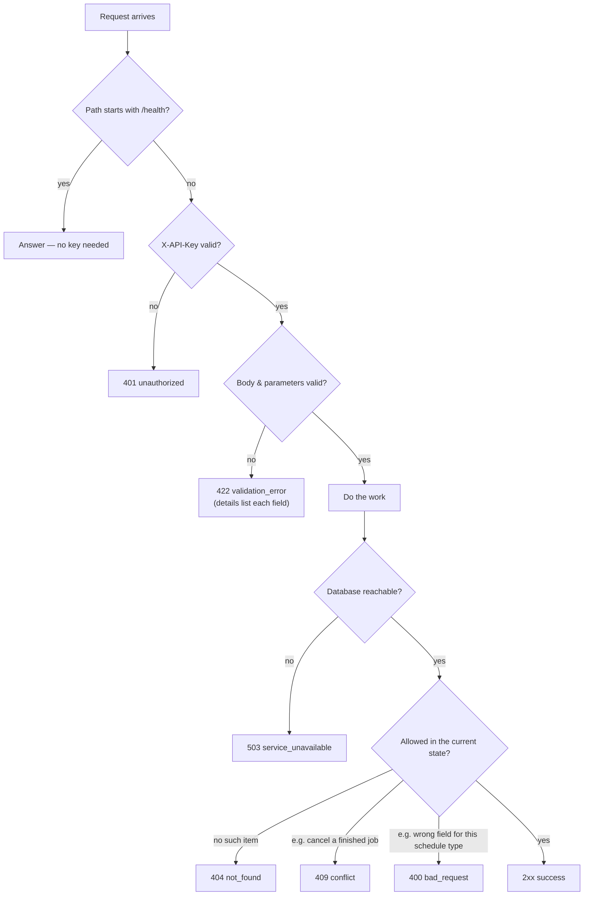
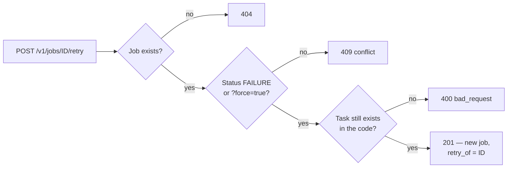
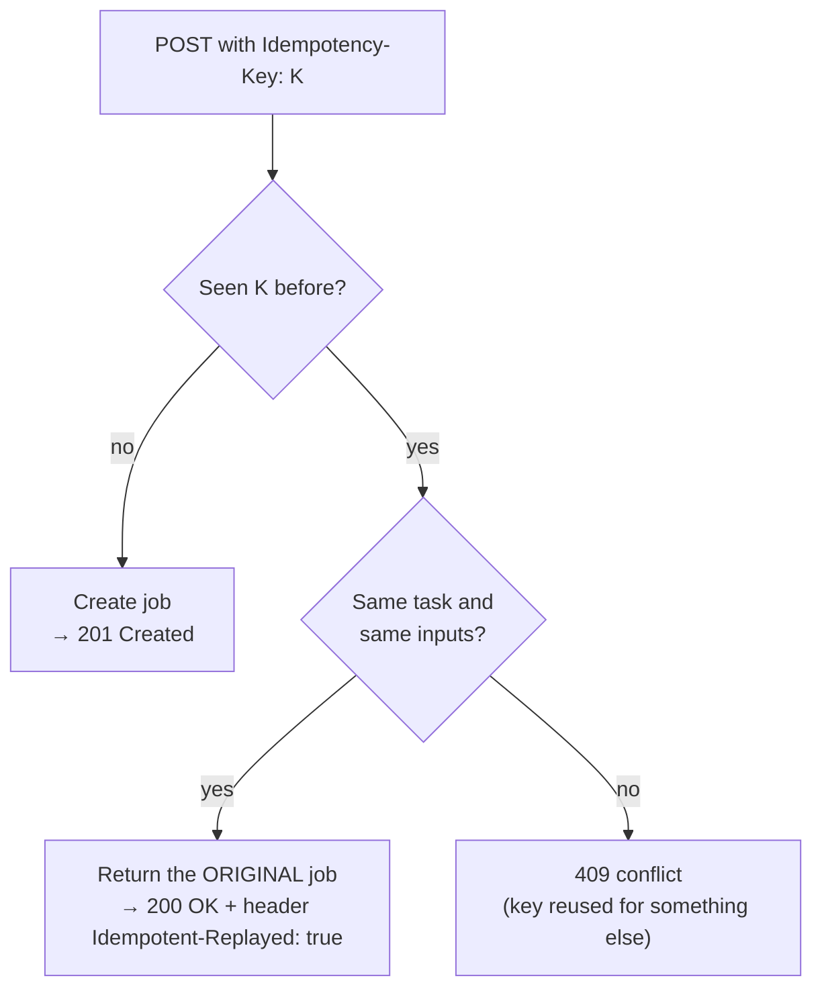

# 5. Using the API

> **Who this is for:** anyone sending requests to the system — app developers, testers, operators.
> **Tip:** everything here can also be tried in the browser at `http://localhost:8000/docs`.

In the examples below:
```bash
API=http://localhost:8000
KEY=dev-key
```

---

> **Building a feature on top of the API** (a web app, a mobile app, another service)?
> Read [14. Integration guide](14-integration-guide.md) for copy-paste TypeScript/React code,
> polling, error handling and security.

## 5.1 How every request is handled



### Rules that apply everywhere
- **Format:** requests and responses are JSON. Send `Content-Type: application/json` with a body.
- **Authentication:** send `X-API-Key: <key>` on every request except `/health` and `/health/ready`.
- **Times:** always UTC, ISO-8601, ending in `Z`, e.g. `2026-07-25T12:27:52.680000Z`.
- **Errors:** always the same shape (see [5.7](#57-errors)).
- **Safe retries:** POST requests accept an `Idempotency-Key` header (see [5.6](#56-safe-retries-with-idempotency-key)).

---

## 5.2 Health

| Request | Answer | Use it for |
|---|---|---|
| `GET /health` | `200 {"status":"ok","service":"job-scheduler","version":"4.0.0"}` | "Is the program running?" |
| `GET /health/ready` | `200 {"status":"ready","checks":{"database":"ok","broker":"ok"}}` or **503** with the failing check in `error.details` | "Can it do real work?" — point load balancers here. |

---

## 5.3 Submitting jobs — `/v1/tasks/*`

Each call queues one job and **returns immediately** with its ID. The job runs later on a worker.

| Request | Body (example) | Rules |
|---|---|---|
| `POST /v1/tasks/add` | `{"x": 3, "y": 4}` | numbers |
| `POST /v1/tasks/long` | `{"duration_seconds": 5}` | whole number 1–120; runs on the `long` queue |
| `POST /v1/tasks/flaky` | `{"fail_probability": 0.7}` | 0.0 (never fails) to 1.0 (always fails) |
| `POST /v1/tasks/notify` | `{"email": "ana@example.com", "message": "Your report is ready."}` | valid email; message 1–2000 characters |
| `POST /v1/tasks/test-batch` | *(none)* | queues one of each, incl. one guaranteed failure |

**Example**
```bash
curl -X POST $API/v1/tasks/add -H "X-API-Key: $KEY" -H "Content-Type: application/json" -d '{"x": 3, "y": 4}'
```
**Answer — `201 Created`**
```json
{"task_id": "8f14e45f-fceb-4dc9-9a0f-3b2c1d4e5f60", "status": "queued"}
```

> **Even if Redis (the queue) is down**, you still get `201`: the job is safely
> stored and will be sent as soon as Redis is back. Only a database outage
> gives `503`.

---

## 5.4 Inspecting jobs — `/v1/jobs`

### List: `GET /v1/jobs`
| Parameter | Default | Meaning |
|---|---|---|
| `limit` | 50 | How many (1–200) |
| `offset` | 0 | Skip this many (for paging) |
| `status` | — | Only this status, e.g. `FAILURE` |

```bash
curl "$API/v1/jobs?status=FAILURE&limit=10" -H "X-API-Key: $KEY"
```
```json
{
  "total": 3, "limit": 10, "offset": 0,
  "jobs": [ { "task_id": "…", "task_name": "app.tasks.flaky_task", "status": "FAILURE", "…": "…" } ]
}
```
`total` counts *all* matching jobs, so you can build pages: `offset=0`, `offset=10`, …

### One job: `GET /v1/jobs/{task_id}`
The full history record:
```json
{
  "task_id": "8f14e45f-…",
  "task_name": "app.tasks.add",
  "status": "SUCCESS",
  "args": [3.0, 4.0],
  "kwargs": {},
  "queue": "default",
  "result": 7.0,
  "error": null,
  "traceback": null,
  "retries": 0,
  "attempts": 1,
  "worker": "celery@worker-7f9c",
  "retry_of": null,
  "schedule_id": null,
  "idempotency_key": null,
  "submitted_at": "2026-07-25T12:27:52.100000Z",
  "published_at": "2026-07-25T12:27:52.110000Z",
  "started_at": "2026-07-25T12:27:52.400000Z",
  "finished_at": "2026-07-25T12:27:52.680000Z"
}
```

| Field | How to read it |
|---|---|
| `status` | Where it is in its life ([statuses](02-key-concepts.md#22-the-life-of-a-job-statuses)). |
| `result` | The answer, once `SUCCESS`. |
| `error` | One-line reason, if it failed. |
| `traceback` | Full technical report, if it failed — give this to a developer. |
| `retries` | Automatic retries so far. |
| `attempts` | Times a worker started it. Normally `retries + 1`; one more means a worker died and another finished it. |
| `published_at` | When it reached the queue. `null` for more than a minute means the queue was unreachable. |
| `retry_of` / `schedule_id` | Where it came from: a manual retry of another job, or a schedule. |

### Live status: `GET /v1/jobs/{task_id}/status`
Reads Celery's live record, which includes **progress** for running jobs:
```json
{"task_id": "…", "state": "PROGRESS", "source": "result_backend", "result": {"progress": 60}, "…": "…"}
```
Live records expire after 24 hours; after that this endpoint falls back to the
history record and says `"source": "job_record"`.

### Retry: `POST /v1/jobs/{task_id}/retry`
Creates a **new** job with the same task and inputs; the new job's `retry_of`
points to the old one.



### Cancel: `DELETE /v1/jobs/{task_id}`
```bash
curl -X DELETE $API/v1/jobs/<id> -H "X-API-Key: $KEY"
# 200 {"task_id": "…", "status": "revoked"}
```
- A waiting job will **never** start — on any worker, even one that missed the cancel message.
- A running job is stopped.
- A job that already finished → `409 conflict` (its status is left alone).

---

## 5.5 Schedules — `/v1/schedules`

Full explanation in [chapter 6](06-scheduling.md). Quick reference:

| Request | Purpose |
|---|---|
| `POST /v1/schedules` | Create (`once` / `interval` / `cron`) |
| `GET /v1/schedules?enabled_only=&limit=&offset=` | List, newest first |
| `GET /v1/schedules/{id}` | One schedule |
| `PATCH /v1/schedules/{id}` | Pause/resume (`enabled`), change `interval_seconds` or `cron_expr` |
| `DELETE /v1/schedules/{id}` | Delete (jobs it already created are kept) |

---

## 5.6 Safe retries with `Idempotency-Key`

Networks fail. If your request times out, you don't know whether the job was
created. Send an **idempotency key** — any unique string you choose, such as
an order number — and you can safely send the request again:

```bash
curl -X POST $API/v1/tasks/add -H "X-API-Key: $KEY" -H "Idempotency-Key: invoice-2026-0042" \
     -H "Content-Type: application/json" -d '{"x": 1, "y": 2}'
```



Works on `POST /v1/tasks/*` (except test-batch), `POST /v1/jobs/{id}/retry` and
`POST /v1/schedules`. Use a **new key for each genuinely new request**.

---

## 5.7 Errors

Every error, from every endpoint, has this shape:
```json
{
  "error": {
    "status_code": 404,
    "type": "not_found",
    "message": "Unknown task_id: 123",
    "details": null
  }
}
```

| `type` | HTTP code | Typical cause | What to do |
|---|---|---|---|
| `bad_request` | 400 | A field that doesn't apply (e.g. `cron_expr` on an interval schedule) | Fix the request. |
| `unauthorized` | 401 | Missing/wrong API key | Send a valid `X-API-Key`. |
| `not_found` | 404 | Unknown job/schedule ID, or wrong URL | Check the ID/URL. |
| `method_not_allowed` | 405 | e.g. `PUT /v1/jobs` | Use the documented method. |
| `conflict` | 409 | Cancel a finished job; retry a non-failed job; edit a system schedule; reused idempotency key | Usually nothing — the request isn't needed, or use a new key. |
| `validation_error` | 422 | Wrong type, out of range, bad cron, past `run_at`, wrong task arguments | Read `details` — it names each bad field. |
| `internal_error` | 500 | A bug | Report it; the server logs have the details. |
| `service_unavailable` | 503 | The database (or, for readiness, the queue) is down | Retry later, with the same idempotency key. |

**Program against `type`, not `message`** — messages are for humans and may change.

---

## 5.8 A client program, start to finish (Python)

```python
import time, uuid, requests

API, HEADERS = "http://localhost:8000", {"X-API-Key": "dev-key"}

def submit_add(x, y):
    key = str(uuid.uuid4())                       # one key per logical request
    for attempt in range(5):                      # retry network errors safely
        try:
            r = requests.post(f"{API}/v1/tasks/add", json={"x": x, "y": y},
                              headers={**HEADERS, "Idempotency-Key": key}, timeout=10)
            if r.status_code in (200, 201):
                return r.json()["task_id"]
            if r.json()["error"]["type"] != "service_unavailable":
                raise RuntimeError(r.json()["error"]["message"])
        except requests.ConnectionError:
            pass
        time.sleep(2 ** attempt)
    raise RuntimeError("API unavailable")

def wait_for(task_id):
    while True:
        job = requests.get(f"{API}/v1/jobs/{task_id}", headers=HEADERS).json()
        if job["status"] in ("SUCCESS", "FAILURE", "REVOKED"):
            return job
        time.sleep(1)

job = wait_for(submit_add(3, 4))
print(job["status"], job["result"])               # SUCCESS 7.0
```

## 5.9 Every endpoint (5.0)

All paths below are under `/v1`. The pre-5.0 unprefixed paths still work as
aliases ([chapter 18](18-api-versioning.md)).

| Method & path | Scope | What it does | More |
|---|---|---|---|
| `POST /tasks/add`, `/long`, `/flaky`, `/notify`, `/test-batch` | `jobs:write` | Submit a sample task | 5.3 |
| `POST /jobs` | `jobs:write` | Submit **any** public task, with priority, delay, timeout, retries, webhook | [16.1](16-webhooks-and-workflows.md#161-per-job-options) |
| `GET /jobs` | `jobs:read` | List; filter by `status`, `task_name`, `workflow_id` | 5.4 |
| `GET /jobs/{id}` | `jobs:read` | The job record | 5.4 |
| `GET /jobs/{id}/status` | `jobs:read` | Live state, including progress | 5.4 |
| `GET /jobs/{id}/events` | `jobs:read` | Live state as a server-sent event stream | [14.16](14-integration-guide.md#1416-live-updates-with-the-event-stream) |
| `GET /jobs/{id}/webhooks` | `jobs:read` | Webhook deliveries for the job | [16.2](16-webhooks-and-workflows.md#162-webhooks) |
| `POST /jobs/{id}/retry` | `jobs:write` | Re-submit | 5.4 |
| `DELETE /jobs/{id}` | `jobs:write` | Cancel | 5.4 |
| `GET /jobs/failures` | `jobs:read` | Failed jobs grouped by task and error | [16.4](16-webhooks-and-workflows.md#164-the-failures-view-dead-letter-queue) |
| `POST /jobs/failures/retry` | `jobs:write` | Re-submit failed jobs in bulk | 16.4 |
| `POST /workflows` · `GET /workflows` · `GET /workflows/{id}` · `DELETE /workflows/{id}` | `jobs:*` | Workflows | [16.3](16-webhooks-and-workflows.md#163-workflows) |
| `POST /schedules` · `GET` · `GET /{id}` · `PATCH /{id}` · `DELETE /{id}` | `schedules:*` | Schedules (cron may have a `timezone`) | [6](06-scheduling.md) |
| `POST /admin/api-keys` · `GET` · `DELETE /{id}` | `admin` | Managed keys | [15.4](15-security-and-tenancy.md#154-creating-listing-and-revoking-keys) |
| `GET /admin/audit-log` | `admin` | Who did what | [15.7](15-security-and-tenancy.md#157-the-audit-log) |

Unversioned and needing no key: `GET /health`, `GET /health/ready`,
`GET /metrics` ([17.2](17-observability.md#172-metrics)), `GET /ui` (the console),
`GET /docs`, `GET /openapi.json`.

New error types in 5.0: `403 forbidden` (missing scope, task not allowed) and
`429 rate_limited` (with `Retry-After`).

For a guided tour of every endpoint in order, see [USER_TESTING.md](../USER_TESTING.md).

**Next:** [6. Scheduling →](06-scheduling.md)
