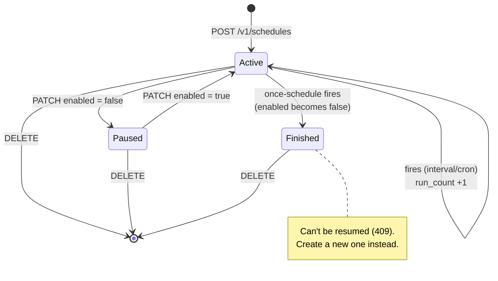
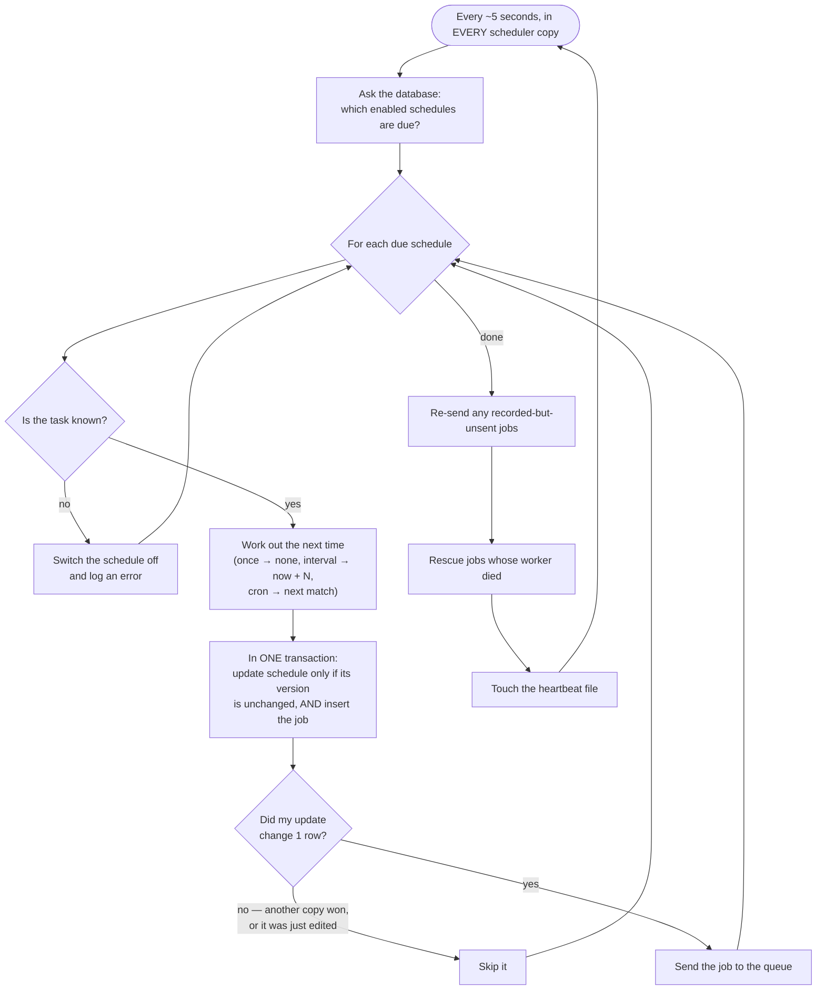

# 6. Scheduling

> **Who this is for:** anyone who wants work to happen automatically at set times.

A **schedule** is a rule that says *"run this task, with these inputs, at these
times"*. You create schedules through the API while the system is running —
no restart or code change needed. Any number of schedules can point at the
same task.

---

## 6.1 The three kinds

| Kind | You give | It runs | Example |
|---|---|---|---|
| `once` | `run_at` — a future date and time **with a timezone** | One time, then switches itself off | "Send the reminder at 2026-07-26 09:50 UTC" |
| `interval` | `interval_seconds` | Right away (next check), then every N seconds after each run | "Every 2 hours" (`7200`) |
| `cron` | `cron_expr` — a calendar pattern | At every matching minute, **in UTC** | "08:00 every weekday" (`0 8 * * 1-5`) |

```mermaid
gantt
    title The three kinds over one day (UTC)
    dateFormat HH:mm
    axisFormat %H:%M
    section once (run_at 09:50)
    fires once          :milestone, 09:50, 0m
    section interval (every 4 h, created 06:00)
    run                 :milestone, 06:00, 0m
    run                 :milestone, 10:00, 0m
    run                 :milestone, 14:00, 0m
    run                 :milestone, 18:00, 0m
    run                 :milestone, 22:00, 0m
    section cron (0 8,12,17 * * *)
    run                 :milestone, 08:00, 0m
    run                 :milestone, 12:00, 0m
    run                 :milestone, 17:00, 0m
```



---

## 6.2 Creating schedules

**Every 2 hours**
```bash
curl -X POST $API/v1/schedules -H "X-API-Key: $KEY" -H "Content-Type: application/json" \
  -d '{"task_name": "app.tasks.heartbeat", "schedule_type": "interval", "interval_seconds": 7200}'
```

**Weekdays at 08:00 UTC**
```bash
curl -X POST $API/v1/schedules -H "X-API-Key: $KEY" -H "Content-Type: application/json" \
  -d '{"task_name": "app.tasks.scheduled_cleanup", "schedule_type": "cron", "cron_expr": "0 8 * * 1-5"}'
```

**Once, at a specific time, with inputs**
```bash
curl -X POST $API/v1/schedules -H "X-API-Key: $KEY" -H "Content-Type: application/json" -d '{
  "task_name": "app.tasks.send_notification",
  "args": ["ana@example.com", "Reminder: standup in 10 minutes"],
  "schedule_type": "once",
  "run_at": "2030-01-01T09:50:00+00:00"
}'
```

**Answer — `201`**
```json
{
  "id": 7, "name": null, "system": false,
  "task_name": "app.tasks.send_notification",
  "args": ["ana@example.com", "Reminder: standup in 10 minutes"], "kwargs": {},
  "schedule_type": "once", "run_at": "2030-01-01T09:50:00Z",
  "interval_seconds": null, "cron_expr": null,
  "enabled": true, "next_run_at": "2030-01-01T09:50:00Z",
  "last_run_at": null, "run_count": 0, "created_at": "2026-07-25T12:34:18Z"
}
```

### Inputs: `args` and `kwargs`
- `args` — a list of inputs in order, e.g. `["ana@example.com", "hello"]`.
- `kwargs` — named inputs, e.g. `{"duration_seconds": 30}`.

They are **checked against the task when you create the schedule**. For
example, `add` with only one number is rejected straight away (422), instead
of failing every time it runs.

### Which tasks can be scheduled?
Only the public tasks: `app.tasks.add`, `app.tasks.long_running_task`,
`app.tasks.flaky_task`, `app.tasks.send_notification`, `app.tasks.heartbeat`,
`app.tasks.scheduled_cleanup`. Anything else is rejected — this stops the API
from being used to run arbitrary code.

### What gets rejected (422)
| Mistake | Example |
|---|---|
| Unknown task | `"task_name": "os.system"` |
| Missing the timing field | `interval` without `interval_seconds` |
| Mixing timing fields | `interval` with a `cron_expr` too |
| `run_at` in the past | `"2020-01-01T00:00:00+00:00"` |
| `run_at` without a timezone | `"2099-01-01T00:00:00"` (add `+00:00` or `Z`) |
| Invalid cron, or 6 fields | `"not cron"`, `"0 0 * * * *"` |
| Inputs don't fit the task | `add` with `"args": [1]` |

---

## 6.3 A gentle cron primer

A cron expression has **five fields**, separated by spaces:

```
 ┌───────────── minute        (0–59)
 │ ┌─────────── hour          (0–23, UTC)
 │ │ ┌───────── day of month  (1–31)
 │ │ │ ┌─────── month         (1–12)
 │ │ │ │ ┌───── day of week   (0–6, Sunday = 0; or 7)
 │ │ │ │ │
 0 8 * * 1-5
```

| Symbol | Means | Example | Reads as |
|---|---|---|---|
| `*` | every | `* * * * *` | every minute |
| number | exactly | `30 9 * * *` | 09:30 every day |
| `,` | list | `0 8,12,17 * * *` | 08:00, 12:00 and 17:00 |
| `-` | range | `0 9 * * 1-5` | 09:00 Monday–Friday |
| `/` | every Nth | `*/15 * * * *` | every 15 minutes |

More examples:

| Expression | Meaning |
|---|---|
| `0 * * * *` | At the start of every hour |
| `0 3 * * *` | 03:00 every night |
| `0 0 1 * *` | Midnight on the 1st of every month |
| `0 9 * * 1` | 09:00 every Monday |
| `30 6 * * 1-5` | 06:30 on weekdays |

> ⚠️ **Cron uses UTC by default.** If you want 09:00 in New York, either
> add `"timezone": "America/New_York"` (5.0+): then `0 9 * * *` means 09:00
> New York time all year, daylight saving included; or write the UTC time
> yourself (`0 14 * * *` in winter, which then drifts by an hour in summer).
> See [16.5 Cron schedules in your time zone](16-webhooks-and-workflows.md#165-cron-schedules-in-your-time-zone).

---

## 6.4 Managing schedules



| Action | Request | Effect |
|---|---|---|
| Pause | `PATCH /v1/schedules/{id}` `{"enabled": false}` | Stops firing; keeps its history. |
| Resume | `{"enabled": true}` | Starts again. If its next time has already passed, it fires on the next check (once — missed runs aren't replayed). |
| Change interval | `{"interval_seconds": 120}` | Next run = last run + 120 s (or now + 120 s if it never ran). Takes effect immediately. |
| Change cron | `{"cron_expr": "*/5 * * * *"}` | Next run = next match from now. |
| Delete | `DELETE /v1/schedules/{id}` | Gone. Jobs it already created stay in `/v1/jobs`. |

Refused changes: a field that doesn't fit the type (`cron_expr` on an
interval schedule) → **400**; `null` values or invalid cron → **422**;
resuming a `once` schedule that already fired, or touching a system schedule
→ **409**.

---

## 6.5 System schedules

Two schedules are built in. They are defined in the code
(`SYSTEM_SCHEDULES` in `app/tasks.py`), created automatically when a scheduler
starts, shown in `GET /v1/schedules` with `"system": true`, and **read-only**
through the API:

| Name | Task | When | Why |
|---|---|---|---|
| `system:heartbeat` | `heartbeat` | every 30 s | Proves the scheduler and workers are alive. |
| `system:cleanup` | `scheduled_cleanup` | `0 3 * * *` (03:00 UTC daily) | Deletes job records older than 30 days and expired live results. |

---

## 6.6 How schedules actually fire

The scheduler service checks the database every **5 seconds** (setting
`SCHEDULE_POLL_INTERVAL_SECONDS`), so a schedule fires within roughly 5–6
seconds of its time.



Why this is safe with many scheduler copies:
- **Exactly one copy fires each due time**, because the update only succeeds if the schedule's `version` hasn't changed since it was read — and the winner changes it.
- **Pausing or editing wins over a stale read**, because editing also changes the version.
- **Crashing right after winning can't lose the run**: the job was saved in the same transaction, and another copy will send it (outbox).
- **Losing a scheduler causes no gap**: the others are already running and simply carry on.

### Timing details
- `interval` counts from when it **actually fired**, so if a check is a second late, the following runs shift by that second.
- **Missed runs aren't replayed.** If every scheduler was down from 08:00 to 11:00, an hourly schedule fires **once** when they're back, then carries on normally — not three times.
- `once` schedules switch themselves off after firing.

**Next:** [7. How "runs exactly once" works →](07-reliability.md)
