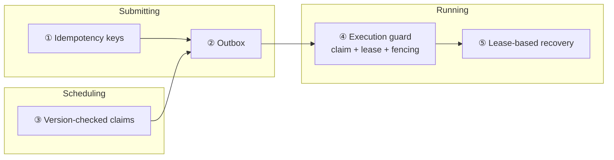
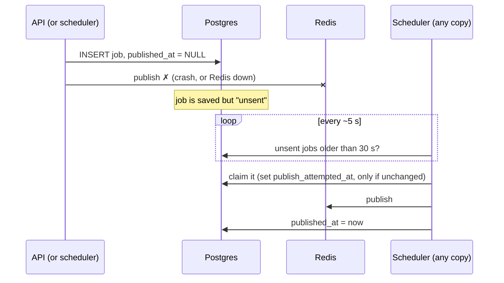
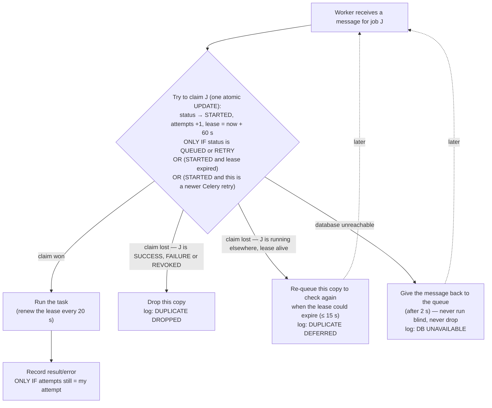
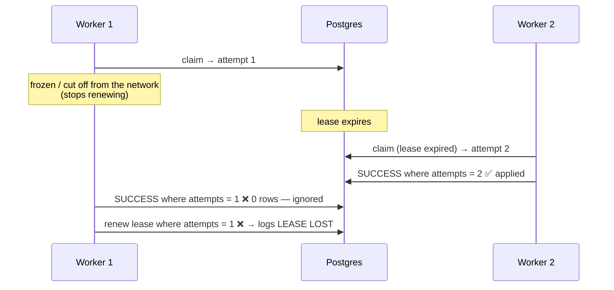
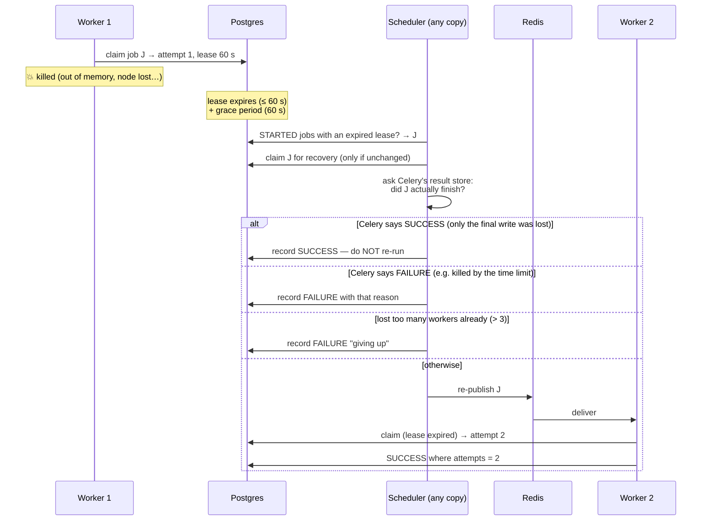

# 7. How "runs exactly once" works

> **Who this is for:** everyone for Part A; developers and operators for Part B.
> **Part A** explains *what* is guaranteed, in plain words.
> **Part B** explains *how*, with diagrams and the exact rules.

---

# Part A — The guarantees, in plain words

## 7.1 Why this is hard

When several computers share work, things go wrong in surprising ways:

- A message gets **delivered twice** (the queue isn't sure the first delivery worked, so it sends it again).
- A computer **crashes halfway** through a job.
- Two schedulers both think **"it's 6:00, I'll start the job"**.
- A program crashes **between** "I saved the job" and "I sent the job".
- A customer's app **clicks twice** or retries after a timeout.
- The **database or queue goes offline** for a minute.

A naïve system would, in these cases, do the work twice (two emails, two
charges) or lose it entirely. This system is built so that neither happens.

## 7.2 What you can rely on

| If this happens… | …the system does this |
|---|---|
| Several schedulers see the same due schedule | Exactly **one** fires it. |
| A scheduler dies | The others carry on within ~5 s. No gap, no hand-over. |
| The queue delivers a job twice | It runs **once**; the copy is thrown away. |
| A copy arrives while the job is still running | The copy waits, then is thrown away when the job finishes. |
| A client sends the same request twice (same `Idempotency-Key`) | One job is created; the second request gets the original back. |
| Someone cancels a job | No worker will ever start it. |
| The API crashes after saving a job but before queuing it | The scheduler notices and queues it. |
| The queue (Redis) is down when a job is submitted | The job is accepted, saved, and queued when Redis returns. |
| The database goes down while jobs are running and waiting | Waiting jobs pause; running jobs finish and record their results once it's back. Nothing lost, nothing repeated. |
| A worker dies mid-job | Another worker finishes the job. |
| A job keeps killing its workers | It is re-tried at most 3 times, then marked FAILURE. |
| A finished or cancelled job | Never runs again, under any circumstances. |

## 7.3 The one honest exception

If a worker dies **in the middle of** a job — after it has started doing
something but before it reports back — the system cannot know how far the job
got. It has two choices: run the job again, or lose it. **It runs it again.**

For most jobs that's fine. For jobs that affect the outside world (sending an
email, charging a card), the job should pass its job ID to that outside system
as an *idempotency key*, so the outside system ignores the repeat. Most email
and payment providers support this. The example task `send_notification`
shows how.

This limit isn't specific to this project — no distributed system can avoid
it. What this project does is make that the *only* case, make it rare (a
worker has to actually die), and record it (`attempts` goes up by one).

---

# Part B — How it works

Everything rests on one principle:

> **Postgres is the referee.** Every decision about "who runs this, and has it
> already happened?" is made with a single atomic update in the database.
> Atomic means *all-or-nothing, one at a time*: when two computers try the same
> update at the same moment, the database lets exactly one succeed.

There are five mechanisms.



## 7.4 Idempotency keys — no duplicate submissions

The `jobs` and `schedules` tables each have a **unique** `idempotency_key`
column. Inserting a second row with the same key is impossible, so a repeated
request finds the existing row and returns it instead (200 +
`Idempotent-Replayed: true`). Same key with different content → 409.

## 7.5 The outbox — no lost jobs between "saved" and "sent"



- Jobs are **always saved first**. `published_at` is filled only after Redis accepts the message.
- Every scheduler copy runs the **relay**: it finds jobs with `published_at` empty for more than `OUTBOX_REPUBLISH_AFTER_SECONDS` (30 s) and sends them.
- Two relays can't send the same job at the same time: each must first update `publish_attempted_at` *on the condition that it still has the value it read*.
- If a job is sent twice anyway (sent, then the sender crashed before marking it), the execution guard (④) drops the second copy.

## 7.6 Version-checked claims — one scheduler fires each run

Every schedule has a `version` number. To fire, a scheduler runs, in one transaction:

```sql
UPDATE schedules
   SET next_run_at = <next>, run_count = run_count + 1, version = version + 1, last_run_at = now
 WHERE id = <id> AND version = <version I read> AND enabled = true;
-- only if exactly 1 row changed:
INSERT INTO jobs (...)   -- the job for this run
```

The first scheduler changes the version; everyone else's `WHERE version = …`
then matches nothing, so they skip. Editing or pausing a schedule also bumps
the version, so a scheduler that read the old values can't fire it. The diagram
is in [chapter 3](03-architecture.md#34-life-of-a-scheduled-run).

## 7.7 The execution guard — one worker runs each job

Every task inherits `GuardedTask` (`app/guard.py`). Before the task's code
runs, the guard asks the database for permission.



### The lease
A claim isn't permanent — it's a **lease** of `EXECUTION_LEASE_SECONDS` (60 s).
While the job runs, a background thread renews it every 20 s. As long as the
worker is alive, the lease never runs out.

```mermaid
gantt
    title Lease of a healthy worker running a 70 s job
    dateFormat ss
    axisFormat %S s
    section Job
    running            :active, 00, 70s
    section Lease (60 s, renewed every 20 s)
    lease 0–60         :00, 60s
    renewed → 80       :20, 60s
    renewed → 100      :40, 60s
    renewed → 120      :60, 60s
    section Finish
    result recorded, lease cleared :milestone, 70, 0s
```



### The fencing token
Each successful claim increases `attempts` and returns the new number to the
worker. **Every later update includes `WHERE attempts = <my number>`.** If a
worker was frozen long enough to lose its lease and another worker took over
(attempt 2), the old worker's late "SUCCESS" (attempt 1) changes nothing.



### Cancelling
`DELETE /v1/jobs/{id}` sets the status to REVOKED in the database. Since REVOKED
jobs can't be claimed, **every** worker refuses to start them — even one that
never received Celery's "revoke" broadcast. (The broadcast is still sent, to
stop the job if it's already running.)

### Celery's own retries
When a task fails and Celery schedules a retry, the new message has a higher
`retries` number. The claim allows "STARTED, but this is a newer retry", so the
retry runs even if the earlier attempt's "RETRY" status hasn't been written yet
— while a duplicate of the *same* attempt is still blocked.

## 7.8 Lease-based recovery — finishing jobs whose worker died



- A dead worker's job is resumed roughly **1–2 minutes** after it died (lease + grace).
- This **doesn't depend on Redis re-delivering** the message (Redis's timing for that is unpredictable). If Redis *also* re-delivers it, the guard drops whichever copy comes second.
- `MAX_WORKER_LOSS_RECOVERIES` (3) stops a job that crashes every worker from looping forever.

## 7.9 Riding out a database outage

| What's happening | Behaviour |
|---|---|
| API receives a request | Answers **503 service_unavailable** quickly; readiness check fails so load balancers route elsewhere. |
| Worker receives a new message | Can't claim → waits 2 s → hands the message back to Redis. Repeats until the database is back. The job is never run without a claim and never dropped. |
| Worker finishes a job | Keeps retrying the final write (with increasing pauses) for up to `FINAL_STATE_WRITE_TIMEOUT_SECONDS` (300 s). Celery's own result write also retries (via `app/result_backend.py`). |
| Running job renews its lease | Renewal fails and is retried next time. If the outage lasts longer than about **2 × the lease** (≈ 2 minutes), recovery may resume the job elsewhere — so keep the lease longer than the outages you expect. |
| Scheduler loop | Logs the error and tries again next loop. |

## 7.10 Riding out a Redis outage

- Submissions still succeed (201): the job is saved with `published_at` empty.
- Workers wait for Redis to return (Celery reconnects automatically).
- When Redis is back, the outbox relay sends every unsent job.
- If Redis lost messages (e.g. during a failover), the outbox and recovery mechanisms resend what's needed, and the guard removes duplicates.

## 7.11 How this is tested

| Test | What it proves |
|---|---|
| `tests/test_no_double_execution.py` | Each guarantee, one at a time: duplicate messages, duplicates of running jobs, cancelled jobs, 10 workers claiming at once, lease takeover + fencing, Celery retries, 10 schedulers racing, stale reads, relay races, crash recovery, DB outage at claim time, idempotency keys. Runs on SQLite **and** Postgres. |
| `scripts/chaos_test.py` | Against a real multi-copy Docker stack: 300 concurrent jobs; 20 identical requests; a scheduler killed mid-test; cancelling via a different API; a worker `SIGKILL`ed mid-job; Redis stopped; Postgres stopped. Then it checks every job: ran once (or exactly once more after the deliberate kill), none stuck, none unsent, no schedule fired twice. |

## 7.12 Tuning the guarantees

| Setting | Default | Raise it if… | Lower it if… |
|---|---|---|---|
| `EXECUTION_LEASE_SECONDS` | 60 | Your database failovers can take longer than ~2 minutes | You want faster recovery from dead workers |
| `MAX_WORKER_LOSS_RECOVERIES` | 3 | Your workers are often pre-empted (spot instances) | You'd rather fail fast |
| `OUTBOX_REPUBLISH_AFTER_SECONDS` | 30 | Publishing is often slow | You want faster delivery after Redis outages |
| `FINAL_STATE_WRITE_TIMEOUT_SECONDS` | 300 | Database outages can last longer | — |
| `DUPLICATE_RECHECK_SECONDS` | 15 | — | You want duplicates resolved faster |

**Next:** [8. Configuration reference →](08-configuration.md)
