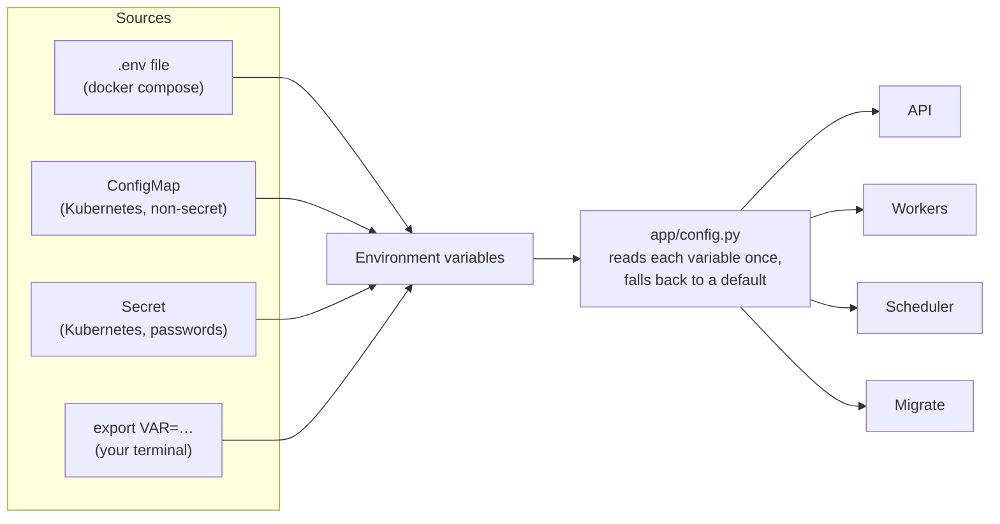

# 8. Configuration reference

> **Who this is for:** anyone setting the system up or tuning it.

All settings are **environment variables** — named values given to a program
when it starts. The same code runs everywhere; only these values change.

---

## 8.1 Where settings come from



- The defaults are defined in [`app/config.py`](../app/config.py), with an explanation next to each one.
- [`.env.example`](../.env.example) lists every variable; copy it to `.env` for Docker.
- Settings are read **when a program starts** — restart it after changing them.
- Yes/no settings accept `true`/`false`, `1`/`0`, `yes`/`no`, `on`/`off`.

---

## 8.2 Required in deployment

These have no safe default. Docker Compose refuses to start without them.

| Variable | Example | Purpose |
|---|---|---|
| `API_KEYS` | `k8Jf…,Zq2p…` | Accepted API keys, comma-separated. Several allow rotating keys without downtime. **Empty = no authentication** (local only — a warning is logged). |
| `DATABASE_URL` | `postgresql://jobs:pw@db:5432/jobs?sslmode=require` | The database. Compose builds it from `POSTGRES_PASSWORD`. |
| `REDIS_PASSWORD` *or* `CELERY_BROKER_URL` | `rediss://:pw@redis:6379/0` | How to reach Redis. |
| `POSTGRES_PASSWORD` | — | Compose only: password for its Postgres container. |
| `FLOWER_BASIC_AUTH` | `admin:s3cret` | Dashboard login (`user:password`). |

Generate strong secrets with: `python -c "import secrets; print(secrets.token_urlsafe(32))"`

---

## 8.3 Database

| Variable | Default | Meaning |
|---|---|---|
| `DATABASE_URL` | `sqlite:///data/scheduler.db` | `postgresql://…` for anything with more than one machine. SQLite = a single file, for one machine only. |
| `DB_POOL_SIZE` | `5` | Database connections kept open per process (Postgres). |
| `DB_MAX_OVERFLOW` | `5` | Extra connections allowed at busy moments. |
| `AUTO_MIGRATE` | `true` | Create/update tables when each process starts. Set `false` when `python -m app.migrate` runs separately (Compose and Kubernetes do this). |
| `CELERY_RESULT_BACKEND` | *(same Postgres, or `data/celery_results.db`)* | Where Celery keeps live results and progress. |
| `CELERY_RESULT_EXPIRES` | `86400` (1 day) | Seconds live results are kept. |
| `JOB_RETENTION_DAYS` | `30` | Days finished job records are kept before nightly cleanup deletes them. |

> **Connection count:** each process may open up to `DB_POOL_SIZE + DB_MAX_OVERFLOW`
> connections. With many pods, multiply — and consider PgBouncer.

---

## 8.4 Queue (Redis)

| Variable | Default | Meaning |
|---|---|---|
| `REDIS_HOST` | `localhost` | Redis server name. |
| `REDIS_PORT` | `6379` | Redis port. |
| `REDIS_PASSWORD` | *(empty)* | Redis password. |
| `CELERY_BROKER_URL` | built from the three above | Full address; overrides them. Supports `redis://`, `rediss://` (encrypted) and `sentinel://` (high availability). |
| `REDIS_SENTINEL_MASTER` | `mymaster` | Master name, when using Sentinel. |
| `BROKER_VISIBILITY_TIMEOUT` | `300` | Seconds before Redis re-delivers a message a worker took but never confirmed. Not relied on for recovery; duplicates are harmless. |

---

## 8.5 "Runs exactly once" settings

Explained in [chapter 7](07-reliability.md).

| Variable | Default | Meaning |
|---|---|---|
| `EXECUTION_LEASE_SECONDS` | `60` | Length of a running job's lease; renewed every third of it. A dead worker's job is resumed after about 2× this. |
| `DUPLICATE_RECHECK_SECONDS` | `15` | Longest wait before a deferred duplicate checks again. |
| `MAX_WORKER_LOSS_RECOVERIES` | `3` | How many times a job is resumed after its worker died, before it's marked FAILURE. |
| `FINAL_STATE_WRITE_TIMEOUT_SECONDS` | `300` | How long a finished job keeps retrying its final write while the database is down. |
| `OUTBOX_REPUBLISH_AFTER_SECONDS` | `30` | Saved-but-unsent jobs older than this are sent by the scheduler. |

---

## 8.6 Scheduler

| Variable | Default | Meaning |
|---|---|---|
| `SCHEDULE_POLL_INTERVAL_SECONDS` | `5` | How often each scheduler checks for due schedules. Lower = more precise, more database load. |
| `SCHEDULER_HEARTBEAT_FILE` | `/tmp/scheduler-heartbeat` | File touched every loop; the health check reads its age. |

---

## 8.7 Tasks and queues

| Variable | Default | Meaning |
|---|---|---|
| `DEFAULT_QUEUE_NAME` | `default` | Queue for quick tasks. |
| `LONG_TASK_QUEUE_NAME` | `long` | Queue for slow tasks. |
| `FIFO_ENABLED` | `true` | `true`: each worker takes one job at a time, so jobs start in arrival order. `false`: workers grab 4 at a time for more throughput. For strict *completion* order too, run workers with `--concurrency=1`. |
| `TASK_DEFAULT_MAX_RETRIES` | `3` | Automatic retries for `flaky_task`. |
| `TASK_DEFAULT_RETRY_BACKOFF` | `5` | First retry delay in seconds; doubles each time (max 60 s), with randomness. |
| `TASK_SOFT_TIME_LIMIT` | `300` | After this many seconds a task is asked to stop (it can clean up). |
| `TASK_TIME_LIMIT` | `360` | After this many seconds a task is forcibly killed. |

---

## 8.8 Logging and app

| Variable | Default | Meaning |
|---|---|---|
| `LOG_LEVEL` | `INFO` | `DEBUG`, `INFO`, `WARNING`, `ERROR`. `DEBUG` also logs task inputs. |
| `LOG_FORMAT` | `text` | `text` for people, `json` for log systems. Compose and Kubernetes use `json`. |
| `LOG_TO_FILE` | `true` | Also write log files to `LOG_DIR`. Compose and Kubernetes set `false` (logs go to standard output). |
| `LOG_DIR` | `logs` | Folder for log files. |
| `APP_NAME` | `job-scheduler` | Shown in `/health` and used as Celery's app name. |
| `FLOWER_PORT` | `5555` | Dashboard port. |

---

## 8.9 Docker Compose only

| Variable | Default | Meaning |
|---|---|---|
| `API_PORT` / `API_PORT_MAX` | `8000` / `8001` | Host ports for the API copies. |
| `API_REPLICAS`, `WORKER_REPLICAS`, `WORKER_LONG_REPLICAS`, `SCHEDULER_REPLICAS` | `2` each | How many copies to run. |
| `API_WORKERS` | `2` | Web server processes inside each API copy. |
| `WORKER_CONCURRENCY` / `WORKER_LONG_CONCURRENCY` | `4` / `2` | Jobs run in parallel per worker copy. |
| `LONG_TASK_GRACE_PERIOD` | `150s` | Time a slow-job worker gets to finish on shutdown. |

---

## 8.10 Ready-made profiles

**Laptop (Python, no Docker)**
```bash
export API_KEYS=dev-key          # everything else: defaults (SQLite, local Redis)
```

**Docker Compose (`.env`)**
```ini
API_KEYS=change-me
REDIS_PASSWORD=change-me
POSTGRES_PASSWORD=change-me
FLOWER_BASIC_AUTH=admin:change-me
```

**Production (Kubernetes Secret + ConfigMap)** — see [`deploy/k8s/configmap.yaml`](../deploy/k8s/configmap.yaml) and [`deploy/k8s/secret.example.yaml`](../deploy/k8s/secret.example.yaml):
```ini
DATABASE_URL=postgresql://jobs:…@db.internal:5432/jobs?sslmode=require
CELERY_BROKER_URL=rediss://:…@redis.internal:6379/0
API_KEYS=<two long random keys>
FLOWER_BASIC_AUTH=admin:<long random password>
AUTO_MIGRATE=false
LOG_FORMAT=json
LOG_TO_FILE=false
```

**Next:** [9. Deployment →](09-deployment.md)
