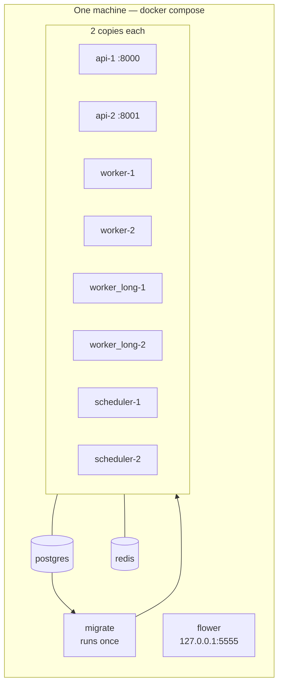
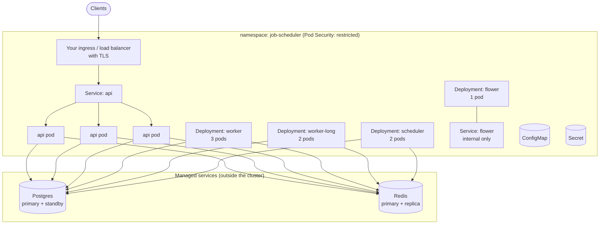
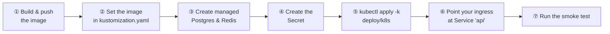
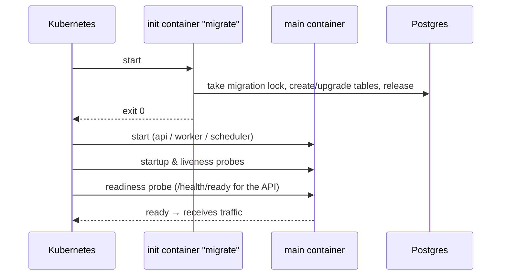
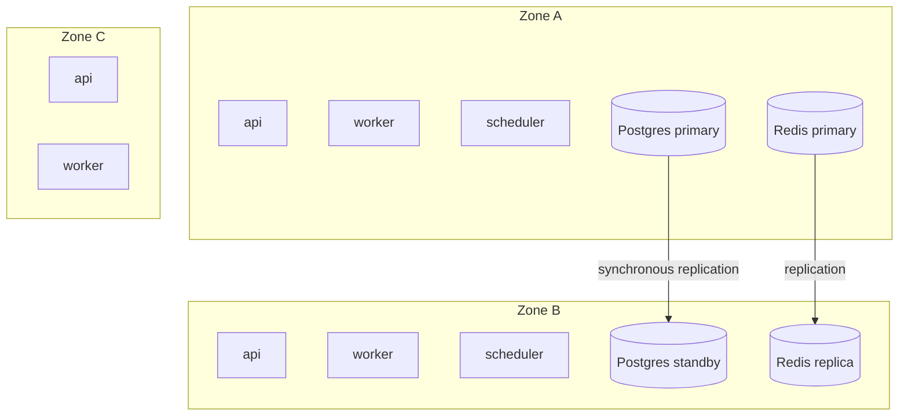

# 9. Deployment

> **Who this is for:** people putting the system on servers — DevOps, SRE, platform teams.

There are two supported ways:

| | Docker Compose | Kubernetes |
|---|---|---|
| Where | One machine | A cluster of machines |
| Good for | Development, CI, demos, small internal use | Production, high availability |
| Postgres & Redis | Included (single containers, **not** highly available) | Bring your own managed, highly available services |
| Files | `docker-compose.yml`, `docker-compose.override.yml` | `deploy/k8s/` (kustomize) or `deploy/helm/` |

---

## 9.1 Docker Compose



### Two modes
| Command | Mode |
|---|---|
| `docker compose up --build` | **Development**: one copy of each, your source code mounted live, the API reloads on change, readable text logs. |
| `docker compose -f docker-compose.yml up -d --build` | **Full stack**: two copies of each app service, JSON logs, no code mounting. |

### What the Compose files do for you
- **Refuse to start** without `API_KEYS`, `REDIS_PASSWORD`, `POSTGRES_PASSWORD`, `FLOWER_BASIC_AUTH`.
- **Order the start-up**: Postgres healthy → `migrate` finishes → everything else.
- **Keep Redis and Postgres private** (no ports published to your machine); Flower only on `127.0.0.1`.
- **Restart** crashed containers automatically; **health-check** API, workers and schedulers.
- Give workers **time to finish** running jobs on shutdown (60 s / 150 s).

### Everyday commands
```bash
docker compose -f docker-compose.yml ps                         # what's running
docker compose -f docker-compose.yml logs -f worker scheduler   # follow logs
docker compose -f docker-compose.yml up -d --scale worker=4     # more workers
docker compose -f docker-compose.yml restart worker             # after changing task code
docker compose -f docker-compose.yml down                       # stop (keeps data)
docker compose -f docker-compose.yml down -v                    # stop and DELETE data
```

---

## 9.2 Kubernetes

### What gets deployed



| File | Contains |
|---|---|
| `kustomization.yaml` | Ties everything together; set your image name/tag here. |
| `namespace.yaml` | The `job-scheduler` namespace, with the strict *restricted* Pod Security level. |
| `serviceaccount.yaml` | An identity with **no** Kubernetes API access. |
| `configmap.yaml` | Non-secret settings. |
| `secret.example.yaml` | Template for the passwords (not applied automatically). |
| `api.yaml` | API Deployment (3), Service, PodDisruptionBudget, autoscaler (3–10). |
| `worker.yaml` / `worker-long.yaml` | Worker Deployments (3 / 2), disruption budgets, autoscalers (3–20 / 2–10). |
| `scheduler.yaml` | Scheduler Deployment (2) and disruption budget. |
| `flower.yaml` | Dashboard Deployment and internal Service. |
| `networkpolicy.yaml` | Blocks all incoming traffic except to the API. |

### Step by step



```bash
# 1. build and push
docker build -t registry.example.com/job-scheduler:4.0.0 .
docker push registry.example.com/job-scheduler:4.0.0

# 2. in deploy/k8s/kustomization.yaml:
#    images: - name: job-scheduler
#              newName: registry.example.com/job-scheduler
#              newTag: "4.0.0"

# 4. secrets (better: from your secret manager)
kubectl create namespace job-scheduler
kubectl -n job-scheduler create secret generic job-scheduler-secrets \
  --from-literal=DATABASE_URL='postgresql://jobs:…@db.internal:5432/jobs?sslmode=require' \
  --from-literal=CELERY_BROKER_URL='rediss://:…@redis.internal:6379/0' \
  --from-literal=API_KEYS='…' \
  --from-literal=FLOWER_BASIC_AUTH='admin:…'

# 5. deploy
kubectl apply -k deploy/k8s
kubectl -n job-scheduler get pods -w

# 7. check
kubectl -n job-scheduler port-forward svc/api 8000:80 &
API_URL=http://localhost:8000 API_KEY=… python scripts/smoke_test.py
```

### How a pod starts



Every pod runs `migrate` first. It's safe for many pods to do this at once —
a database lock makes them take turns, and it's instant when nothing needs
changing.

### Built-in availability features

| Feature | Setting | Why |
|---|---|---|
| Several copies | API 3, worker 3, worker-long 2, scheduler 2 | No single point of failure. |
| Spread across nodes **and** zones | `topologySpreadConstraints` | Losing a machine or a data-centre zone doesn't take out every copy. |
| Safe rolling updates | API/scheduler `maxUnavailable: 0` | New pods are ready before old ones stop. |
| Graceful worker shutdown | `terminationGracePeriodSeconds: 330` | Running jobs can finish (longer than the 300 s soft time limit). |
| Disruption budgets | API ≥ 2, scheduler ≥ 1, workers ≤ 1 down | Node maintenance can't remove too many at once. |
| Probes | API `/health` + `/health/ready`; scheduler heartbeat; workers `celery inspect ping` | Broken pods are restarted; unready ones get no traffic. |
| Autoscaling | CPU-based HPAs | More pods when busy. (For queue-length scaling, use KEDA's Redis trigger.) |
| Hardening | non-root, read-only filesystem, no capabilities, no service-account token, network policies | Small attack surface. |

### Helm

Prefer Helm? The chart in `deploy/helm/job-scheduler/` deploys the same
pods, probes, budgets and security settings as `deploy/k8s/`. Use one or the
other, not both.

```bash
helm install job-scheduler deploy/helm/job-scheduler \
  --namespace job-scheduler \
  --set image.repository=registry.example.com/job-scheduler \
  --set secrets.existingSecret=job-scheduler-secrets
```

It can also create the Ingress, the Secret and Prometheus monitoring for you.
Settings, upgrades and examples are in the
[chart README](../deploy/helm/job-scheduler/README.md).

---

## 9.3 High availability: the full picture

The application has **no single point of failure**. Postgres and Redis must be
made highly available by your platform:



| Dependency | Recommended | Notes |
|---|---|---|
| **Postgres** | AWS RDS/Aurora Multi-AZ, Google Cloud SQL HA, Azure Flexible Server HA, or CloudNativePG/Patroni | The referee for every "once" guarantee. Use TLS (`sslmode=require`), point-in-time backups, and PgBouncer if you run many pods. |
| **Redis** | AWS ElastiCache Multi-AZ, Google Memorystore Standard, or Redis Sentinel | Enable AOF persistence. A failover can lose the newest messages; the outbox and recovery re-send them and the guard removes duplicates. |

What happens when something fails is covered in [chapter 7](07-reliability.md#72-what-you-can-rely-on).

---

## 9.4 Supply-chain security

GitHub Actions checks what goes into the image, and signs what comes out.

### Scans
The `Security` workflow (`.github/workflows/security.yml`) runs on every push
to `main`, on every pull request, and once a week. The weekly run catches new
CVEs even when nobody pushes.

| Check | Tool | Fails the build when |
|---|---|---|
| Python dependencies | `pip-audit` on `requirements.txt` | Any pinned package has a known vulnerability. |
| Container image | Trivy | The image has a CRITICAL or HIGH vulnerability that has a fix. |
| Bill of materials | Syft (`anchore/sbom-action`) | Never. It only produces the SBOM. |

Each run uploads an **SBOM** (SPDX JSON) of the image. Find it under
*Artifacts* on the workflow run page, as `job-scheduler-sbom.spdx.json`.

Dependabot opens weekly pull requests for Python packages, GitHub Actions and
the Docker base image.

### Releases
Pushing a tag like `v4.0.1` runs the `Release` workflow
(`.github/workflows/release.yml`). It:

1. Builds the image for `linux/amd64` and `linux/arm64`.
2. Pushes it to `ghcr.io/ravibhushan29/jobscheduler`, tagged `4.0.1`, `4.0`
   and `sha-<commit>`.
3. Attaches an SBOM and build provenance to the image in the registry.
4. Signs the image with **cosign, keyless**. There is no signing key to leak.
   GitHub proves the identity of the workflow, and the signature is recorded
   in the public Sigstore log.
5. Creates a GitHub Release with auto-generated notes.

### Verify an image before you deploy it
Install [cosign](https://docs.sigstore.dev/cosign/system_config/installation/), then run:

```bash
cosign verify ghcr.io/ravibhushan29/jobscheduler:4.0.1 \
  --certificate-identity-regexp '^https://github\.com/ravibhushan29/JobScheduler/\.github/workflows/release\.yml@refs/tags/v' \
  --certificate-oidc-issuer https://token.actions.githubusercontent.com
```

It succeeds only if the image was signed by this repository's release workflow,
from a version tag. If it fails, don't deploy that image.

To see the SBOM and provenance stored with an image:

```bash
docker buildx imagetools inspect ghcr.io/ravibhushan29/jobscheduler:4.0.1 --format '{{ json .SBOM }}'
docker buildx imagetools inspect ghcr.io/ravibhushan29/jobscheduler:4.0.1 --format '{{ json .Provenance }}'
```

---

## 9.5 Production checklist

**Security**
- [ ] Long random `API_KEYS` (two, so you can rotate), stored in a secret manager.
- [ ] TLS on the public endpoint; TLS to Postgres (`sslmode=require`) and Redis (`rediss://`).
- [ ] Flower reachable only via `port-forward` or an authenticated ingress.
- [ ] Image signature checked with `cosign verify` (see [9.4](#94-supply-chain-security)).

**Availability**
- [ ] Managed, highly available Postgres and Redis.
- [ ] At least 2 schedulers and 2 of each worker type, in different zones.
- [ ] `EXECUTION_LEASE_SECONDS × 2` longer than your expected database failover time.

**Operations**
- [ ] Logs shipped somewhere searchable (they're JSON).
- [ ] Alerts set up (see [chapter 10](10-operations.md#103-what-to-alert-on)).
- [ ] Postgres backups with point-in-time recovery, and a restore tested.
- [ ] CPU/memory requests and limits adjusted to your real tasks.
- [ ] Smoke test run after each deployment.

**Next:** [10. Operations & runbooks →](10-operations.md)
