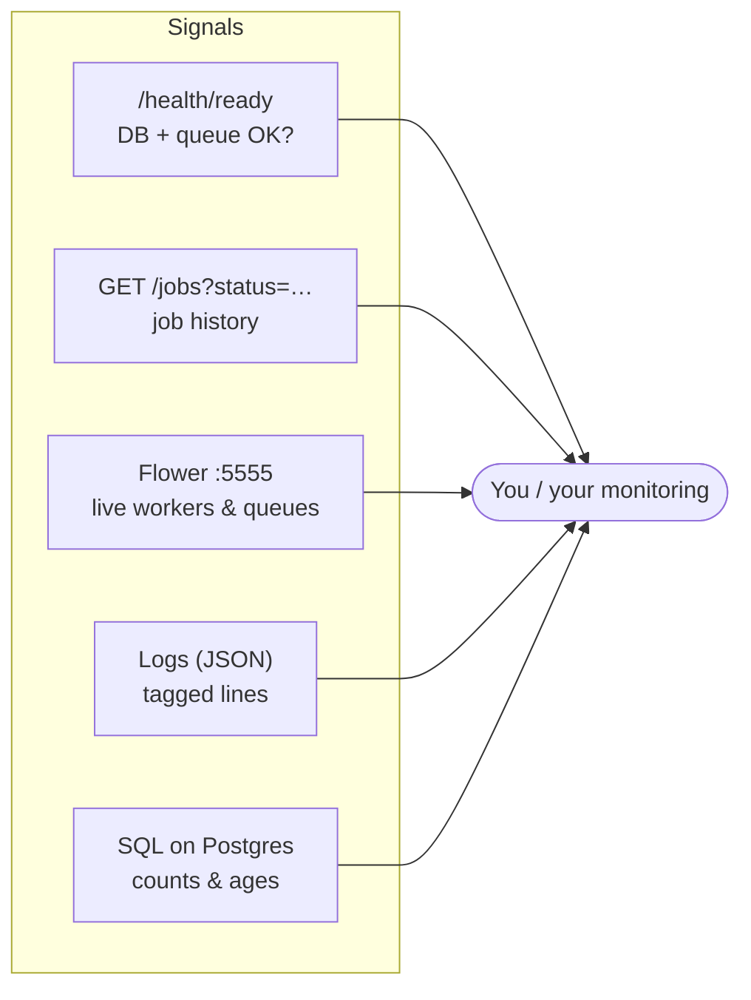
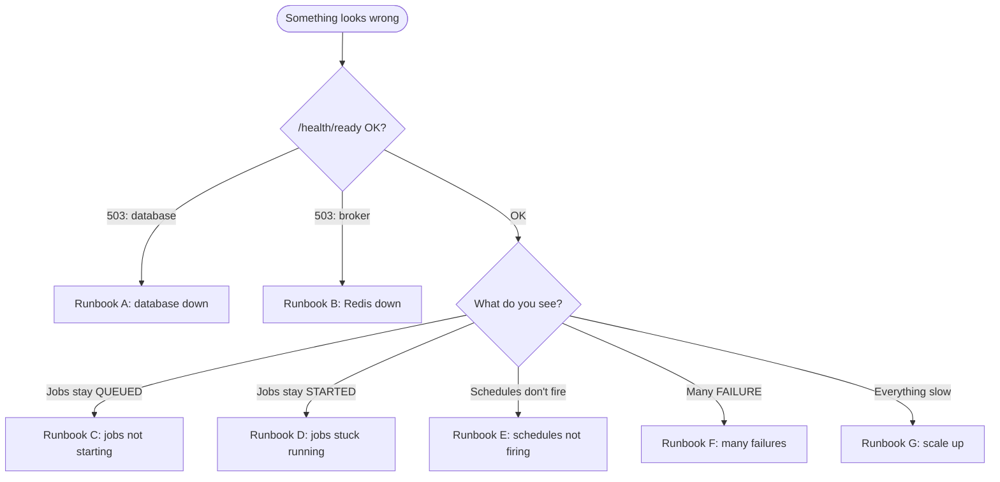
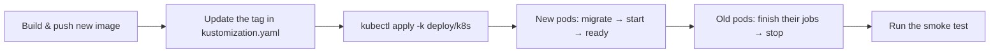

# 10. Operations & runbooks

> **Who this is for:** whoever keeps the system running day to day.

---

## 10.1 How to see what's going on



| Question | How to answer it |
|---|---|
| Is the system up? | `GET /health/ready` → 200 with `"database": "ok", "broker": "ok"`. |
| What's running now? | `GET /jobs?status=STARTED`, or Flower → Tasks. |
| What failed recently? | `GET /jobs?status=FAILURE` — `error` and `traceback` explain why. |
| Are workers alive? | Flower → Workers, or `celery -A app.celery_app inspect ping`. |
| Are schedulers alive? | `system:heartbeat`'s `run_count` keeps rising (`GET /schedules`); the scheduler logs `[SCHEDULE FIRED]`. |
| Is anything stuck? | The SQL queries in [10.4](#104-useful-sql). |

---

## 10.2 Log lines to know

Every important event has a **tag** at the start of the message, so it's easy
to search and alert on.

| Tag | Where | Meaning | Action |
|---|---|---|---|
| `[RECEIVED]` | worker | A worker got a message. | — |
| `[END]` | worker | A job finished (with its final state). | — |
| `[RETRY]` | worker | A job failed and will be retried. | Watch if frequent. |
| `[FAILURE]` | worker | A job failed for good. | Investigate (see the job's `traceback`). |
| `[SCHEDULE FIRED]` | scheduler | A schedule created a job. | — |
| `[DUPLICATE DROPPED]` | worker | A copy of a finished/cancelled job was thrown away. | None — the guard working. |
| `[DUPLICATE DEFERRED]` | worker | A copy arrived while the job was running; will re-check. | None. |
| `[OUTBOX]` | scheduler | A job that never reached the queue is being sent now. | Check Redis health if frequent. |
| `[RECOVER]` | scheduler | A worker died mid-job; the job is being resumed. | Find out why workers die (memory? node loss?). |
| `[ABANDONED]` | scheduler | A job whose worker died was marked FAILURE (time limit, or too many worker losses). | Investigate the task. |
| `[LEASE LOST]` | worker | A worker was cut off from the database longer than its lease; another worker took over. | Check database/network stability. |
| `[DB UNAVAILABLE]` | worker | Couldn't reach the database; message handed back to the queue. | Check Postgres. |

Example (JSON format):
```json
{"time": "2026-11-05T17:16:24.777150+00:00", "level": "INFO", "logger": "app.scheduler",
 "process": "MainProcess", "message": "[SCHEDULE FIRED] schedule_id=1 task=app.tasks.add task_id=37d0…"}
```

---

## 10.3 What to alert on

| Alert | Condition | Severity |
|---|---|---|
| API not ready | `/health/ready` failing on all replicas for 2 min | 🔴 Page |
| No scheduler alive | `system:heartbeat` hasn't run for 5 min | 🔴 Page |
| Queue backing up | Oldest `QUEUED` job older than N minutes (see SQL) | 🟠 Warn |
| Jobs never published | Jobs with `published_at IS NULL` older than 5 min | 🟠 Warn (Redis trouble) |
| Failure rate | `[FAILURE]` lines per minute above your normal | 🟠 Warn |
| Workers dying | Any `[RECOVER]` or `[ABANDONED]` | 🟠 Warn |
| Split-brain sign | Any `[LEASE LOST]` | 🟠 Warn |
| Pods restarting | Kubernetes restart count rising | 🟠 Warn |

---

## 10.4 Useful SQL

Connect with `docker compose exec postgres psql -U jobs -d jobs` (Compose) or your normal Postgres client.

```sql
-- Jobs by status in the last hour
SELECT status, count(*) FROM jobs WHERE submitted_at > now() - interval '1 hour' GROUP BY status;

-- Oldest job still waiting (queue backlog)
SELECT task_id, task_name, now() - submitted_at AS waiting FROM jobs
 WHERE status = 'QUEUED' ORDER BY submitted_at LIMIT 5;

-- Jobs that never reached the queue
SELECT task_id, task_name, submitted_at FROM jobs
 WHERE published_at IS NULL AND submitted_at < now() - interval '5 minutes';

-- Running jobs whose lease has expired (worker probably dead; recovery will handle them)
SELECT task_id, task_name, worker, lease_expires_at FROM jobs
 WHERE status = 'STARTED' AND lease_expires_at < now();

-- Jobs that were resumed after a worker died
SELECT task_id, task_name, attempts, retries FROM jobs WHERE attempts > retries + 1;

-- Proof that no schedule fired twice for one due time (should return nothing)
SELECT schedule_id, date_trunc('second', submitted_at), count(*) FROM jobs
 WHERE schedule_id IS NOT NULL GROUP BY 1, 2 HAVING count(*) > 1;
```

---

## 10.5 Runbooks

Start here when something looks wrong:



### Runbook A — Database down
**Symptoms:** API returns 503; readiness fails; workers log `[DB UNAVAILABLE]`.
**What the system is doing:** waiting safely. No job runs without the database; nothing is lost.
1. Check your Postgres provider's status page / console.
2. If it's a failover, wait — it usually completes in under 2 minutes.
3. Once it's back, check: `/health/ready` is 200 and `[DB UNAVAILABLE]` lines stop.
4. Nothing else to do: waiting jobs run, and finished jobs record their results.
5. If the outage lasted longer than about 2 × `EXECUTION_LEASE_SECONDS`, some running jobs may have been resumed elsewhere — search for `[RECOVER]` / `[LEASE LOST]`.

### Runbook B — Redis down
**Symptoms:** readiness reports `broker` error; new jobs show `published_at: null`.
**What the system is doing:** still accepting jobs (stored in Postgres).
1. Check your Redis provider.
2. When Redis is back, the scheduler sends the waiting jobs (look for `[OUTBOX]` lines).
3. Confirm with the "never reached the queue" SQL — it should drain to zero.

### Runbook C — Jobs stay QUEUED
1. Is a worker running **for that queue**? `long_running_task` needs a `long` worker.
   `kubectl -n job-scheduler get pods` / `docker compose ps`.
2. Is `published_at` set? If not → Runbook B (or no scheduler is running to relay it).
3. Is the queue just long? Check the backlog SQL → Runbook G.

### Runbook D — Jobs stay STARTED
1. Check `lease_expires_at`. If it's in the future, the job is genuinely still running (check the worker logs).
2. If it's in the past, the worker probably died. A scheduler resumes it within about a minute (`[RECOVER]`). If nothing happens, check that a scheduler is running.
3. Recurring? Look for out-of-memory kills (`kubectl describe pod`) and raise memory limits.

### Runbook E — Schedules don't fire
1. Is at least one scheduler running and healthy? (`python -m app.scheduler healthcheck` inside the pod returns 0.)
2. Is the schedule `enabled: true`, and is `next_run_at` in the past?
3. Cron is in **UTC** — is the expected time actually due yet?
4. Scheduler logs mention the schedule? An unknown task disables it (error logged).

### Runbook F — Many failures
1. `GET /jobs?status=FAILURE` → read `error` and `traceback`.
2. If an external service is down, wait and then use `POST /jobs/{id}/retry` (with `Idempotency-Key`) for the ones that matter.
3. `Worker lost …` errors → Runbook D step 3.

### Runbook G — Scale up
- **Compose:** `docker compose -f docker-compose.yml up -d --scale worker=6`
- **Kubernetes:** raise the HPA `maxReplicas`, or `kubectl -n job-scheduler scale deploy/worker --replicas=6`.
- Watch Postgres connections: each process uses up to `DB_POOL_SIZE + DB_MAX_OVERFLOW`.

---

## 10.6 Routine tasks

### Upgrading to a new version

Database changes are only ever **additive** (new tables/columns), so old and new pods can run side by side during the rollout. Read the [CHANGELOG](../CHANGELOG.md) first.

### Rotating an API key (no downtime)
1. Add the new key: `API_KEYS=old-key,new-key` → roll out.
2. Move every client to `new-key`.
3. Remove the old one: `API_KEYS=new-key` → roll out.

### Backups and restore
- **Back up Postgres** (point-in-time recovery). It contains everything that matters.
- **Redis needs no backup**: it only holds messages in transit, and anything lost there is re-sent from Postgres.
- After a restore, start the services normally; the scheduler re-sends any job recorded but not finished.

### Data retention
Finished jobs are deleted after `JOB_RETENTION_DAYS` (30) by the nightly `system:cleanup` (03:00 UTC). Live results expire after `CELERY_RESULT_EXPIRES` (1 day).

### Verifying the guarantees after a change
```bash
# against any running deployment
API_URL=… API_KEY=… python scripts/smoke_test.py
# against a local multi-copy Compose stack (kills containers!)
python scripts/chaos_test.py --project <name> --api http://localhost:8000 --api http://localhost:8001 --key <key>
```

**Next:** [11. Developer guide →](11-developer-guide.md)
