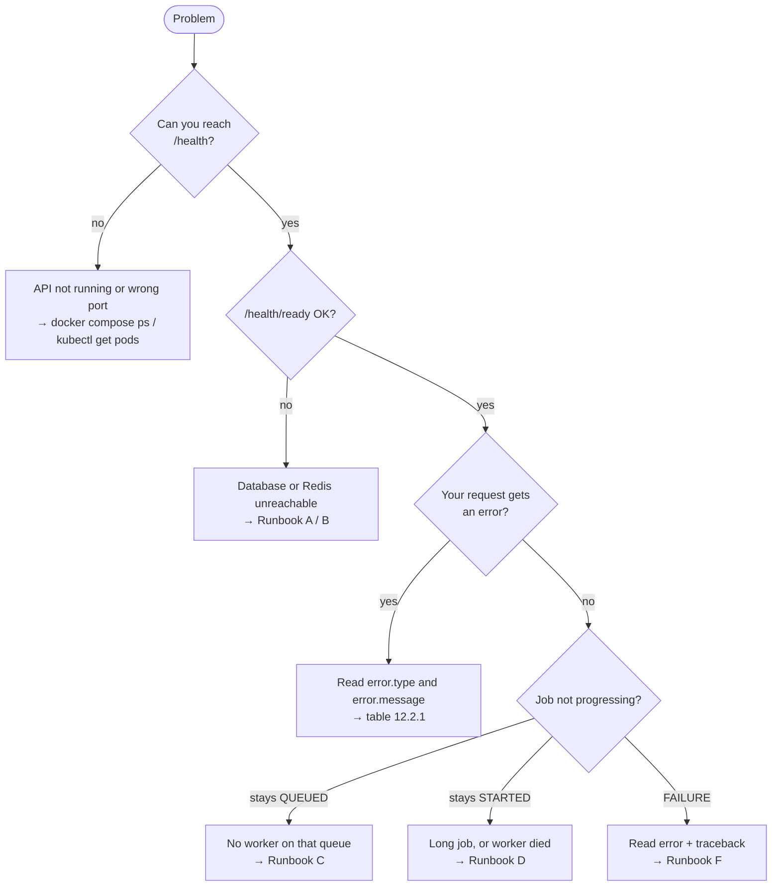

# 12. FAQ & troubleshooting

---

## 12.1 Frequently asked questions

### General

**Does a job ever run twice?**
Only in one case: its worker died *while running it*, and another worker
finished it (you'll see `attempts` one higher than usual). Duplicated
messages, multiple schedulers, client retries and cancellations never cause a
second run. See [chapter 7](07-reliability.md).

**Does the API wait for the job to finish?**
No. It answers immediately with a job ID. Poll `GET /v1/jobs/{id}` (or
`/v1/jobs/{id}/status` for live progress).

**How fast does a job start?**
Usually within a fraction of a second, if a worker is free. Scheduled jobs fire
within about 5–6 seconds of their time.

**How long is history kept?**
Finished jobs: 30 days (`JOB_RETENTION_DAYS`). Live progress records: 1 day.

**Can I run it without Docker?** Yes — see [4.4](04-getting-started.md#44-option-c--python-only-no-docker). It uses SQLite and needs only Redis.

**Can I run it without Postgres?** On a single machine, yes (SQLite). On more than one machine, no — the machines need a shared database.

**Why not Celery Beat?** It must run as exactly one process, which is a single point of failure, and two copies fire everything twice. Our scheduler runs as many copies as you like.

### Jobs

**What's the difference between `retries` and `attempts`?**
`retries` = automatic retries after errors. `attempts` = how many times a
worker started the job. Normally `attempts = retries + 1`.

**What's the difference between `POST /v1/jobs/{id}/retry` and automatic retries?**
Automatic retries happen inside the same job (same ID). `POST …/retry` makes a
**new** job (new ID) with the same inputs, linked by `retry_of`.

**Why does `/v1/jobs/{id}/status` say `"source": "job_record"`?**
The live record expired (after 1 day), so the answer comes from the permanent history instead.

**Can I cancel a job that's already finished?** No — you'll get `409 conflict`. Finished is final.

**Why is `published_at` null?** The job is saved but hasn't reached the queue yet — normally for milliseconds. If it stays null, Redis was unreachable; the scheduler will send it.

### Schedules

**My cron schedule runs at the wrong hour.** Cron is in **UTC** unless the schedule has a `timezone`. Add `"timezone": "Europe/London"` (any IANA name) to have it follow local time and daylight saving.

**My one-off schedule was rejected.** `run_at` must be in the future and include a timezone (`+00:00` or `Z`).

**Why can't I resume a `once` schedule?** It has already fired. Create a new one.

**Why can't I edit `system:cleanup` / `system:heartbeat`?** They're defined in code (`SYSTEM_SCHEDULES`). Change them there.

**The scheduler was down for 3 hours. Will my hourly job run 3 times?** No — once when it's back, then on its normal timing.

### Security

**Where do I get an API key?** Whoever runs the system sets them in `API_KEYS`. For local use, any value you put there.

**Is the dashboard public?** No. Flower needs a password and is bound to localhost (Compose) or internal-only (Kubernetes).

**I get `403 forbidden`.** Your key is valid but lacks the scope for that call (e.g. a `jobs:read` key submitting a job), or may not run that task (`allowed_tasks`). See [15.3](15-security-and-tenancy.md#153-scopes-what-a-key-may-do).

**I get `429 rate_limited`.** Your key's per-minute limit is used up. Wait `Retry-After` seconds; the SDKs do this for you.

**A job I just created returns `404` for a colleague.** Your keys belong to different tenants: each sees only its own jobs.

### Webhooks & workflows

**My webhook never arrives.** Check `GET /v1/jobs/{id}/webhooks`: `last_error` says why (DNS, timeout, HTTP 500, or "not in WEBHOOK_ALLOWED_HOSTS"). Deliveries retry for about a day.

**I received the same webhook twice.** Delivery is at least once. De-duplicate on the `X-JobScheduler-Delivery` header.

**A workflow step is stuck in `WAITING`.** One of its dependencies hasn't succeeded yet. Look at the workflow: if a dependency failed, the step would be `REVOKED`. If all dependencies succeeded, the step is queued within a few seconds by the scheduler, so check a scheduler is running.

**How do I see why a job was slow?** Turn on tracing ([17.4](17-observability.md#174-tracing-opentelemetry)) and look the job up in Jaeger or Tempo: one trace shows the API, the queue wait and the worker.

---

## 12.2 Troubleshooting

### 12.2.1 Error responses

| You get | Meaning | Fix |
|---|---|---|
| `401 unauthorized` | Key missing or wrong | Header must be exactly `X-API-Key: <one of API_KEYS>`. |
| `404 not_found` | Wrong ID or URL | Check the ID; URLs are case-sensitive. |
| `405 method_not_allowed` | Wrong HTTP method | e.g. use `DELETE /v1/jobs/{id}` to cancel. |
| `409 conflict` | Not allowed in the current state | The message says why (finished job, system schedule, reused idempotency key…). |
| `422 validation_error` | Bad input | `error.details` lists every bad field and why. |
| `500 internal_error` | A bug | Check the API logs for the traceback. |
| `503 service_unavailable` | Database down (or, for readiness, Redis) | Wait and retry with the same `Idempotency-Key`. |

### 12.2.2 Start-up problems

| Symptom | Cause | Fix |
|---|---|---|
| `required variable API_KEYS is missing a value` | `.env` incomplete | Set `API_KEYS`, `REDIS_PASSWORD`, `POSTGRES_PASSWORD`, `FLOWER_BASIC_AUTH`. |
| `port is already allocated` | Port 8000/5555 in use | Set `API_PORT` / `FLOWER_PORT` in `.env`. |
| `migrate` container exits with an error | Postgres not reachable or wrong password | Check `POSTGRES_PASSWORD` / `DATABASE_URL`; `docker compose logs migrate`. |
| Worker logs `No module named 'packaging'` | Old image built before the fix | Rebuild: `docker compose build --no-cache`. |
| `redis-cli ping` doesn't answer `PONG` (local run) | Redis not running | `brew services start redis` / `sudo systemctl start redis`. |
| `ModuleNotFoundError: app` | Running from the wrong folder | Run commands from the project root. |
| Kubernetes pods stuck in `Init` | The migrate init container can't reach Postgres | `kubectl -n job-scheduler logs <pod> -c migrate`; check the Secret. |

### 12.2.3 Getting more detail
- Set `LOG_LEVEL=DEBUG` to also log task inputs.
- `GET /v1/jobs/{id}` → `traceback` shows exactly where a task failed.
- Flower (`:5555`) shows what each worker is doing right now.
- The SQL queries in [10.4](10-operations.md#104-useful-sql) show stuck or unusual jobs.

---

Still stuck? Collect: the request you sent, the full response, the job ID,
and the relevant log lines (search for the job ID), and share them with the
team.

**Back to the [documentation index](README.md).**
