# 13. Diagram gallery

All the project's key diagrams in one place. Each links back to the chapter
that explains it. (Diagrams are written in [Mermaid](https://mermaid.js.org/)
and render automatically on GitHub, GitLab and in VS Code's Markdown preview.)

| # | Diagram | Type |
|---|---|---|
| 1 | [System context](#1-system-context) | Who uses the system and what it depends on |
| 2 | [Components](#2-components) | The parts and how they connect |
| 3 | [Network & ports](#3-network--ports) | Who talks to whom, on which port |
| 4 | [Job status lifecycle](#4-job-status-lifecycle) | State diagram |
| 5 | [Submitting and running a job](#5-submitting-and-running-a-job) | Sequence |
| 6 | [Firing a schedule with many schedulers](#6-firing-a-schedule-with-many-schedulers) | Sequence |
| 7 | [Scheduler loop](#7-scheduler-loop) | Flowchart |
| 8 | [Execution guard decision](#8-execution-guard-decision) | Flowchart |
| 9 | [Outbox](#9-outbox) | Sequence |
| 10 | [Crash recovery](#10-crash-recovery) | Sequence |
| 11 | [Fencing an outdated worker](#11-fencing-an-outdated-worker) | Sequence |
| 12 | [Idempotency key](#12-idempotency-key) | Flowchart |
| 13 | [Database tables](#13-database-tables) | Entity-relationship |
| 14 | [Schedule lifecycle](#14-schedule-lifecycle) | State diagram |
| 15 | [Kubernetes deployment](#15-kubernetes-deployment) | Deployment |
| 16 | [High availability across zones](#16-high-availability-across-zones) | Deployment |
| 17 | [Incident triage](#17-incident-triage) | Decision tree |

---

## 1. System context
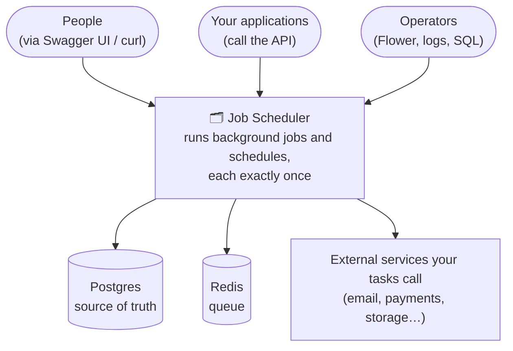
*Explained in [chapter 1](01-what-is-this.md).*

## 2. Components
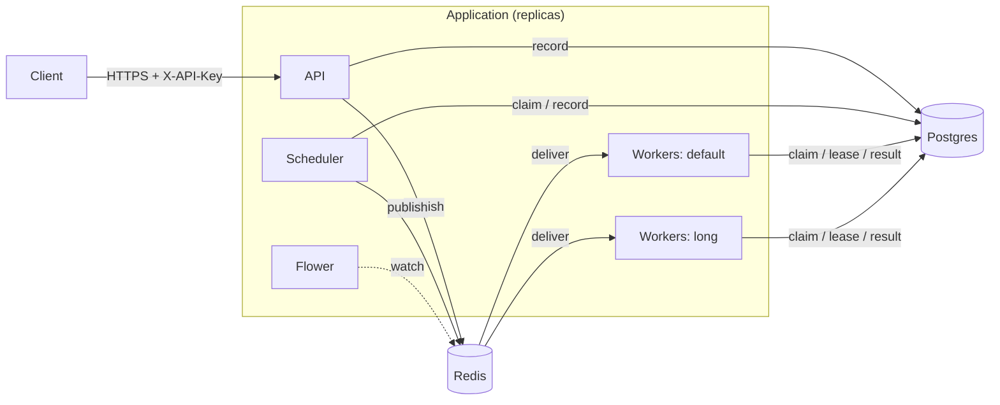
*Explained in [chapter 3.1](03-architecture.md#31-the-big-picture).*

## 3. Network & ports
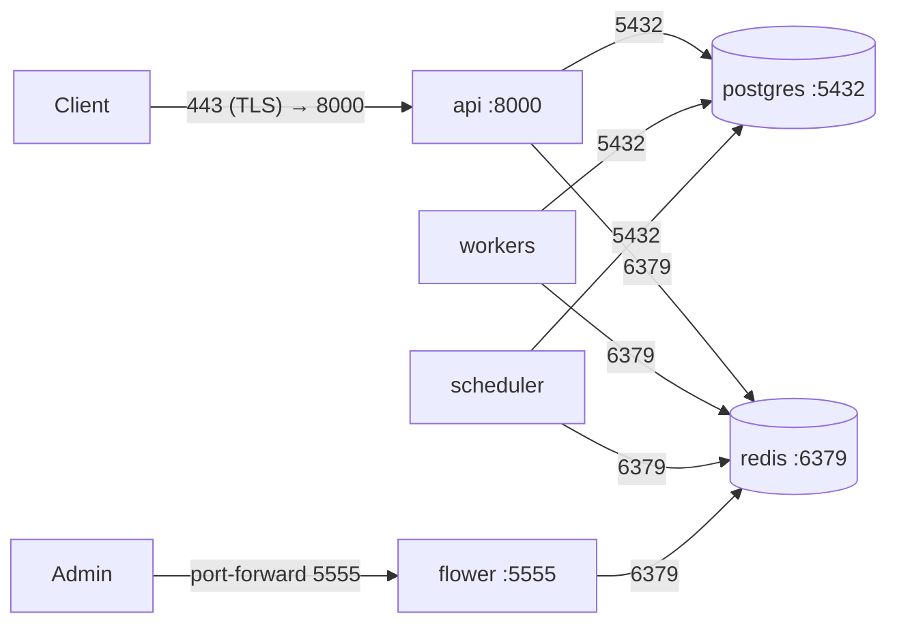
Only the API accepts traffic from outside. Workers and schedulers make outgoing connections only.

## 4. Job status lifecycle
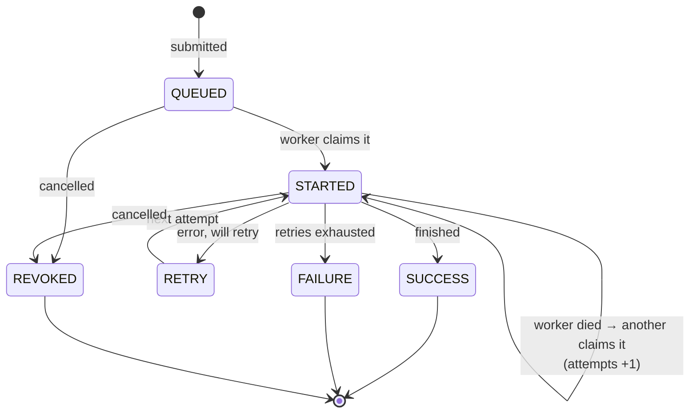
*Explained in [chapter 2.2](02-key-concepts.md#22-the-life-of-a-job-statuses).*

## 5. Submitting and running a job
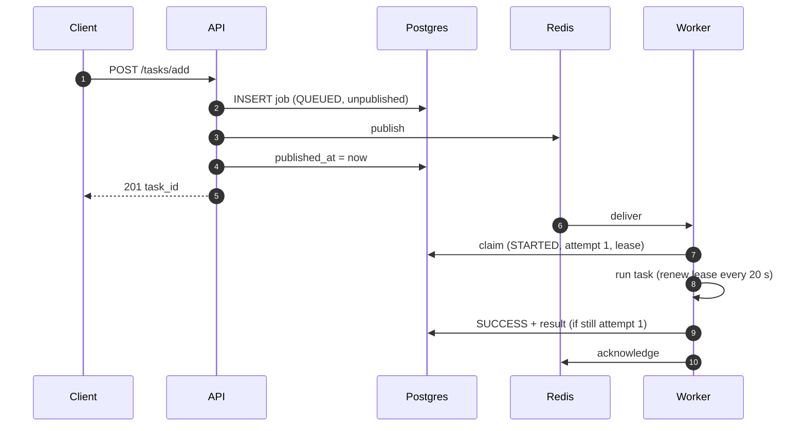
*Explained in [chapter 3.3](03-architecture.md#33-life-of-a-job-step-by-step).*

## 6. Firing a schedule with many schedulers
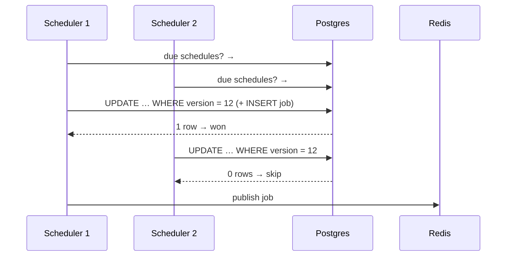
*Explained in [chapter 3.4](03-architecture.md#34-life-of-a-scheduled-run).*

## 7. Scheduler loop
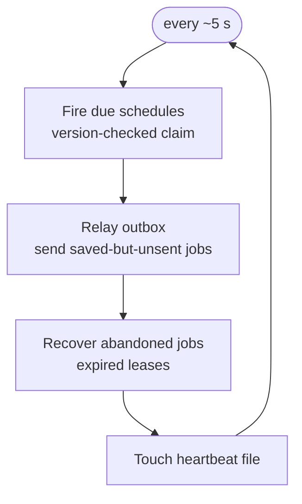
*Explained in [chapter 6.6](06-scheduling.md#66-how-schedules-actually-fire).*

## 8. Execution guard decision
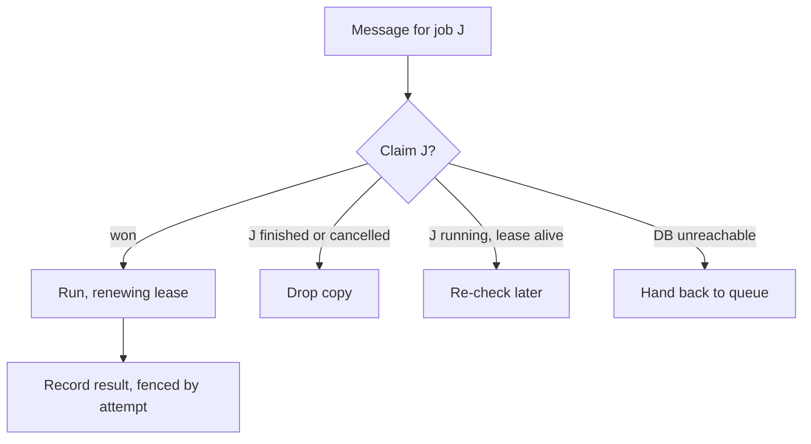
*Explained in [chapter 7.7](07-reliability.md#77-the-execution-guard--one-worker-runs-each-job).*

## 9. Outbox
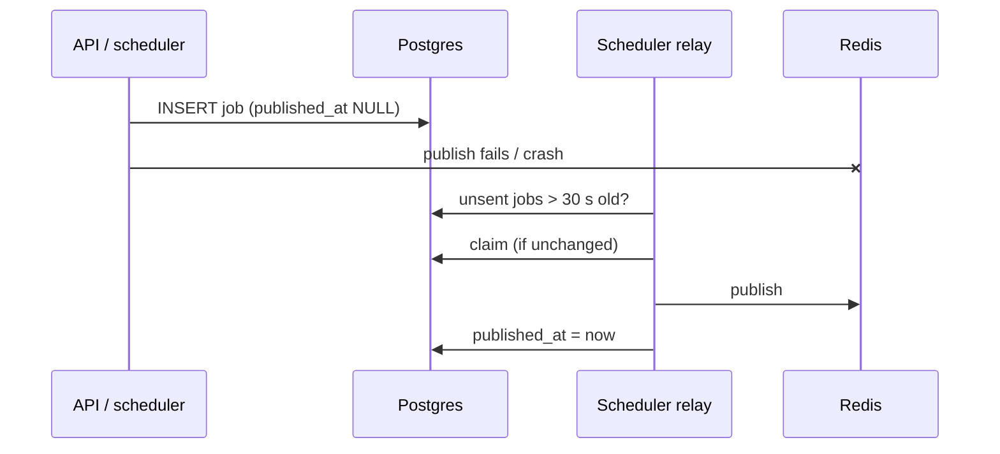
*Explained in [chapter 7.5](07-reliability.md#75-the-outbox--no-lost-jobs-between-saved-and-sent).*

## 10. Crash recovery
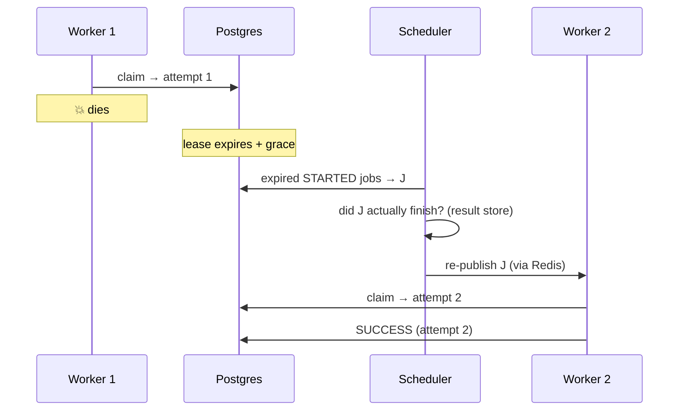
*Explained in [chapter 7.8](07-reliability.md#78-lease-based-recovery--finishing-jobs-whose-worker-died).*

## 11. Fencing an outdated worker
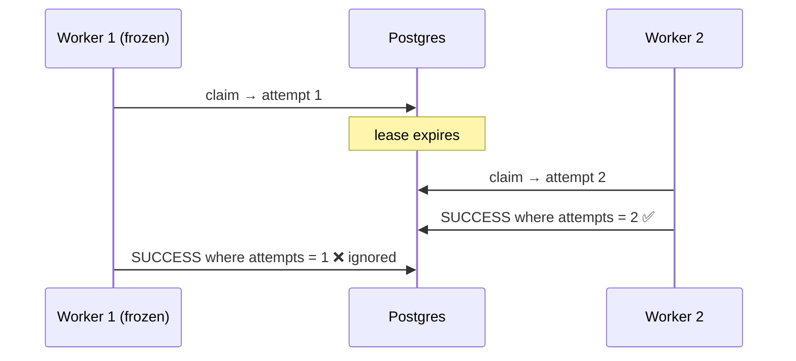
*Explained in [chapter 7.7](07-reliability.md#the-fencing-token).*

## 12. Idempotency key
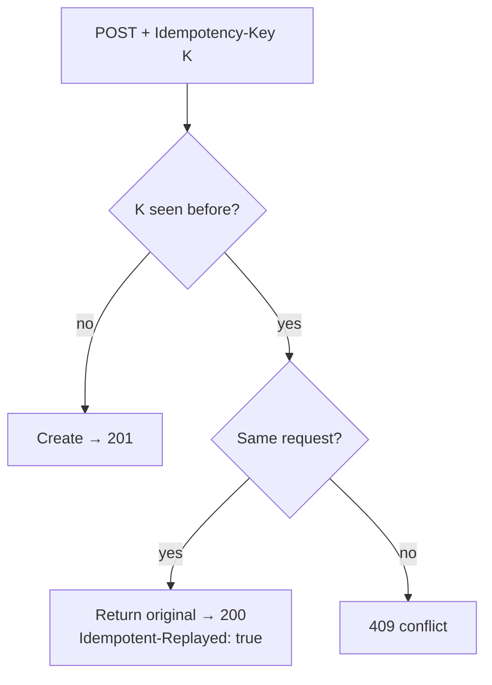
*Explained in [chapter 5.6](05-using-the-api.md#56-safe-retries-with-idempotency-key).*

## 13. Database tables
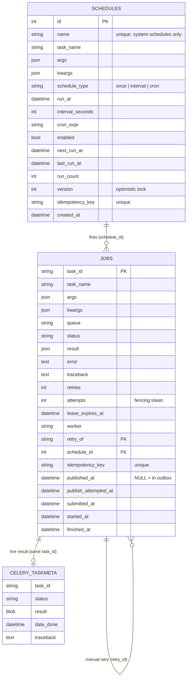
*Explained in [chapter 3.5](03-architecture.md#35-where-data-lives).*

## 14. Schedule lifecycle
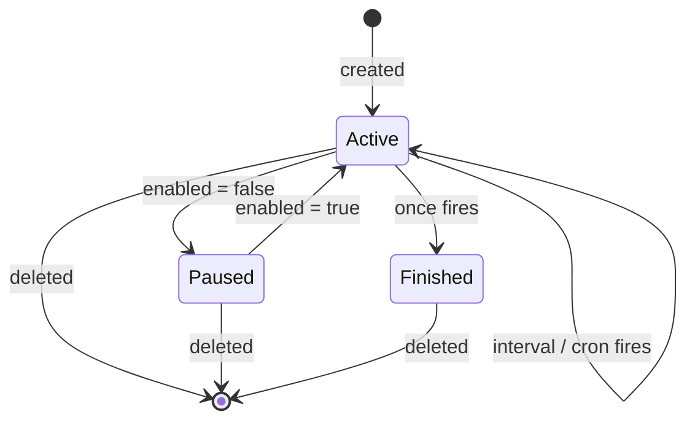
*Explained in [chapter 6.4](06-scheduling.md#64-managing-schedules).*

## 15. Kubernetes deployment
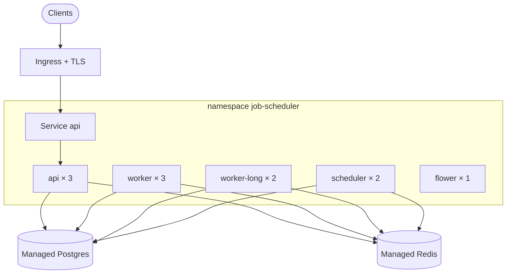
*Explained in [chapter 9.2](09-deployment.md#92-kubernetes).*

## 16. High availability across zones
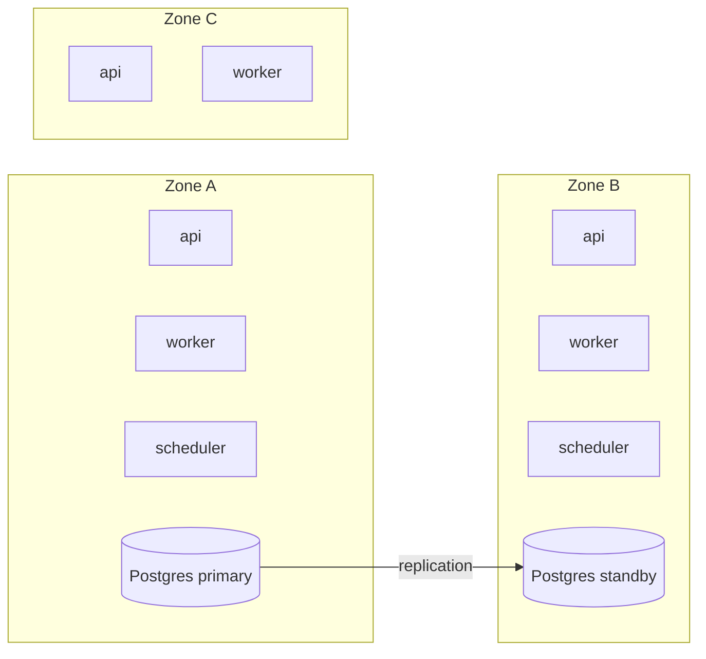
*Explained in [chapter 9.3](09-deployment.md#93-high-availability-the-full-picture).*

## 17. Incident triage
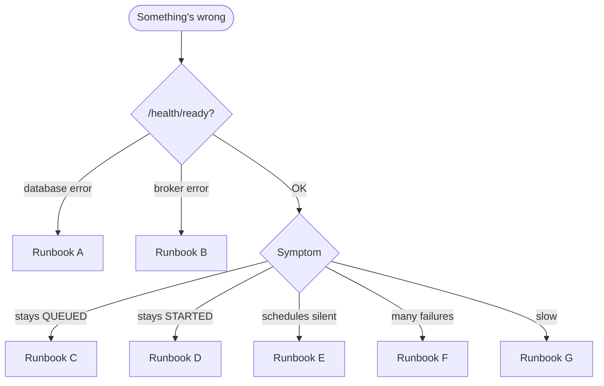
*Explained in [chapter 10.5](10-operations.md#105-runbooks).*
