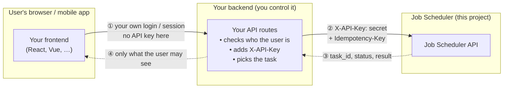
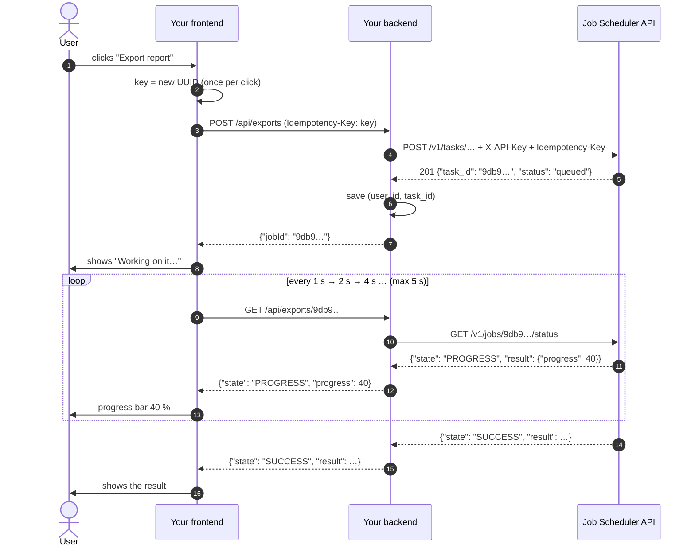
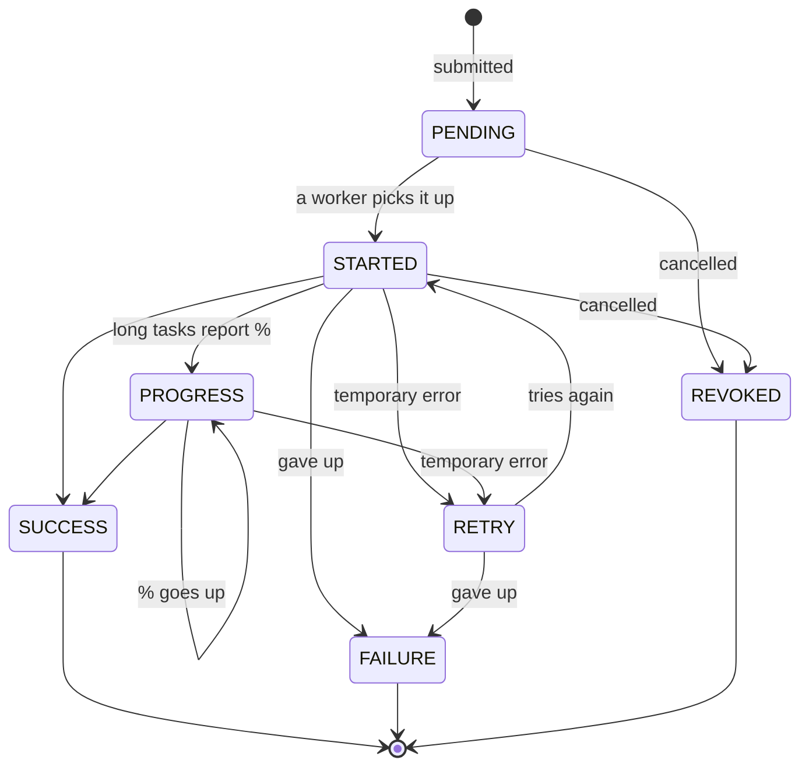
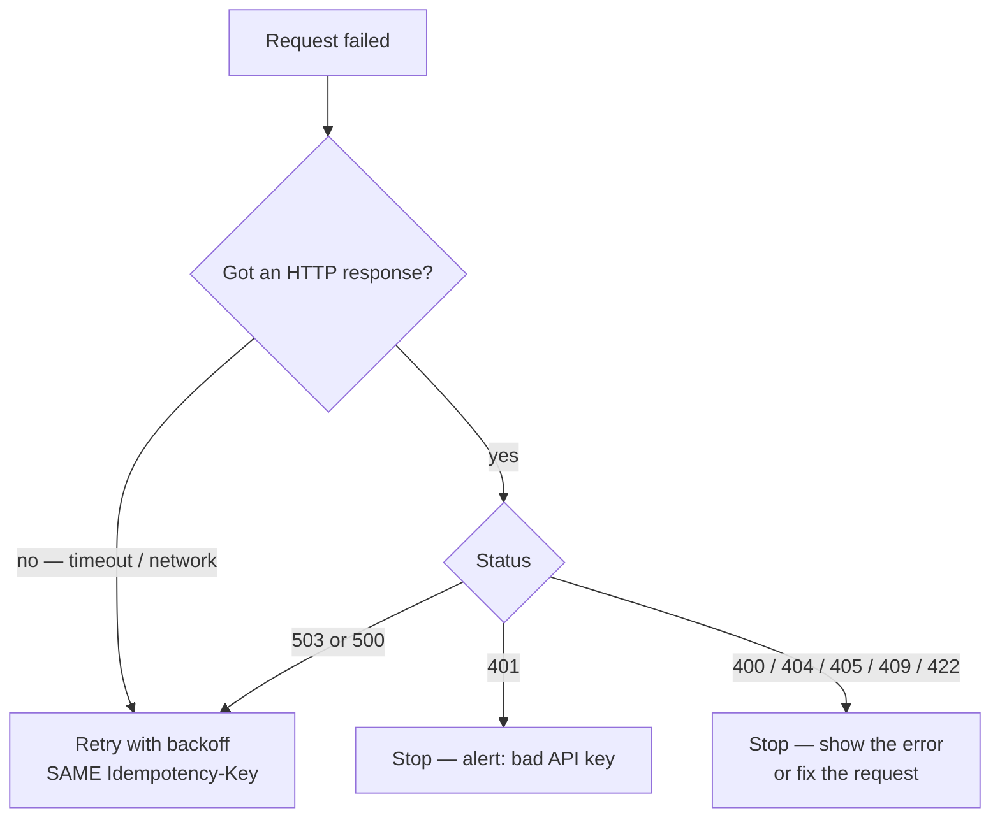
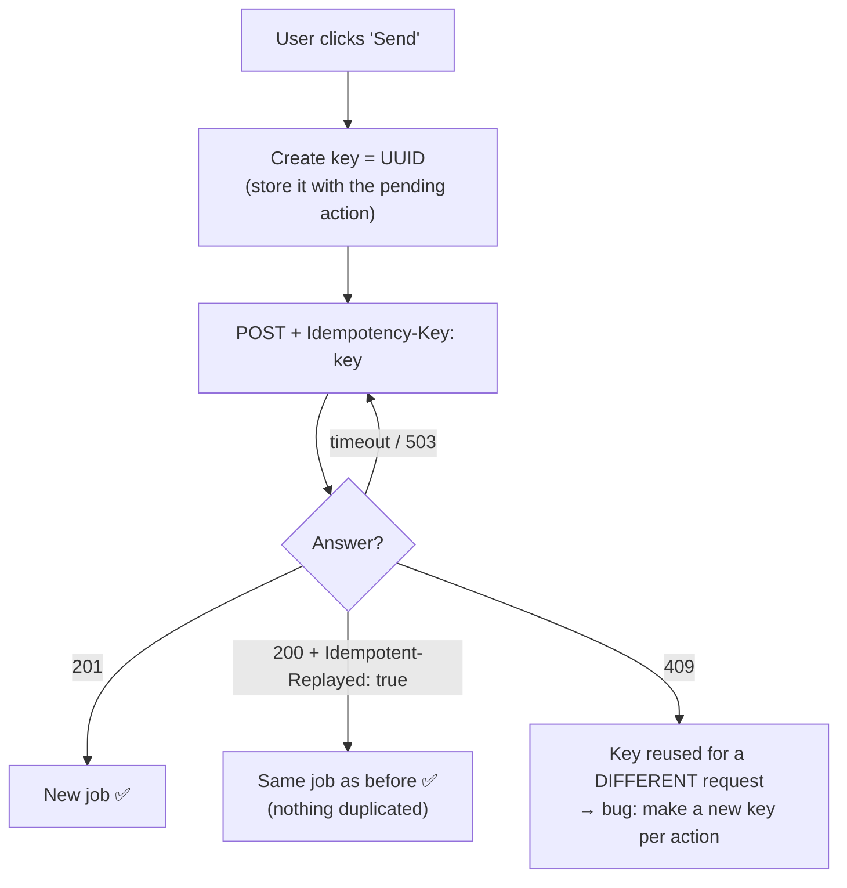
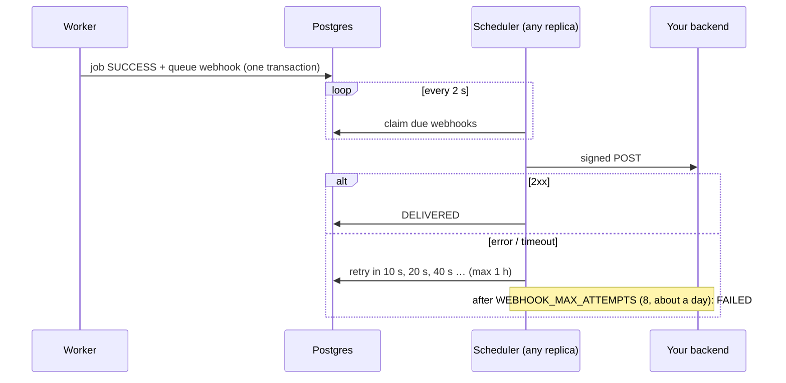

# 14. Integration guide — using the API from your app

> **Who this is for:** any developer whose code calls this service, whether it's a
> backend (Node, Python, Java, Go…) or a frontend (React, Vue, Angular, mobile).
> **You need:** basic HTTP and JSON knowledge. Nothing about Celery or Redis.
> **Time to read:** 20 minutes. Copy-paste code is included for every step.

[Chapter 5](05-using-the-api.md) lists every endpoint. This chapter is about
**how to build a feature on top of them**: where to call from, how to wait for
a result, how to show progress and errors, and how to make retries safe.

---

## 14.1 The one-minute version

1. **Call the API from a server, never straight from the browser.** The API key
   is a secret, and the API does not allow cross-origin (CORS) browser calls.
   Your frontend calls *your* backend; your backend calls this service.
2. **Submitting returns immediately** with a `task_id`. The work has *not* run yet.
3. **Find out when it's done** in one of three ways: get a **webhook** (pass a
   `callback_url`, [14.15](#1415-webhooks-get-told-when-a-job-finishes)),
   **stream** state changes (`GET /v1/jobs/{task_id}/events`), or **poll**
   `GET /v1/jobs/{task_id}/status` until the state is `SUCCESS`, `FAILURE`
   or `REVOKED`, waiting a little longer between each check.
4. **Send an `Idempotency-Key` header** on every POST (one new key per user
   action). Then retrying after a timeout, or a double-click, never creates a
   second job.
5. **Every error has the same JSON shape.** Branch on `error.type`, never on the
   message text.
6. **Use the SDK** if you can: [`sdk/python`](../sdk/python/README.md) or
   [`sdk/typescript`](../sdk/typescript/README.md) do all of the above for you.

---

## 14.2 Where to call it from



This pattern is often called a **backend-for-frontend (BFF)**. It's needed for
three reasons:

| Reason | What would go wrong calling directly from the browser |
|---|---|
| **The API key is a secret** | Anything in frontend code can be read by every visitor (browser dev tools). Anyone could then submit jobs, cancel them, or read other people's results. |
| **No CORS** | The API doesn't send CORS headers, so browsers block cross-origin calls. (A preflight `OPTIONS` request gets `405`.) This is deliberate: the API is meant for servers. |
| **Users ≠ API clients** | The API knows about API keys, not *your* users. Your backend must check that user A only sees and cancels user A's jobs. |

> 💡 **Store which job belongs to which user** in your own database
> (`user_id → task_id`) when you submit. Check it in your backend before
> returning a job's status or allowing a cancel.

Server-to-server callers (cron scripts, other microservices, data pipelines)
simply call the API directly with their key.

---

## 14.3 The basics

| Thing | Value |
|---|---|
| **Base URL** | Whatever your team deployed, e.g. `https://jobs.internal.example.com`. Locally: `http://localhost:8000`. |
| **Auth** | Header `X-API-Key: <key>` on every request except `/health` and `/health/ready`. Get a key from whoever runs the service. |
| **Body format** | JSON. Send `Content-Type: application/json`. |
| **Times** | Always **UTC**, ISO-8601, e.g. `2026-11-06T09:08:51.153508Z`. `new Date(value)` in JavaScript and `datetime.fromisoformat(value)` in Python both parse it. Convert to the user's time zone only when *displaying*. |
| **IDs** | Jobs use a `task_id` (a UUID string). Schedules use a numeric `id`. |
| **Interactive docs** | `GET /docs` (Swagger UI: try every call in the browser) and `/redoc`. |
| **Machine-readable spec** | `GET /openapi.json`. Use it to generate a typed client (see [14.10](#1410-generate-a-typed-client-from-openapijson)). |

### What can I submit?

| Endpoint | Body | What the task does |
|---|---|---|
| `POST /v1/tasks/add` | `{"x": 3, "y": 4}` | Adds two numbers. Result: `7.0`. |
| `POST /v1/tasks/long` | `{"duration_seconds": 30}` (1–120) | Slow job that reports **progress 0–100 %**. |
| `POST /v1/tasks/flaky` | `{"fail_probability": 0.7}` (0–1) | Fails randomly and retries itself. |
| `POST /v1/tasks/notify` | `{"email": "a@b.com", "message": "Hi"}` | Simulated email (fails 30 % of the time, retries). |

These are the **example tasks** that ship with the project. Your team adds real
ones (send invoice, export report…); see
[11.5 Adding a new task](11-developer-guide.md#115-adding-a-new-task).

**Any public task, with options: `POST /v1/jobs`.** One endpoint for every task,
no new route needed per task:

```json
POST /v1/jobs
{
  "task_name": "app.tasks.send_notification",
  "args": ["ana@example.com", "Your report is ready"],
  "priority": "high",                       // high | normal (default) | low
  "delay_seconds": 600,                     // or "run_at": "2026-12-01T09:00:00Z"
  "timeout_seconds": 60,                    // stop it after 60 s
  "max_retries": 5,                         // override the task's retry limit
  "callback_url": "https://api.example.com/hooks/job-finished"
}
```

Everything in this chapter works the same for any task and either endpoint.

---

## 14.4 The core flow: submit → wait → show the result



### Step 1 — submit

```bash
curl -X POST "$API/v1/tasks/add" \
  -H "X-API-Key: $KEY" -H "Content-Type: application/json" \
  -H "Idempotency-Key: 6f1c2a9e-4b7d-4a1e-9d3f-0c2b8e5a7f10" \
  -d '{"x": 3, "y": 4}'
```
```json
201 Created
{"task_id": "9db9ab82-9f7a-4eab-9ece-a27afd99fae3", "status": "queued"}
```

`201` = a new job was created. `200` with the header
`Idempotent-Replayed: true` = you already sent this request (same key), and
you're getting the **original** job back. Treat both as success.

### Step 2 — check on it

There are two read endpoints. Use the first one for screens:

| Endpoint | Use it for | Notes |
|---|---|---|
| `GET /v1/jobs/{task_id}/status` | **Live UI**: spinners, progress bars | Includes `PROGRESS` updates. `state` is one of the values in the table below. |
| `GET /v1/jobs/{task_id}` | **Details & history**: audit pages, support tools | The permanent record: `status`, timestamps, `attempts`, `worker`, `retry_of`, `schedule_id`. No progress. |

```json
GET /v1/jobs/9db9…/status   →   200
{
  "task_id": "9db9ab82-9f7a-4eab-9ece-a27afd99fae3",
  "state": "SUCCESS",
  "source": "result_backend",
  "result": 7.0,
  "error": null,
  "traceback": null,
  "name": "app.tasks.add",
  "args": [3.0, 4.0], "kwargs": {},
  "retries": 0,
  "worker": "celery@worker-7d9f…",
  "queue": "default",
  "date_done": "2026-11-06T09:08:51.412000Z",
  "children": null
}
```

### Step 3 — turn the state into UI



| `state` | Finished? | What to show the user | Extra fields |
|---|---|---|---|
| `PENDING` | no | "Waiting to start…" (spinner) | — |
| `STARTED` | no | "Working…" (spinner) | — |
| `PROGRESS` | no | Progress bar | `result.progress` = 0–100 |
| `RETRY` | no | "Working… (retrying)". **Not an error yet**; it may still succeed. | — |
| `SUCCESS` | **yes** | The result | `result` = what the task returned |
| `FAILURE` | **yes** | A friendly error + "Try again" button | `error` = short reason (log it; don't show raw text to end users) |
| `REVOKED` | **yes** | "Cancelled" | — |

> ⚠️ `GET /v1/jobs/{task_id}` (the history record) says `QUEUED` where the
> status endpoint says `PENDING`. They mean the same thing. It never says
> `PROGRESS`.

### Polling: how often, and for how long?

- **Start fast, slow down:** wait 0.5 s, then 1 s, 2 s, 4 s, then every 5 s.
  Quick jobs feel instant; slow jobs don't flood the API.
- **Stop as soon as the state is `SUCCESS`, `FAILURE` or `REVOKED`.**
- **Give up on waiting after a sensible time** (e.g. 10 minutes) and show
  "Still running — we'll notify you", but **don't cancel the job**. It keeps
  running, and the user can come back later (keep the `task_id`).
- **Stop polling when the user leaves the page** (unmount / abort).
- **A network error or `503` while polling is not a job failure.** Keep polling.

> **Don't want to poll?** Two push options (5.0+):
> - **Webhooks** — the service calls *your* backend when the job finishes
>   ([14.15](#1415-webhooks-get-told-when-a-job-finishes)). Best for jobs that
>   take minutes or hours.
> - **Event stream** — `GET /v1/jobs/{task_id}/events` is a
>   [server-sent events](https://developer.mozilla.org/docs/Web/API/Server-sent_events)
>   stream: one `status` event per change (same JSON as `/status`), closed after
>   the final state. Your backend can relay it to the browser as-is
>   ([14.16](#1416-live-updates-with-the-event-stream)).

---

## 14.5 Errors — one shape for everything

Every non-2xx response looks like this:

```json
{
  "error": {
    "status_code": 422,
    "type": "validation_error",
    "message": "Request validation failed; see 'details' for each field error.",
    "details": [
      {"type": "missing", "loc": ["body", "y"], "msg": "Field required", "input": {"x": 3}}
    ]
  }
}
```

**Branch on `error.type`.** The `message` is for humans and may change.

| HTTP | `error.type` | What it means | What your code should do |
|---|---|---|---|
| 400 | `bad_request` | Not valid right now (e.g. `cron_expr` on an interval schedule) | Bug in your request: fix the code. |
| 401 | `unauthorized` | Missing / wrong `X-API-Key` | Configuration problem. Alert; don't retry. |
| 404 | `not_found` | Unknown `task_id` / schedule `id`, or wrong URL | Show "not found". Old jobs are deleted after **30 days**. |
| 405 | `method_not_allowed` | Wrong HTTP method | Bug: fix the code. |
| 409 | `conflict` | Not allowed in the current state: cancelling a finished job, retrying a job that didn't fail, reusing an `Idempotency-Key` for a different request | Usually show the message; for idempotency, see [14.6](#146-safe-retries-and-double-clicks-idempotency-key). |
| 422 | `validation_error` | The body or query failed validation | Show field errors (below). Don't retry unchanged. |
| 503 | `service_unavailable` | Database or queue temporarily down | **Retry with backoff** (with the same `Idempotency-Key`). |
| 500 | `internal_error` | Unexpected server error | Retry a few times, then report. |

### Showing validation errors next to form fields

`details[].loc` is the path to the bad field: `["body", "email"]` means the
`email` field of the body. Map it to your form:

```ts
// err.details from a 422 → { email: "value is not a valid email address…" }
function fieldErrors(details: Array<{ loc: (string | number)[]; msg: string }>) {
  const out: Record<string, string> = {};
  for (const d of details ?? []) {
    const field = d.loc.filter((p) => p !== "body" && p !== "query").join(".");
    out[field || "_form"] = d.msg;
  }
  return out;
}
```

Schedule rules that cover several fields (wrong timing field, `run_at` in the
past, invalid cron) come back with `loc: ["body"]`, so show them at the top of
the form (`_form` above).

### Retry or not?



---

## 14.6 Safe retries and double-clicks: `Idempotency-Key`

Networks fail at the worst moment: your request reached the API and the job
was created, but the answer got lost. If you simply retry, you'd create a
**second** job (two emails, two charges). The `Idempotency-Key` header
prevents that.



**Rules**

1. **One key per user action**, not per HTTP attempt. Create it when the user
   clicks; reuse it for every retry of *that* click.
2. **Disable the button** while the request is in flight too. The key covers
   what slips through (two tabs, flaky mobile networks).
3. Use a **UUID** (`crypto.randomUUID()`, `uuid.uuid4()`), max 255 characters.
4. Same key + **same** task and inputs → the original job (`200`).
   Same key + **different** inputs → `409 conflict`.
5. Works on `POST /v1/tasks/*`, `POST /v1/jobs/{task_id}/retry` and `POST /v1/schedules`.
   Especially important for schedules: a duplicate schedule would fire every
   job twice, forever.
6. If the frontend sends the key to your backend, **forward it**, ideally
   prefixed with the user id (`user42:6f1c…`) so two users can never collide.

---

## 14.7 Backend code (server-side TypeScript / Node 18+)

> **Shortcut:** the ready-made SDK in [`sdk/typescript`](../sdk/typescript/README.md)
> does everything below (and more: workflows, schedules, the event stream,
> webhook verification), with types generated from the API:
> ```ts
> import { JobScheduler } from "@jobscheduler/client";
> const js = new JobScheduler({ baseUrl: process.env.JOB_SCHEDULER_URL, apiKey: process.env.JOB_SCHEDULER_API_KEY });
> const { taskId } = await js.submit("app.tasks.add", { args: [3, 4] });
> const final = await js.wait(taskId);
> ```
> The hand-written version below shows what it does, if you'd rather not add a dependency.

A small, dependency-free client. It uses only `fetch`, which is built into
Node 18+, Deno and Bun. Put it in your backend, e.g. `src/jobScheduler.ts`.

```ts
// src/jobScheduler.ts: server-side only. Never import this into browser code.
const BASE_URL = process.env.JOB_SCHEDULER_URL ?? "http://localhost:8000";
const API_KEY = process.env.JOB_SCHEDULER_API_KEY ?? "";

export type JobState =
  | "PENDING" | "STARTED" | "PROGRESS" | "RETRY"
  | "SUCCESS" | "FAILURE" | "REVOKED";

export const FINISHED: ReadonlySet<JobState> = new Set(["SUCCESS", "FAILURE", "REVOKED"]);

export interface JobStatus {
  task_id: string;
  state: JobState;
  source: "result_backend" | "job_record";
  result: unknown;            // SUCCESS: return value · PROGRESS: { progress: 0-100 }
  error: string | null;       // FAILURE: short reason
  name: string | null;
  date_done: string | null;   // ISO-8601 UTC
}

export interface Submitted {
  taskId: string;
  replayed: boolean;          // true = this key was already used; same job returned
}

/** Error from the API, in its standard envelope. Branch on `type`. */
export class JobSchedulerError extends Error {
  constructor(
    public status: number,
    public type: string,
    message: string,
    public details: unknown = null,
  ) {
    super(message);
    this.name = "JobSchedulerError";
  }
  /** True for problems that may go away if you try again later. */
  get retryable(): boolean {
    return this.status === 0 || this.status >= 500; // network error, 500, 503
  }
}

const sleep = (ms: number) => new Promise((resolve) => setTimeout(resolve, ms));

async function call<T>(method: string, path: string, init: { body?: unknown; idempotencyKey?: string } = {}) {
  const headers: Record<string, string> = { "X-API-Key": API_KEY };
  if (init.body !== undefined) headers["Content-Type"] = "application/json";
  if (init.idempotencyKey) headers["Idempotency-Key"] = init.idempotencyKey;

  let res: Response;
  try {
    res = await fetch(BASE_URL + path, {
      method,
      headers,
      body: init.body === undefined ? undefined : JSON.stringify(init.body),
      signal: AbortSignal.timeout(10_000), // never hang forever
    });
  } catch (cause) {
    throw new JobSchedulerError(0, "network_error", `Job Scheduler unreachable: ${String(cause)}`);
  }

  const data: any = await res.json().catch(() => null);
  if (!res.ok) {
    const e = data?.error ?? {};
    throw new JobSchedulerError(res.status, e.type ?? "http_error", e.message ?? res.statusText, e.details ?? null);
  }
  return { data: data as T, headers: res.headers };
}

/**
 * Queue a task. Safe to call again with the same `idempotencyKey`
 * (timeouts, 503s): you get the original job back, never a duplicate.
 */
export async function submit(path: string, body: unknown, idempotencyKey: string, attempts = 4): Promise<Submitted> {
  for (let attempt = 1; ; attempt++) {
    try {
      const { data, headers } = await call<{ task_id: string }>("POST", path, { body, idempotencyKey });
      return { taskId: data.task_id, replayed: headers.get("Idempotent-Replayed") === "true" };
    } catch (err) {
      if (!(err instanceof JobSchedulerError) || !err.retryable || attempt >= attempts) throw err;
      await sleep(500 * 2 ** (attempt - 1)); // 0.5 s, 1 s, 2 s…
    }
  }
}

export async function getStatus(taskId: string): Promise<JobStatus> {
  return (await call<JobStatus>("GET", `/v1/jobs/${encodeURIComponent(taskId)}/status`)).data;
}

export async function cancel(taskId: string): Promise<void> {
  await call("DELETE", `/v1/jobs/${encodeURIComponent(taskId)}`);
}

/**
 * Poll until the job finishes (or `timeoutMs` passes). Temporary errors while
 * polling are ignored: they say nothing about the job itself.
 */
export async function waitForJob(
  taskId: string,
  { timeoutMs = 10 * 60_000, onUpdate }: { timeoutMs?: number; onUpdate?: (s: JobStatus) => void } = {},
): Promise<JobStatus> {
  const deadline = Date.now() + timeoutMs;
  let delay = 500;
  while (true) {
    try {
      const status = await getStatus(taskId);
      onUpdate?.(status);
      if (FINISHED.has(status.state)) return status;
    } catch (err) {
      if (!(err instanceof JobSchedulerError) || !err.retryable) throw err;
    }
    if (Date.now() + delay > deadline) throw new Error(`Job ${taskId} still running after ${timeoutMs} ms`);
    await sleep(delay);
    delay = Math.min(delay * 2, 5_000);
  }
}
```

### Using it

```ts
import { randomUUID } from "node:crypto";
import { submit, waitForJob } from "./jobScheduler";

const { taskId } = await submit("/v1/tasks/add", { x: 3, y: 4 }, randomUUID());
const final = await waitForJob(taskId, { onUpdate: (s) => console.log(s.state) });
console.log(final.state, final.result); // SUCCESS 7
```

### Backend routes for your frontend (Express example)

The same idea works in Next.js route handlers, NestJS, Fastify, Django,
Spring… Your backend checks the user, calls the scheduler, and returns only
what the user needs.

```ts
// src/routes/exports.ts
import express from "express";
import { randomUUID } from "node:crypto";
import { submit, getStatus, cancel, JobSchedulerError } from "../jobScheduler";
import { jobsRepo } from "../db"; // YOUR table: (user_id, task_id, created_at)

export const router = express.Router();

// Start a job. The browser sends its own Idempotency-Key per click.
router.post("/api/exports", async (req, res, next) => {
  try {
    const userId = req.user.id; // from your auth middleware
    const clientKey = req.get("Idempotency-Key") ?? randomUUID();
    const { taskId } = await submit(
      "/v1/tasks/long",
      { duration_seconds: 10 },
      `user${userId}:${clientKey}`, // namespaced so users can't collide
    );
    await jobsRepo.saveIfMissing(userId, taskId); // replay → same taskId → no duplicate row
    res.status(202).json({ jobId: taskId });
  } catch (err) {
    next(err);
  }
});

// Status for the UI: only the caller's own jobs, only safe fields.
router.get("/api/exports/:jobId", async (req, res, next) => {
  try {
    if (!(await jobsRepo.belongsTo(req.user.id, req.params.jobId))) return res.sendStatus(404);
    const s = await getStatus(req.params.jobId);
    res.json({
      state: s.state,
      progress: s.state === "PROGRESS" ? (s.result as { progress: number }).progress : null,
      result: s.state === "SUCCESS" ? s.result : null,
      failed: s.state === "FAILURE", // don't forward raw error text / tracebacks to users
    });
  } catch (err) {
    next(err);
  }
});

router.delete("/api/exports/:jobId", async (req, res, next) => {
  try {
    if (!(await jobsRepo.belongsTo(req.user.id, req.params.jobId))) return res.sendStatus(404);
    await cancel(req.params.jobId);
    res.sendStatus(204);
  } catch (err) {
    if (err instanceof JobSchedulerError && err.type === "conflict") return res.sendStatus(409); // already finished
    next(err);
  }
});
```

---

## 14.8 Frontend code (React)

The browser talks **only to your backend** (the routes above). No API key, no
scheduler URL.

### A polling hook

```tsx
// src/hooks/useJob.ts
import { useEffect, useState } from "react";

type State = "PENDING" | "STARTED" | "PROGRESS" | "RETRY" | "SUCCESS" | "FAILURE" | "REVOKED";
export interface JobView { state: State; progress: number | null; result: unknown; failed: boolean }

const FINISHED = new Set<State>(["SUCCESS", "FAILURE", "REVOKED"]);

/** Polls /api/exports/:jobId with backoff until the job finishes. Stops on unmount. */
export function useJob(jobId: string | null) {
  const [job, setJob] = useState<JobView | null>(null);

  useEffect(() => {
    if (!jobId) return;
    let stopped = false;
    let timer: ReturnType<typeof setTimeout>;
    let delay = 500;

    const tick = async () => {
      try {
        const res = await fetch(`/api/exports/${jobId}`, { credentials: "include" });
        if (res.ok) {
          const view: JobView = await res.json();
          if (stopped) return;
          setJob(view);
          if (FINISHED.has(view.state)) return; // done: stop polling
        }
        // a non-OK answer or a network blip isn't a job failure; keep polling
      } catch {
        /* offline for a moment, keep polling */
      }
      if (!stopped) {
        timer = setTimeout(tick, delay);
        delay = Math.min(delay * 2, 5000);
      }
    };

    tick();
    return () => {
      stopped = true;
      clearTimeout(timer);
    };
  }, [jobId]);

  return job;
}
```

### A button that starts a job and shows progress

```tsx
// src/components/ExportButton.tsx
import { useRef, useState } from "react";
import { useJob } from "../hooks/useJob";

export function ExportButton() {
  const [jobId, setJobId] = useState<string | null>(null);
  const [busy, setBusy] = useState(false);
  const [error, setError] = useState<string | null>(null);
  const keyRef = useRef<string | null>(null); // one key per click, reused on retry
  const job = useJob(jobId);

  async function start() {
    setBusy(true);
    setError(null);
    keyRef.current ??= crypto.randomUUID();
    try {
      const res = await fetch("/api/exports", {
        method: "POST",
        credentials: "include",
        headers: { "Idempotency-Key": keyRef.current },
      });
      if (!res.ok) throw new Error(`HTTP ${res.status}`);
      setJobId((await res.json()).jobId);
      keyRef.current = null; // success: the next click is a new action
    } catch {
      setError("Couldn't start the export. Please try again."); // retry reuses the same key
    } finally {
      setBusy(false);
    }
  }

  const running = job !== null && !["SUCCESS", "FAILURE", "REVOKED"].includes(job.state);

  return (
    <div>
      <button onClick={start} disabled={busy || running}>
        {busy ? "Starting…" : "Export report"}
      </button>

      {error && <p role="alert">{error}</p>}
      {job?.state === "PENDING" && <p>Waiting to start…</p>}
      {(job?.state === "STARTED" || job?.state === "RETRY") && <p>Working…</p>}
      {job?.state === "PROGRESS" && <progress max={100} value={job.progress ?? 0} />}
      {job?.state === "SUCCESS" && <p>Done! {String(job.result)}</p>}
      {job?.state === "FAILURE" && <p role="alert">Something went wrong. Please try again.</p>}
      {job?.state === "REVOKED" && <p>Cancelled.</p>}
    </div>
  );
}
```

**Survive page reloads:** save `jobId` in the URL (`/exports/9db9…`) or
`localStorage`, and call `useJob(savedId)` on load. The job keeps running on
the server whether or not anyone is watching. Vue, Angular, Svelte and mobile
apps follow exactly the same pattern: start → keep the id → poll with backoff
→ stop when finished.

---

## 14.9 Python and other languages

**Python** — use the SDK in [`sdk/python`](../sdk/python/README.md)
(`pip install ./sdk/python`):

```python
from jobscheduler_client import JobScheduler

with JobScheduler("https://jobs.example.com", api_key="jsk_...") as js:
    job = js.submit("app.tasks.add", args=[3, 4])   # Idempotency-Key + safe retries built in
    print(js.wait(job.task_id)["result"])           # 7.0
    for event in js.events(job.task_id): ...        # or stream state changes
```

[Chapter 5.8](05-using-the-api.md#58-a-client-program-start-to-finish-python)
shows the same thing with plain `requests`. The steps in any language:

```text
1. key = new UUID
2. repeat up to N times:
       POST /v1/tasks/<name>   headers: X-API-Key, Idempotency-Key: key
       201 or 200        → remember task_id, stop
       timeout/503/500   → wait (0.5 s, 1 s, 2 s…), try again with the SAME key
       other 4xx         → stop, report error.type + error.message
3. delay = 0.5 s
   repeat until timeout:
       GET /v1/jobs/<task_id>/status
       state in (SUCCESS, FAILURE, REVOKED) → done
       wait delay; delay = min(delay × 2, 5 s)
```

---

## 14.10 Generate a typed client from `openapi.json`

The API publishes an OpenAPI 3 description of every endpoint, field and error
shape at `GET /openapi.json`. Generate types instead of writing them by hand:

```bash
# TypeScript types (then use with fetch, or with the tiny `openapi-fetch` wrapper)
npx openapi-typescript http://localhost:8000/openapi.json -o src/jobScheduler.schema.ts

# A full client in almost any language (Java, Go, C#, Kotlin, Swift, Python…)
docker run --rm -v "$PWD:/out" openapitools/openapi-generator-cli generate \
  -i http://host.docker.internal:8000/openapi.json -g typescript-fetch -o /out/job-scheduler-client
```

Regenerate whenever the API version changes (`GET /health` shows the version).
The repository keeps the spec in [`sdk/openapi.json`](../sdk/openapi.json); CI
fails if it drifts from the code.

---

## 14.11 Schedules from your app

Use schedules when work should happen **automatically**, like "every Monday at
08:00" or "once, tomorrow 09:50". Full details: [chapter 6](06-scheduling.md).

```ts
// Weekly report, Mondays 08:00 UTC: create it once, e.g. when a user turns the setting on
const res = await fetch(`${BASE_URL}/v1/schedules`, {
  method: "POST",
  headers: {
    "X-API-Key": API_KEY,
    "Content-Type": "application/json",
    "Idempotency-Key": `weekly-report:user42`, // stable key: re-running this code never makes a second schedule
  },
  body: JSON.stringify({
    task_name: "app.tasks.send_notification",
    args: ["ana@example.com", "Your weekly report is ready"],
    schedule_type: "cron",
    cron_expr: "0 8 * * 1",
  }),
});
const schedule = await res.json(); // 201 new, 200 replayed: keep schedule.id
```

| Want to… | Call |
|---|---|
| Pause / resume | `PATCH /v1/schedules/{id}` `{"enabled": false}` / `{"enabled": true}` |
| Change timing | `PATCH /v1/schedules/{id}` `{"interval_seconds": 600}` or `{"cron_expr": "0 9 * * 1"}` |
| Remove | `DELETE /v1/schedules/{id}` |
| See runs it created | `GET /v1/jobs` and look for `schedule_id` = the schedule's id |

**Frontend tips for schedule forms**
- **Times:** a `once` schedule needs `run_at` **with a time zone**, in the
  future. From a browser date picker: `new Date(localValue).toISOString()`
  gives UTC with `Z`, which is exactly right.
- **Cron is UTC.** If your users think in their local time, convert in your
  backend (and remember daylight saving time), or offer simple choices
  ("daily at…", "weekly on…") and build the cron string yourself.
- Store the schedule `id` with *your* record (the user's settings) so you can
  pause or delete it later.

---

## 14.12 Lists and pagination

```http
GET /v1/jobs?status=FAILURE&limit=50&offset=0
```
```json
{"total": 132, "limit": 50, "offset": 0, "jobs": [ … newest first … ]}
```

- `limit` 1–200 (default 50), `offset` ≥ 0. Next page: `offset += limit`
  while `offset < total`.
- `status` filters exactly: `QUEUED`, `STARTED`, `RETRY`, `SUCCESS`,
  `FAILURE`, `REVOKED`.
- `GET /v1/schedules?limit=&offset=&enabled_only=true` returns a plain list
  (no `total`). Keep fetching until a page comes back shorter than `limit`.
- Job records are kept for **30 days** after they finish (setting
  `JOB_RETENTION_DAYS`). If you need them longer, copy what you need into
  your own database when the job finishes.

---

## 14.13 Checklist before you ship

- [ ] The API key lives only on the server (environment variable / secret store), never in frontend code or git.
- [ ] The browser calls **your** backend; your backend checks the user owns the job.
- [ ] Every POST sends an `Idempotency-Key`: one per user action, reused on retry.
- [ ] Buttons are disabled while a request is in flight.
- [ ] Polling backs off (0.5 s → 5 s), stops on `SUCCESS`/`FAILURE`/`REVOKED`, and stops when the page closes.
- [ ] `RETRY` is shown as "still working", not as an error.
- [ ] Network errors and `503` are retried; `4xx` are not (except as noted).
- [ ] Errors are handled by `error.type`; raw `error` / `traceback` text isn't shown to end users.
- [ ] Times are sent and stored in UTC; converted only for display.
- [ ] You store `task_id` / schedule `id` alongside your own records.
- [ ] If results matter after 30 days, you copy them into your own storage.

---

## 14.14 Quick answers

**Can my React app call the API directly if I add the key to `.env`?**
No. Anything bundled into frontend code (`VITE_*`, `NEXT_PUBLIC_*`,
`REACT_APP_*`) is public. And browsers would block it anyway (no CORS).

**The job is `RETRY`. Did it fail?**
Not yet. It hit a temporary error and will try again automatically. Only
`FAILURE` is final.

**How do I let a user re-run a failed job?**
Have your backend call `POST /v1/jobs/{task_id}/retry` (with an
`Idempotency-Key`). It creates a **new** job with a new `task_id` and
`retry_of` pointing at the old one. Poll the new id.

**Can I cancel a job that's running?**
Yes: `DELETE /v1/jobs/{task_id}`. It returns `409` if the job already finished.

**Will a job ever run twice?**
Not by accident: duplicates, crashes and multiple servers are all handled
(see [chapter 7](07-reliability.md)). The one exception: if a worker machine
dies *in the middle* of a job, the job is re-run. That's why tasks with
external side effects pass their `task_id` as an idempotency key to the
outside service.

**How fast does a job start?**
Usually within a fraction of a second. Scheduled runs fire within about 5–6
seconds of their time.

**I get `401` everywhere.**
The `X-API-Key` header is missing or wrong. Check the header name, and that
your key is in the server's `API_KEYS` list.

**My first status call says `404`.**
Check the `task_id` is exactly what submit returned. A job you *just*
submitted is always found (it's saved before the API answers).

**Can a key see another team's jobs?**
Not if it's bound to a tenant: it gets `404` for anything outside its tenant,
exactly as if the job didn't exist. See [15. Security & tenants](15-security-and-tenancy.md).

---

## 14.15 Webhooks: get told when a job finishes

Pass `callback_url` when you submit (`POST /v1/jobs`, or on a workflow or a
workflow step). When the job reaches `SUCCESS`, `FAILURE` or `REVOKED`, the
service sends **one signed POST** to that URL:

```http
POST /hooks/job-finished HTTP/1.1
Content-Type: application/json
X-JobScheduler-Event: job.finished
X-JobScheduler-Delivery: 1842            ← the same on every retry: de-duplicate on it
X-JobScheduler-Timestamp: 1793987452
X-JobScheduler-Signature: sha256=5f3c…   ← HMAC-SHA256(secret, "<timestamp>.<body>")

{"event": "job.finished", "task_id": "9db9…", "task_name": "app.tasks.add",
 "status": "SUCCESS", "result": 7.0, "error": null, "attempts": 1, "retries": 0,
 "submitted_at": "…", "finished_at": "…", "workflow_id": null, "workflow_step": null, "schedule_id": null}
```



**What the service guarantees.** The webhook is recorded in the same database
transaction as the job's final state, so it can't be lost, even if a machine
crashes at that exact moment. It is delivered **at least once**: if your
server answers slowly or a network blip hides the `2xx`, you may get the same
delivery twice. **De-duplicate on `X-JobScheduler-Delivery`.**

**Receiving it (Node / Express):**

```ts
import express from "express";
import { verifyWebhook } from "@jobscheduler/client";

const app = express();
// The signature covers the exact bytes: read the raw body, not parsed JSON.
app.post("/hooks/job-finished", express.raw({ type: "application/json" }), async (req, res) => {
  if (!(await verifyWebhook(req.body, req.headers, process.env.WEBHOOK_SIGNING_SECRET!))) return res.sendStatus(401);
  const deliveryId = req.get("X-JobScheduler-Delivery")!;
  if (await alreadyProcessed(deliveryId)) return res.sendStatus(200); // duplicate: just acknowledge
  const event = JSON.parse(req.body.toString("utf8"));
  await markExportReady(event.task_id, event.status, event.result);   // your code
  await rememberProcessed(deliveryId);
  res.sendStatus(204);                                                // any 2xx = delivered
});
```

**Receiving it (Python / FastAPI):**

```python
from fastapi import FastAPI, HTTPException, Request
from jobscheduler_client import verify_webhook

app = FastAPI()

@app.post("/hooks/job-finished", status_code=204)
async def job_finished(request: Request):
    body = await request.body()
    if not verify_webhook(body, request.headers, os.environ["WEBHOOK_SIGNING_SECRET"]):
        raise HTTPException(401)
    event = json.loads(body)   # de-duplicate on request.headers["X-JobScheduler-Delivery"]
```

**Rules for receivers**
- Answer **fast** (under 10 s) with any `2xx`; do slow work afterwards.
- **Verify the signature** and reject timestamps older than 5 minutes (both
  helpers do), so nobody can fake or replay a "job finished" call.
- Treat it as a **hint plus data**: if in doubt, re-read `GET /v1/jobs/{task_id}`.
- See what happened to each delivery: `GET /v1/jobs/{task_id}/webhooks`
  (status, attempts, last HTTP code and error).

**For operators:** set `WEBHOOK_SIGNING_SECRET` (share it with receivers) and
`WEBHOOK_ALLOWED_HOSTS` (e.g. `*.example.com`) so callbacks can only go where
you expect, never to internal addresses like cloud metadata services.

---

## 14.16 Live updates with the event stream

`GET /v1/jobs/{task_id}/events` keeps the connection open and sends an event
each time the state or progress changes, then closes after the final state:

```text
$ curl -N -H "X-API-Key: $KEY" $API/v1/jobs/9db9…/events
event: status
data: {"task_id":"9db9…","state":"STARTED",…}

event: status
data: {"task_id":"9db9…","state":"PROGRESS","result":{"progress":33},…}

event: status
data: {"task_id":"9db9…","state":"SUCCESS","result":"Completed after 3s",…}
```

A `: keep-alive` comment is sent every 15 s so proxies don't cut the line.

**Relay it to the browser** through your backend (the browser still never
sees the API key), and use the browser's built-in `EventSource`:

```ts
// Backend (Express): stream the scheduler's events to the logged-in user.
router.get("/api/exports/:jobId/events", async (req, res) => {
  if (!(await jobsRepo.belongsTo(req.user.id, req.params.jobId))) return res.sendStatus(404);
  const upstream = await fetch(`${BASE_URL}/v1/jobs/${req.params.jobId}/events`, { headers: { "X-API-Key": API_KEY } });
  res.writeHead(200, { "Content-Type": "text/event-stream", "Cache-Control": "no-cache" });
  for await (const chunk of upstream.body!) res.write(chunk);
  res.end();
});
```

```ts
// Frontend: no polling code at all.
const source = new EventSource(`/api/exports/${jobId}/events`, { withCredentials: true });
source.addEventListener("status", (e) => {
  const s = JSON.parse((e as MessageEvent).data);
  setJob(s);                                    // re-render: progress bar, result…
  if (["SUCCESS", "FAILURE", "REVOKED"].includes(s.state)) source.close();
});
```

Polling (14.4) is still the most robust fallback: use it if a proxy between
you and the service doesn't support long-lived responses.

---

## 14.17 Running several jobs in order: workflows

When work has steps ("export, then compress, then email"; or "fetch 3 sources
in parallel, then merge"), submit them together as a **workflow** instead of
chaining calls yourself. The service starts each step when the steps it
depends on have succeeded:

```json
POST /v1/workflows
{
  "name": "monthly-report",
  "callback_url": "https://api.example.com/hooks/report-done",
  "steps": [
    {"id": "sales",   "task_name": "app.tasks.add", "args": [1, 2]},
    {"id": "refunds", "task_name": "app.tasks.add", "args": [3, 4]},
    {"id": "merge",   "task_name": "app.tasks.add", "args": [5, 6], "depends_on": ["sales", "refunds"]}
  ]
}
```

Full explanation, diagrams and failure rules: [16. Webhooks & workflows](16-webhooks-and-workflows.md).

**Next:** [15. Security, keys & tenants](15-security-and-tenancy.md) · [Back to the index](README.md)
