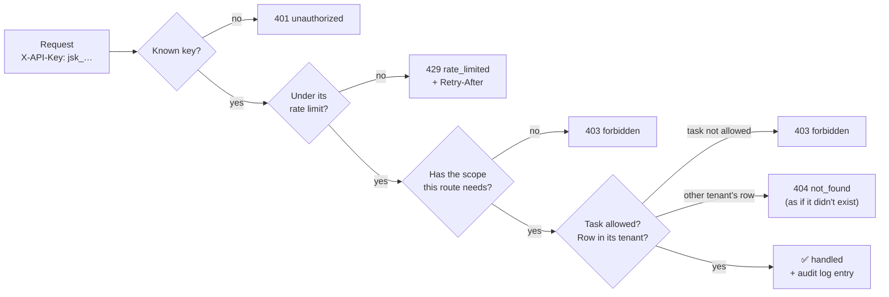
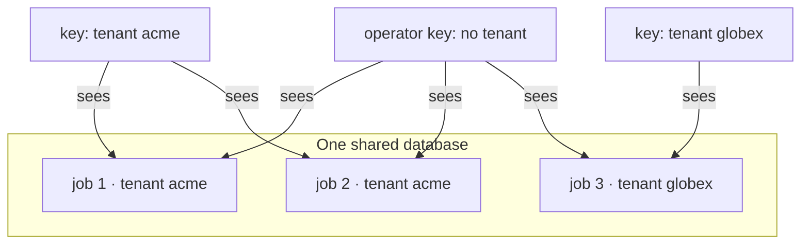

# 15. Security, API keys & tenants

> **Who this is for:** whoever runs the service and hands out access; developers
> who want to know what their key may do.
> **New in 5.0.**

---

## 15.1 The idea in one picture

Every request carries an API key in the `X-API-Key` header. The key decides
**who** you are, **what** you may do (scopes), **whose data** you see (tenant),
**which tasks** you may run, and **how fast** you may call.



---

## 15.2 Two kinds of key

| | **Bootstrap keys** | **Managed keys** |
|---|---|---|
| Where they come from | The `API_KEYS` environment variable (comma-separated) | `POST /v1/admin/api-keys` |
| Power | Everything: every scope, every tenant | Only what you give them |
| Stored as | Plain text in your secret store | A SHA-256 hash; the key itself is shown **once** |
| Looks like | Whatever you choose | `jsk_` + 43 random characters |
| Typical use | Operators, and creating managed keys | One per application, team or customer |
| Rotate by | Adding the new key, moving clients, removing the old one | Creating a new key, then revoking the old one |

> ⚠️ If `API_KEYS` is empty, **authentication is switched off** and every request
> acts as an admin. That's only for local development; the service logs a
> warning at startup. Managed keys need `API_KEYS` to be set.

---

## 15.3 Scopes: what a key may do

| Scope | Allows |
|---|---|
| `jobs:read` | List and read jobs and workflows, live status, event streams, webhook deliveries, the failures view |
| `jobs:write` | Submit, retry and cancel jobs; start and cancel workflows; bulk retry |
| `schedules:read` | List and read schedules |
| `schedules:write` | Create, change, pause and delete schedules |
| `admin` | Everything above, plus managing keys and reading the audit log |

`/health`, `/health/ready`, `/metrics` and the console page `/ui` need no key.
The console asks for one, and every call it makes is checked like any other.

---

## 15.4 Creating, listing and revoking keys

```bash
curl -X POST $API/v1/admin/api-keys -H "X-API-Key: $BOOTSTRAP_KEY" -H "Content-Type: application/json" -d '{
  "name": "billing-service",
  "scopes": ["jobs:read", "jobs:write"],
  "tenant": "acme",
  "allowed_tasks": ["app.tasks.send_notification"],
  "rate_limit_per_minute": 600
}'
```

```json
201 Created
{
  "id": 3, "name": "billing-service", "key_prefix": "jsk_Qm3t1x",
  "scopes": ["jobs:read", "jobs:write"], "tenant": "acme",
  "allowed_tasks": ["app.tasks.send_notification"], "rate_limit_per_minute": 600,
  "created_at": "2026-11-06T10:00:00Z", "last_used_at": null, "revoked_at": null,
  "key": "jsk_Qm3t1xV…"            ← shown ONLY here. Put it in your secret manager now.
}
```

| Want to… | Call |
|---|---|
| See every key (never the secret) | `GET /v1/admin/api-keys`: `key_prefix` and `last_used_at` help you find who uses what |
| Revoke a key | `DELETE /v1/admin/api-keys/{id}`. It stops working at once on that API replica, and within `API_KEY_CACHE_SECONDS` (10 s) on the others |
| Rotate a key | Create a new key with the same settings, deploy it to the client, then revoke the old one |

All fields except `name` and `scopes` are optional:

| Field | Meaning | Left out |
|---|---|---|
| `tenant` | The key only sees and creates that tenant's jobs, schedules and workflows | Sees every tenant (like an admin) |
| `allowed_tasks` | The only tasks it may submit, retry or schedule | Every public task |
| `rate_limit_per_minute` | Max requests per minute | `DEFAULT_RATE_LIMIT_PER_MINUTE` (0 = unlimited) |

---

## 15.5 Tenants: many teams or customers, one deployment

A **tenant** is just a name (`"acme"`, `"team-payments"`). A key bound to a
tenant:

- **stamps** every job, schedule and workflow it creates with that tenant;
- **sees only** that tenant's rows. Everything else answers `404`, exactly
  as if it didn't exist, so a key can't even learn other tenants' IDs;
- has **its own idempotency keys**: two tenants can both send
  `Idempotency-Key: order-7` and get two separate jobs;
- counts towards the tenant's **schedule quota** (`TENANT_MAX_ACTIVE_SCHEDULES`,
  0 = unlimited). Creating one more answers `409`.

Keys without a tenant (bootstrap keys, or managed keys created without one)
see every tenant. That's what operators and the console use.



> **Isolation level.** Tenants share the workers and queues: this is
> *data* isolation and fair-use limits, not separate compute. A tenant that
> floods the queue slows others down, so give each tenant's keys a
> `rate_limit_per_minute`. For hard isolation, run separate deployments.

---

## 15.6 Rate limits

- Counted **per key, per minute**, in Redis, so the limit holds across every
  API replica: two replicas don't give a key twice its limit. (Tested: 20
  requests spread over 2 replicas with a limit of 10 → exactly 10 × `200`, 10 × `429`.)
- Every answer to a limited key carries `X-RateLimit-Limit`,
  `X-RateLimit-Remaining` and `X-RateLimit-Reset` (seconds).
- Over the limit: `429` with `error.type = "rate_limited"` and a
  `Retry-After` header. Both SDKs wait that long and retry automatically.
- If Redis is briefly unreachable the limiter **lets requests through**
  (and logs a warning). Losing the limiter must not take the whole API down.

---

## 15.7 The audit log

Every change is recorded: who (key name), what, on which resource, from
which IP, and when.

| Action | When |
|---|---|
| `job.submit`, `job.retry`, `job.cancel`, `jobs.bulk_retry` | Jobs |
| `schedule.create`, `schedule.update`, `schedule.delete` | Schedules |
| `workflow.create`, `workflow.cancel` | Workflows |
| `apikey.create`, `apikey.revoke` | Keys |

```bash
curl "$API/v1/admin/audit-log?actor=billing-service&limit=20" -H "X-API-Key: $BOOTSTRAP_KEY"
curl "$API/v1/admin/audit-log?action=job.cancel"              -H "X-API-Key: $BOOTSTRAP_KEY"
```

Entries are kept for `AUDIT_RETENTION_DAYS` (365) and pruned by the nightly
cleanup. Reads aren't logged (they would dwarf everything else). Use your
ingress or load-balancer logs for that.

---

## 15.8 The operator console

Open **`/ui`** on any API replica (e.g. `http://localhost:8000/ui`), paste a
key, and you get:

| Tab | Shows | Actions |
|---|---|---|
| Overview | Job counts by status, active schedules, the most common failures | — |
| Jobs | Latest jobs, filter by status or task | Cancel, retry |
| Failures | Failed jobs grouped by task and error | **Retry a whole group** in one click |
| Schedules | Every schedule, its timing (with time zone) and next run | Pause, resume, delete |
| Workflows | Every workflow; click one to see each step | Cancel a running workflow |

It's a single static page (no build step, no extra service). It calls the
same API with your key, so a key's scopes and tenant apply in the console
too. The key is kept only in that browser tab (`sessionStorage`), and the page
is served with a strict Content-Security-Policy and can't be embedded in
other sites. In production, expose `/ui` only on your internal network or
behind your SSO proxy.

---

## 15.9 Webhook security

Covered in [16.2](16-webhooks-and-workflows.md#162-webhooks): every webhook is
signed with `WEBHOOK_SIGNING_SECRET`, carries a timestamp against replays,
and can only go to hosts in `WEBHOOK_ALLOWED_HOSTS`.

## 15.10 Checklist

- [ ] `API_KEYS` set to long random values (e.g. `openssl rand -hex 32`), stored in a secret manager.
- [ ] Applications use **managed keys** with the fewest scopes they need.
- [ ] Each customer or team key has a `tenant` and a `rate_limit_per_minute`.
- [ ] `WEBHOOK_SIGNING_SECRET` and `WEBHOOK_ALLOWED_HOSTS` set.
- [ ] `/ui`, `/metrics` and Flower reachable only from your internal network.
- [ ] Unused keys revoked (check `last_used_at`).
- [ ] Container images verified with `cosign verify` ([9.4](09-deployment.md)).

**Next:** [16. Webhooks & workflows →](16-webhooks-and-workflows.md)
