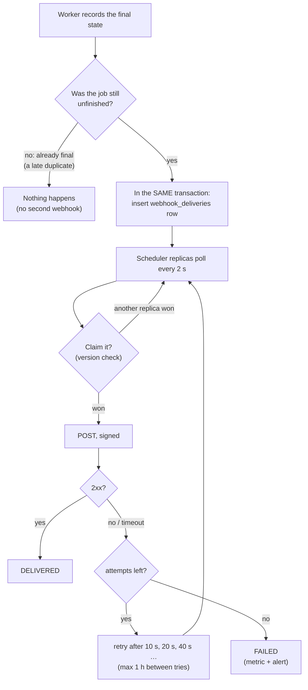
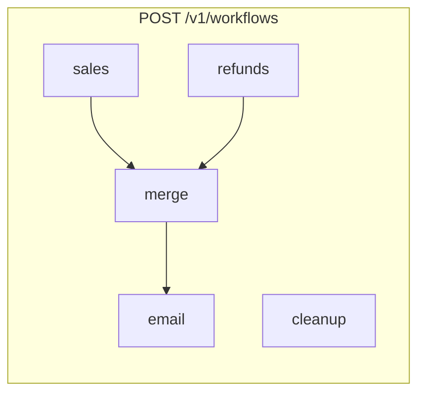
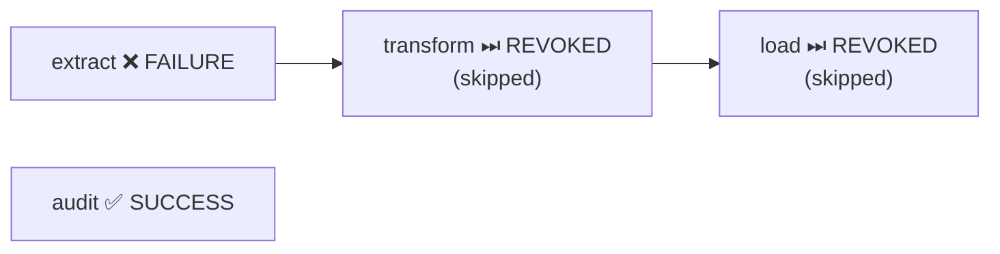
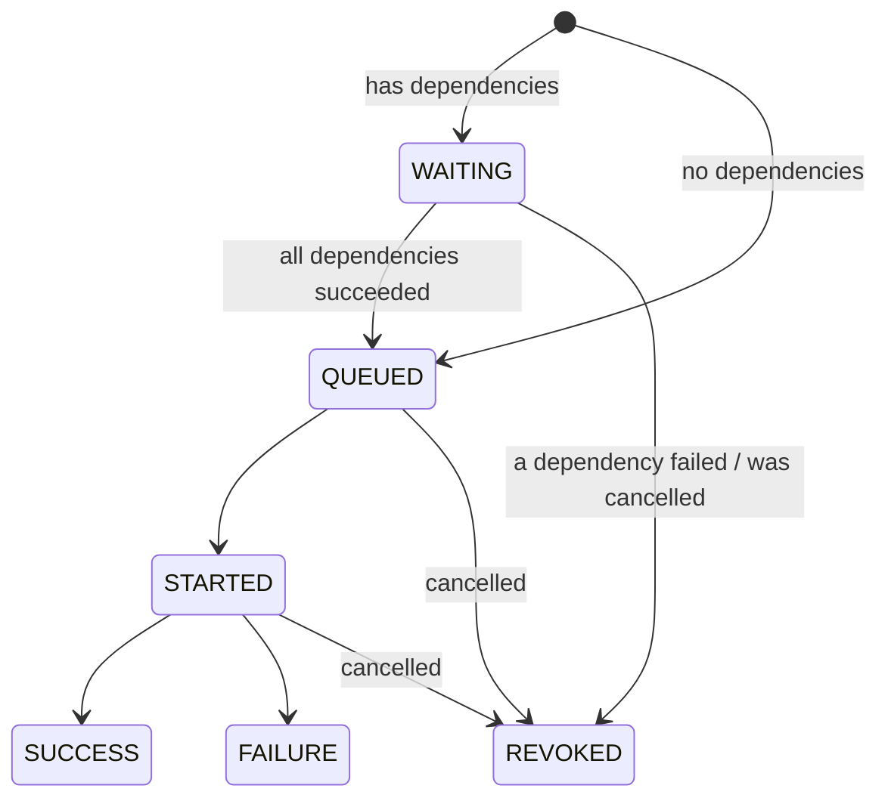
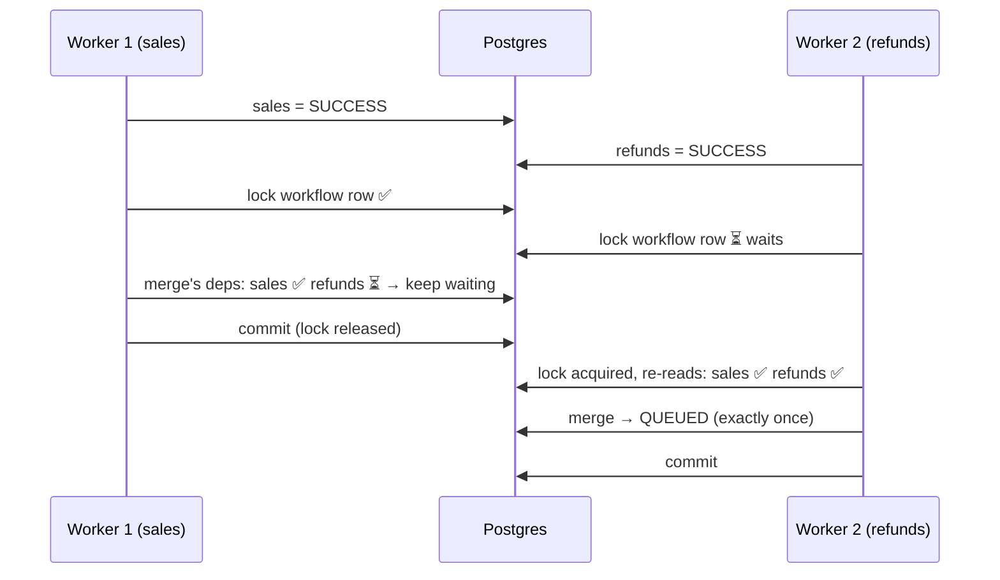

# 16. Webhooks, workflows & per-job options

> **Who this is for:** developers building on the service, and anyone who wants
> to know how these features stay correct with many replicas.
> **New in 5.0.** For copy-paste client code see the
> [integration guide](14-integration-guide.md#1415-webhooks-get-told-when-a-job-finishes).

---

## 16.1 Per-job options

`POST /v1/jobs` accepts any public task plus options. Workflow steps accept the same options.

| Option | Example | What it does | How it works |
|---|---|---|---|
| `priority` | `"high"` | `high` jobs are taken from the queue before `normal`, then `low` | Redis keeps one list per priority; workers always read the highest-priority list first. *Tested: 5 low then 5 high jobs on one worker ran H H H H H L L L L L.* |
| `delay_seconds` / `run_at` | `600` / `"2026-12-01T09:00:00Z"` | Don't start before that time | Saved but **not** queued; the scheduler queues it when due (within ~5 s). Survives restarts, unlike broker-side delays |
| `timeout_seconds` | `60` | Stop the job after 60 s | The worker raises `SoftTimeLimitExceeded` in the task; it's killed 10 s later if it ignores that. *Tested with a real worker.* |
| `max_retries` | `5` | Override the task's automatic retry limit | Read by every worker when it claims the job |
| `callback_url` | `"https://…"` | Webhook when the job finishes | [16.2](#162-webhooks) |

Retrying a job (`POST /v1/jobs/{id}/retry`) keeps all of these options.

---

## 16.2 Webhooks

### What you get
One signed `POST` to `callback_url` when the job reaches `SUCCESS`, `FAILURE`
or `REVOKED`. Workflows can have their own `callback_url`, called once when
every step has finished (`event: "workflow.finished"`).

### Why it can't be lost or doubled



- **Transactional outbox.** The delivery row is written in the same
  transaction as the job's final state. A crash can't leave a finished job
  without its webhook, or queue a webhook for a job that didn't finish.
- **Final state written once.** A job that has already finished can't be
  "finished" again (for example by a late duplicate message, or a cancel
  arriving just after success), so it can't queue a second webhook.
- **One sender at a time.** Any scheduler replica can send it. Each claims
  the delivery with an optimistic version check first, like schedules.
- **At least once.** If the receiver's `2xx` is lost on the way back, the
  delivery is retried. The `X-JobScheduler-Delivery` header stays the same,
  so receivers de-duplicate on it.

### Signature

```
X-JobScheduler-Timestamp: 1793987452
X-JobScheduler-Signature: sha256=<hex of HMAC-SHA256(WEBHOOK_SIGNING_SECRET, "1793987452." + raw body)>
```

Receivers recompute it over the **raw bytes** and reject anything older than
5 minutes. `verify_webhook` (Python SDK) and `verifyWebhook` (TypeScript SDK)
do both.

### Settings

| Setting | Default | |
|---|---|---|
| `WEBHOOK_SIGNING_SECRET` | empty | **Set it.** Empty sends no signature header |
| `WEBHOOK_ALLOWED_HOSTS` | empty (any) | e.g. `*.example.com,hooks.partner.io`. Checked when the job is submitted *and* again before each send. Blocks callbacks to internal addresses |
| `WEBHOOK_TIMEOUT_SECONDS` | `10` | Per attempt |
| `WEBHOOK_MAX_ATTEMPTS` | `8` | About a day of backoff, then `FAILED` |
| `WEBHOOK_POLL_INTERVAL_SECONDS` | `2` | How often schedulers look for due deliveries |

Inspect deliveries: `GET /v1/jobs/{task_id}/webhooks`.

---

## 16.3 Workflows

A **workflow** is a set of steps. Each step is a task plus the steps it
`depends_on`.



- Steps with no dependencies (`sales`, `refunds`, `cleanup`) **start at once,
  in parallel** (fan-out).
- A step with several dependencies (`merge`) starts when **all** of them have
  **succeeded** (fan-in).
- Until then it is `WAITING`: saved, but not on any queue.

### When something fails



If a step fails (after its retries) or is cancelled, **every step downstream
of it is skipped** (`REVOKED`, with `error: "Skipped: upstream step(s) [...]
did not succeed"`). Independent branches carry on. The workflow ends:

| Workflow status | When |
|---|---|
| `SUCCESS` | Every step succeeded |
| `FAILURE` | At least one step failed |
| `REVOKED` | Nothing failed, but something was cancelled |
| `RUNNING` | Steps still waiting or running |

### Life of a workflow step



### Why it's correct with many replicas

The hard case is fan-in: `sales` and `refunds` finish **at the same moment**
on two different workers. Each worker's transaction sees its own step as
done but the other one as still running, so naively *neither* would release
`merge`, or *both* would.



Advancing a workflow happens **inside the transaction that records the
step's final state**, after locking the workflow's row. Steps of one workflow
are therefore processed one at a time. The second sees the first's committed
result, so `merge` is released exactly once. A released step is given
`run_after = now`, and the scheduler's outbox relay queues it within a few
seconds. The execution guard (chapter 7) still makes sure each step runs
once, even if its message is delivered twice.

### Limits and tips
- Up to 200 steps per workflow. Step ids: letters, digits, `_ . -`.
- The API rejects duplicate ids, unknown dependencies, and cycles
  (`a → b → a`) with `422`, naming the problem.
- Steps don't pass results to each other automatically. Write results to
  your own storage (keyed by the workflow id), or read them from
  `GET /v1/workflows/{id}`, which lists every step's `result`.
- Cancel the whole thing: `DELETE /v1/workflows/{id}`. Cancel one step:
  `DELETE /v1/jobs/{task_id}`; its downstream steps are skipped.
- Idempotent: send an `Idempotency-Key` with `POST /v1/workflows`.

---

## 16.4 The failures view (dead-letter queue)

Failed jobs are kept (not thrown away) and grouped:

```bash
curl $API/v1/jobs/failures -H "X-API-Key: $KEY"
```
```json
{"groups": [
  {"task_name": "app.tasks.send_notification", "error": "Upstream notification service unreachable",
   "count": 37, "first_failed_at": "…", "last_failed_at": "…", "example_task_id": "…"}
]}
```

Once the cause is fixed, re-submit a whole group:

```bash
curl -X POST $API/v1/jobs/failures/retry -H "X-API-Key: $KEY" -H "Content-Type: application/json" \
  -d '{"task_name": "app.tasks.send_notification", "error": "Upstream notification service unreachable"}'
# {"retried": 37, "jobs": [{"retry_of": "<old id>", "task_id": "<new id>"}, …]}
```

Each failed job is re-submitted **at most once**, even if two people click
"retry all" at the same moment. Each retry uses an internal idempotency key
derived from the failed job's id. A job that has been retried leaves the
view. The console's **Failures** tab does the same with one click.

---

## 16.5 Cron schedules in your time zone

```json
POST /v1/schedules
{"task_name": "app.tasks.heartbeat", "schedule_type": "cron", "cron_expr": "0 9 * * 1-5", "timezone": "America/New_York"}
```

`0 9 * * 1-5` now means **09:00 New York time, all year**: 14:00 UTC in
winter and 13:00 UTC in summer. Daylight-saving changes are handled:

| Situation | What happens |
|---|---|
| Clocks go **forward** (02:30 doesn't exist that night) | A 02:30 schedule fires at the next valid time (03:00) that day: once |
| Clocks go **back** (01:30 happens twice) | A 01:30 schedule fires **once**, not twice |

Any IANA name works (`Europe/London`, `Asia/Kolkata`, `Australia/Sydney`).
Unknown names are rejected with `422`. Change or remove it with
`PATCH /v1/schedules/{id}` `{"timezone": "UTC"}`. `timezone` applies only to
`cron` schedules.

**Next:** [17. Observability & performance →](17-observability.md)
