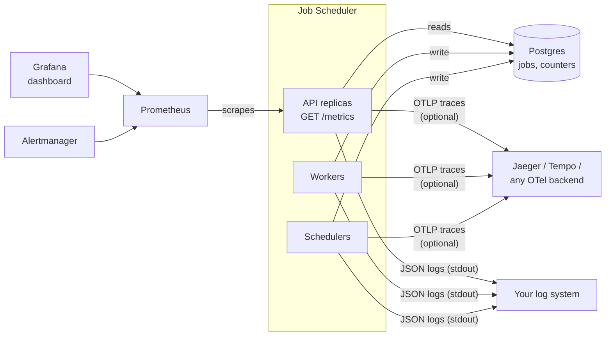
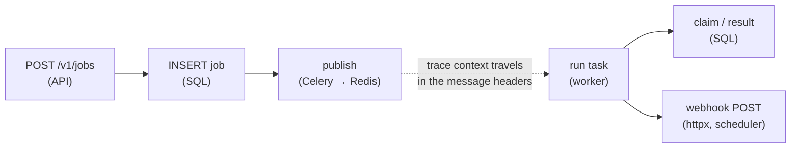

# 17. Observability, performance & disaster recovery

> **Who this is for:** operations / SRE, and anyone sizing a deployment.
> **New in 5.0.** Logs and runbooks are in [chapter 10](10-operations.md).

---

## 17.1 The three signals



| Signal | Where | Use it for |
|---|---|---|
| **Metrics** | `GET /metrics` on the API (Prometheus format) | Dashboards, alerts, capacity |
| **Traces** | OpenTelemetry, off by default | "Why was *this* job slow?": follow one request into the worker |
| **Logs** | stdout, JSON in containers, with `[TAG]`s | The details: see [10.2](10-operations.md) |

### Try it locally in one command

```bash
docker compose -f docker-compose.yml -f docker-compose.monitoring.yml up -d --build
```

| | URL | |
|---|---|---|
| Grafana | http://localhost:3000 | admin / admin → dashboard **Job Scheduler** |
| Prometheus | http://localhost:9090 | *Alerts* tab shows the rules below |
| Jaeger | http://localhost:16686 | services `job-scheduler-api`, `-worker`, `-scheduler` |
| Console | http://localhost:8000/ui | paste an API key |

---

## 17.2 Metrics

**Why the API serves them, and why they're "cluster-wide".** Workers and
schedulers come and go, and a job's life spans several machines. So the
numbers that matter (jobs per status, how long they wait, schedule lateness)
are read **from the shared database** when Prometheus scrapes, cached 10 s.
Every API replica reports the same values. **Use `max()` across instances,
not `sum()`**: the dashboard and alerts already do. The HTTP metrics are the
exception: they're per API process, so you sum them as usual.

| Metric | Type | Labels | Meaning |
|---|---|---|---|
| `jobscheduler_jobs` | gauge | status, queue, task | Jobs in the history right now |
| `jobscheduler_jobs_finished_recent` | gauge | task, status | Finished in the last 5 min (`METRICS_WINDOW_SECONDS`) |
| `jobscheduler_job_duration_seconds` | gauge | task, quantile (0.5/0.95/0.99) | Run time of recently finished jobs |
| `jobscheduler_job_wait_seconds` | gauge | queue, quantile | Ready → started: the queueing delay users feel |
| `jobscheduler_oldest_queued_job_age_seconds` | gauge | queue | Oldest job no worker has picked up: "is the queue stuck?" |
| `jobscheduler_queue_messages` | gauge | queue | Messages waiting in Redis (all priorities) |
| `jobscheduler_outbox_pending` / `_oldest_age_seconds` | gauge | — | Saved but not yet published: "is Redis reachable?" |
| `jobscheduler_jobs_delayed` | gauge | — | Waiting for their delayed start |
| `jobscheduler_schedules` | gauge | enabled | Schedules |
| `jobscheduler_schedule_max_overdue_seconds` | gauge | — | How late the most overdue schedule is: "is any scheduler running?" |
| `jobscheduler_webhooks` | gauge | status | Webhook deliveries by status |
| `jobscheduler_workflows` | gauge | status | Workflows by status |
| `jobscheduler_events_total` | counter | event | Reliability events, below |
| `jobscheduler_http_requests_total` | counter | method, route, status | API requests (per process) |
| `jobscheduler_http_request_duration_seconds` | histogram | method, route | API latency (per process) |
| `jobscheduler_metrics_up` | gauge | — | 1 if the database could be read |
| `jobscheduler_build_info` | info | version | Version reporting |

**`jobscheduler_events_total{event=…}`**: the guarantees from chapter 7, made visible:

| event | Means |
|---|---|
| `duplicate_dropped` | A duplicate message for a finished job was thrown away by the execution guard |
| `duplicate_deferred` | A duplicate for a running job was put back to check later |
| `worker_lost_recovered` | A job whose worker died was handed to another worker |
| `lease_lost` | A frozen worker lost its job to another worker |
| `outbox_relayed` | A saved-but-unsent job was sent by the outbox relay |
| `schedule_fired` | A schedule fired (one job each) |
| `webhook_delivered` / `webhook_failed` | Webhook outcomes |
| `rate_limited` | Requests answered `429` |

The `jobscheduler_` metrics are read from the database. `/metrics` isn't behind
an API key (Prometheus can't send one easily), so keep it on the internal
network; the NetworkPolicy and Helm chart already do. Set `METRICS_ENABLED=false`
to turn it off.

### The dashboard

`deploy/monitoring/grafana/dashboards/job-scheduler.json` (17 panels):
queued / running / retrying / waiting counts, schedule lateness, outbox
backlog, finished-by-status, failures by task, Redis queue depth, wait and
run-time p95, oldest queued job, reliability events, webhooks, workflows,
API rate and latency. Import it into any Grafana, or let
`docker-compose.monitoring.yml` provision it.

---

## 17.3 Alerts

`deploy/monitoring/alerts.yml`, validated with `promtool`. With the Helm chart:
`-f deploy/helm/job-scheduler/examples/monitoring-values.yaml`.

| Alert | Fires when | Severity | First look at |
|---|---|---|---|
| `JobSchedulerMetricsDown` | No replica can read metrics for 5 min | critical | DB / API down: runbook A |
| `JobSchedulerSchedulesOverdue` | A schedule is > 2 min late | critical | No scheduler running: runbook E |
| `JobSchedulerQueueStuck` | Oldest queued job > 10 min | warning | Workers for that queue: runbook C |
| `JobSchedulerQueueWaitHigh` | p95 wait > 60 s for 10 min | warning | Add workers: runbook G |
| `JobSchedulerFailureRateHigh` | > 20 % of a task's jobs fail (≥ 5) | warning | Failures view: runbook F |
| `JobSchedulerOutboxBacklog` | Unpublished job > 5 min old | warning | Redis: runbook B |
| `JobSchedulerWorkersLost` | > 5 recoveries in 15 min | warning | OOM kills / nodes: runbook D |
| `JobSchedulerWebhooksFailing` | A webhook gave up | warning | `GET /v1/jobs/{id}/webhooks` |
| `JobSchedulerApiErrors` | > 5 % of requests are 5xx | warning | `/health/ready`, API logs |

---

## 17.4 Tracing (OpenTelemetry)

Set one variable on every service:

```bash
OTEL_EXPORTER_OTLP_ENDPOINT=http://otel-collector:4318     # any OTLP/HTTP endpoint
```

Then one trace follows a job all the way through:



- Instrumented: FastAPI requests (except `/health*` and `/metrics`), every SQL
  statement, Celery publish and run, outgoing HTTP (webhooks).
- Service names: `job-scheduler-api`, `job-scheduler-worker`,
  `job-scheduler-scheduler`.
- Standard OTel variables work: sample 10 % with
  `OTEL_TRACES_SAMPLER=parentbased_traceidratio OTEL_TRACES_SAMPLER_ARG=0.1`;
  tag the environment with `OTEL_RESOURCE_ATTRIBUTES=deployment.environment=prod`.
- *Tested:* traces from all three services arrived in Jaeger, including
  traces that span API → worker.

---

## 17.5 Performance

`scripts/load_test.py` submits N jobs through every API replica, waits for
all of them, and checks each ran exactly once:

```bash
python scripts/load_test.py --api http://localhost:8000 --api http://localhost:8001 \
    --key "$API_KEY" --jobs 5000 --concurrency 100
```

**Measured** (one 10-core laptop running *everything* in Docker: Postgres,
Redis, 2 API, 3 worker, 2 long-worker and 3 scheduler containers;
`docker-compose.yml` defaults):

| | Result |
|---|---|
| Submitted | 5,000 / 5,000, 0 errors |
| Submit throughput | ~150 jobs/s |
| Submit latency | p50 ≈ 0.45 s, p95 ≈ 1.8 s, p99 ≈ 2.8 s (100 requests in flight) |
| Completed (end to end) | ~90 jobs/s; all 5,000 done in 55 s |
| Ran exactly once | 5,000 / 5,000; 0 duplicates |

These are **floor** numbers: one machine shared by every component, Docker
networking, `FIFO_ENABLED=true` (one job prefetched at a time). On real
servers, and with `FIFO_ENABLED=false` for throughput, expect much more.
Measure your own hardware before committing to a number.

**What limits throughput, in order:**
1. **Postgres writes.** Every job is ~4 small transactions (insert, publish
   mark, claim, result). Use a fast managed Postgres, keep `DB_POOL_SIZE`
   × replicas under its connection limit, or add PgBouncer.
2. **Workers.** Add replicas (`--scale worker=N`, or the HPA). Each replica
   runs `WORKER_CONCURRENCY` processes.
3. **API.** Stateless: add replicas.

---

## 17.6 Disaster recovery

### What to back up
Only **Postgres**. It holds every job, schedule, workflow, webhook, key and
audit entry. Redis holds only in-flight messages, and anything lost there is
re-sent from the database by the outbox relay and lease recovery.

### Backup and restore drill

A backup you have never restored is a hope, not a backup. Run the drill
monthly:

```bash
scripts/backup_restore_drill.sh <compose-project>               # compose stack
PGURL=postgresql://… scripts/backup_restore_drill.sh --url       # any Postgres
```

It dumps the live database (no downtime), restores it into a throwaway
Postgres, compares every table's row count, runs the app's migrations against
the copy, reads the job history through the app's own code, and reports how
long each step took (your recovery-time estimate). The dump is kept in `./backups/`.

*Tested:*

```text
1. dump:     backups/jobs-20261106T180006Z.dump (1.9M) in 0s
2. restore:  into drill-pg-… in 2s
3. compare:  table                        live   restored
            api_keys                        0          0
            audit_log                   15331      15331
            celery_taskmeta             15391      15391
            event_counters                  5          5
            jobs                        15391      15391
            schedules                       7          7
            webhook_deliveries              0          0
            workflows                       1          1
4. app:      migrations OK; app reads 15391 jobs
5. result:   restore drill took 4s end to end
PASSED
```

### Recovery objectives

| | Target | How |
|---|---|---|
| **RPO** (data you can lose) | Seconds | Managed Postgres with point-in-time recovery (WAL archiving) and a synchronous standby |
| **RTO** (time to recover) | Minutes | Fail over to the standby (automatic on managed services); the app reconnects by itself (`pool_pre_ping`) |
| Region loss | Your restore time | Cross-region replica or backups; restore, point `DATABASE_URL` at it, roll the pods |

**After any restore:** jobs that were `STARTED` at backup time are rescued
automatically. Their leases have expired, so the scheduler re-queues them
(chapter 7.8). Jobs saved but not yet sent are sent by the outbox. Nothing
needs to be fixed by hand.

**Next:** [18. API versioning →](18-api-versioning.md)
