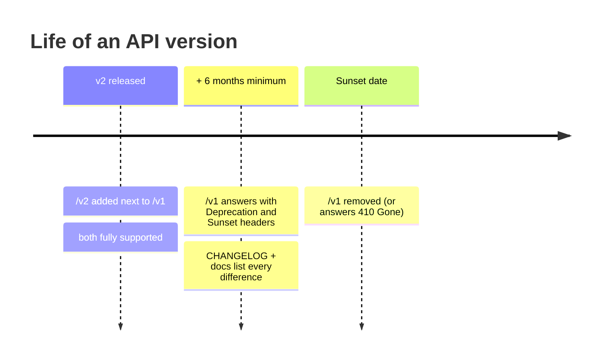

# 18. API versioning & deprecation policy

> **Who this is for:** anyone who integrates with the API and wants to know
> what may change, and how much warning they'll get.

---

## 18.1 Where versions live

Every endpoint is under a **major version prefix**: `/v1/...`.

| Path | Status |
|---|---|
| `/v1/tasks/*`, `/v1/jobs…`, `/v1/schedules…`, `/v1/workflows…`, `/v1/admin…` | **Current.** Use these |
| `/tasks/*`, `/jobs…`, `/schedules…` (no prefix) | **Deprecated aliases** of v1, kept for clients written before 5.0 |
| `/health`, `/health/ready`, `/metrics`, `/ui`, `/docs`, `/openapi.json` | Not versioned (infrastructure) |

The deprecated aliases behave exactly like `/v1` and answer with:

```http
Deprecation: true
Link: </v1/jobs/9db9…>; rel="successor-version"
```

They are hidden from `/docs` and `/openapi.json`. Newer endpoints
(workflows, admin) exist only under `/v1`.

**Migrating** an old client is a find-and-replace: put `/v1` in front of the
path. Nothing else changes: same bodies, same answers, same errors.

---

## 18.2 What may change within v1

**Additive changes only.** We may, without a new version:

- add endpoints;
- add **optional** request fields (with defaults that keep today's behaviour);
- add fields to responses;
- add values to *open* lists: new `error.type`s, new job `state`s or
  `status`es (5.0 added `WAITING`), new `event`s in metrics and webhooks;
- add headers.

**So write tolerant clients:** ignore unknown response fields, and treat an
unknown status as "not finished yet" unless it's one of `SUCCESS`, `FAILURE`,
`REVOKED`. Both SDKs do.

**Never within v1** (that needs `/v2`):

- removing or renaming an endpoint, field, header or enum value;
- making an optional field required, or tightening validation of valid
  requests that worked before;
- changing the meaning or type of a field;
- changing the error envelope or the authentication scheme.

---

## 18.3 How a breaking change would ship



1. `/v2` is added **alongside** `/v1`; both work.
2. `/v1` starts sending `Deprecation: true` and a `Sunset: <date>` header at
   least **6 months** before removal. [CHANGELOG.md](../CHANGELOG.md) lists every
   difference, with a migration guide.
3. After the sunset date `/v1` is removed.

The pre-5.0 unprefixed aliases follow the same rule: they will be removed
no sooner than 6 months after a `Sunset` header first appears on them. As of
5.0 they have no sunset date.

---

## 18.4 Versions you can see

| What | Where |
|---|---|
| Server release | `GET /health` → `"version": "5.0.0"`; also `jobscheduler_build_info` in `/metrics` |
| API contract | `GET /openapi.json`, also committed as [`sdk/openapi.json`](../sdk/openapi.json). CI fails if the code and the committed spec drift apart |
| SDKs | `sdk/python` and `sdk/typescript`, versioned with the server (5.0.0) |

Server releases follow [semantic versioning](https://semver.org/): a new
*major* server version may change deployment or configuration (see the
CHANGELOG's upgrade notes), but it **never** breaks the HTTP API without a
new `/vN` prefix as described above.

**Back to:** [the index](README.md)
